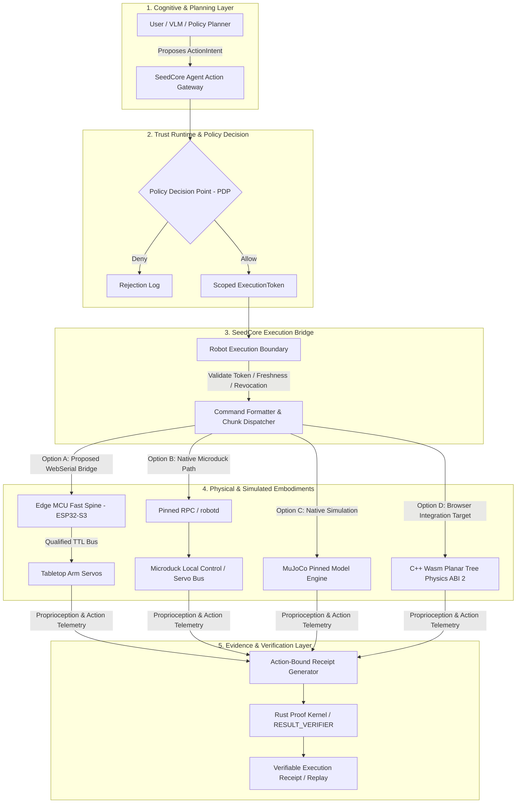

# SeedCore

[](https://github.com/NeilLi/seedcore/actions/workflows/unit-tests.yml)
[](LICENSE)
[](packages/mini-physics/)
[](tools/mini-sim/verify.cjs)

**The Open Trust Runtime for Affordable Physical AI.**

SeedCore develops the boundary between AI proposals and robot execution:
accountable agents, **scoped capability tokens**, local enforcement and
**verifiable action evidence**. Browser-first maker and supervised education
kits are the initial adoption focus. Microduck is the native-runtime reference;
a small tabletop arm is the proposed MCU Fast Spine bench fixture.

The browser simulator, pinned Microduck body model and shared trust/proof
components exist. A read-only Microduck adapter and bounded-session host
simulation now provide observation/artifact replay and signed simulation
evidence. Independent training parity, native Microduck motion, physical
WebSerial, Fast Spine firmware and device-rooted receipts remain open. See the
[simulation-first acceptance guide](docs/development/robotics/simulation_first_acceptance.md)
for local policy paths, reproducible checks and the split-screen rehearsal.

---

## Positioning And Adoption

SeedCore combines open developer tools, qualified hardware profiles and
verifiable execution. Its advantage must be demonstrated through cost,
qualification, trusted releases and repeatable support.

| Pillar | Proposed product value | First validation |
| --- | --- | --- |
| **SeedCore Inside** | Open reference firmware and browser lessons for supported affordable robot kits | One independently reproducible firmware/board/body profile |
| **Auditable classroom governance** | Teacher roles, bounded motion, privacy/egress controls and explainable evidence | Allowed, denied and interrupted attempts with actual boundary enforcement |
| **Opt-in sim-to-real telemetry** | Retained, versioned trajectories with action and signer provenance | Adult bench data improves calibration/evaluation under reviewed sharing rights |

Selected kits below **$300** and a **$12 controller BOM** are design targets,
excluding an existing host and with cost boundaries documented in the
[execution plan](docs/development/strategy/seedcore_physical_ai_execution_plan_2026_2028.md).
They are not Microduck prices or supplier quotations. “Android + TrustZone”
expresses an interface/isolation ambition, not an OS or safety certification.

### Slow Brain, Fast Spine: Proposed Physical Bridge

High-level planning produces bounded intent or action chunks; a native robot
controller or qualified MCU handles local execution. The planned arm profile
evaluates **200–500 Hz interpolation**, independently measuring servo-bus and
telemetry rates. Microduck retains `robotd` control and bus ownership.

PDP admission, continuous local limits/deadlines and asynchronous evidence
closure have separate responsibilities. Local stop must work during browser
or cloud loss. Measure revocation propagation and observed stopping; a fast
lookup is not a physical-stop guarantee. Small robots still need profile-specific
force, pinch, electrical and fall assessment.

The current browser studio contains no hardware/gateway connection or signed
robot receipts. Its physics covers fixed-base planar 1/2/3-link arms rendered
with a 3D camera; native MuJoCo owns the separate pinned Microduck model path.

---

## Technical Stack Architecture

SeedCore is structured in clean, decoupled layers separating governance, mathematical simulation, hardware abstraction, and cryptographic proofs:

This diagram is the target integration architecture. The physical MCU bridge
and Microduck action/evidence path are not yet delivered.



### 1. Trust Runtime & Policy Decision Layer
- **Agent Action Gateway:** [`agent_actions_router.py`](src/seedcore/api/routers/agent_actions_router.py) supplies the existing intent ingress.
- **Policy Decision Point (PDP):** Evaluates intents and issues scoped `ExecutionToken` authority. Robot-specific session bindings require versioned review against the existing token and policy contracts.
- **Revocation Custody:** [`execution_token_revocation.py`](src/seedcore/hal/custody/execution_token_revocation.py) supplies shared revocation checks; physical propagation and stopping remain profile-specific acceptance work.

### 2. Hardware Abstraction Layer (HAL) & Drivers
- **Base Interfaces (`src/seedcore/hal/interfaces.py`):** Unified [`BaseRobotDriver`](src/seedcore/hal/interfaces.py), [`ProprioceptionState`](src/seedcore/hal/interfaces.py), [`RobotCapabilities`](src/seedcore/hal/interfaces.py), and operational [`RobotState`](src/seedcore/hal/interfaces.py).
- **Driver Implementations (`src/seedcore/hal/drivers/`):**
  - [`robot_sim_driver.py`](src/seedcore/hal/drivers/robot_sim_driver.py): Extensible execution framework with in-memory and physics-backed profiles.
  - [`microduck.py`](src/seedcore/hal/drivers/microduck.py): M1 read-only MuJoCo and explicit fake-I/O profiles; pinned 61/14 semantics, home/scaling and no startup actuation. Hardware selection fails without simulation fallback. Independent checkpoint/export parity remains open. Those dimensions are Microduck-specific.

### 3. Native MuJoCo Workbench & Model Packages
- **Model Ingestion (`packages/models/`):** Validated, versioned model packages with SHA-256 integrity manifests. Includes the pinned **Microduck 0.1.0** MJCF model ([`packages/models/microduck/0.1.0/manifest.json`](packages/models/microduck/0.1.0/manifest.json), $0.737\text{ kg}$, $nq=21, nv=20, nu=14$).
- **Integrity & Parity Verifier:** [`tests/test_model_package.py`](tests/test_model_package.py) verifies total mass, joint limits, kinematic trees, and dynamics against upstream CAD sources.

### 4. Zero-Allocation C++ Physics Kernel & WebAssembly Core
- **Analytical C++ Physics (`packages/mini-physics/`):**
  - [`include/mini_physics.h`](packages/mini-physics/include/mini_physics.h) & [`src/mini_physics.cpp`](packages/mini-physics/src/mini_physics.cpp): **ABI 1** planar two-joint dynamics core.
  - [`include/mini_tree_physics.h`](packages/mini-physics/include/mini_tree_physics.h) & [`src/mini_tree_physics.cpp`](packages/mini-physics/src/mini_tree_physics.cpp): **ABI 2** general multi-link serial chain dynamics ($N \in \{1, 2, 3\}$). Features exact analytical mass matrix $M(q) = \sum \left( m_i J_{v, i}^T J_{v, i} + I_i J_{\omega, i}^T J_{\omega, i} \right)$, skew-symmetric Coriolis vector $c(q, v)$, gravity torque $g(q) = \nabla U(q)$, analytical $3\times 3$ Cramer matrix inversion, and RK4 integration. Zero heap allocations (`malloc`/`new`), zero exceptions, and caller-owned 64-double buffer.
- **Dual-ABI WebAssembly Build (`apps/mini-robot-simulator/mini-physics.wasm`):**
  - Compiled via Clang and `wasm-ld` (`tools/mini-sim/build-physics.cjs`).
  - Exports: `mini_abi`, `mini_eval`, `mini_scratch` (ABI 1) and `mini_tree_abi`, `mini_tree_eval`, `mini_tree_scratch` (ABI 2).
  - Current raw module size **13,242 bytes**; standalone host math imports (`sin`, `cos`). This is not MCU firmware size or whole-application memory use.

### 5. Simulator Contracts & Verification
- **Schema Contracts (`packages/mini-sim-contracts/`):**
  - [`schemas/tree-model.schema.json`](packages/mini-sim-contracts/schemas/tree-model.schema.json): Schema `seedcore.mini-sim.tree-model.v1`.
  - [`src/index.ts`](packages/mini-sim-contracts/src/index.ts) & [`src/tree_contracts.ts`](packages/mini-sim-contracts/src/tree_contracts.ts): TypeScript bindings for model compilation, bounded ASCII/UTF-8 canonical SHA-256 digests, 3D forward kinematics, Jacobian, and Wasm buffer serialization.
  - Built via locked `tsc` into zero-dependency [`sim-contracts.js`](apps/mini-robot-simulator/sim-contracts.js) and [`sim-contracts.d.ts`](apps/mini-robot-simulator/sim-contracts.d.ts).

### 6. Zero-Install 3D Browser Studio & Workbench
- **Planar Tree Studio with a 3D View ([`apps/mini-robot-simulator/tree-lab.html`](apps/mini-robot-simulator/tree-lab.html)):**
  - Interactive 3D perspective viewport ([`tree-lab.js`](apps/mini-robot-simulator/tree-lab.js), [`tree-lab-ui.js`](apps/mini-robot-simulator/tree-lab-ui.js)) with drag-to-orbit camera controls, depth clipping, and perspective scaling.
  - Preset models: 1-link pendulum, 2-link serial arm, 3-link articulated manipulator.
  - Real-time analytical inspectors: live mass matrix $M(q)$, end-effector Jacobian $\mathbf{J}(q)$, kinetic/potential/total mechanical energy meters, and JSON experiment export.
- **Planar Beginner Lessons ([`apps/mini-robot-simulator/index.html`](apps/mini-robot-simulator/index.html)):**
  - WebWorker isolated simulation ([`simulation-worker.js`](apps/mini-robot-simulator/simulation-worker.js)) with resumable checkpoints, predictive learning challenges, and 480 Hz real-time stepping.

### 7. Cryptographic Proof Kernel & Verifier
- **Rust Proof Engine (`rust/`):** Rust proof kernel and offline CLI (`seedcore-verify`) with token, signature, receipt and replay verification.
- Device enrollment, signed robot telemetry and Microduck `RESULT_VERIFIER` closure remain M3/M4 integration work; a verifier needs captured evidence from a configured signer.
- **TypeScript Proof Surfaces (`ts/`):** Verification APIs, typed schema contracts, and operator console bindings.

### 8. Multi-Robot Team Orchestration
- **Team Coordination (`src/seedcore/robotics/`):**
  - [`coordinator.py`](src/seedcore/robotics/coordinator.py): Round barriers, uncertainty tracking, and execution halt controls.
  - [`contracts.py`](src/seedcore/robotics/contracts.py): Cognitive proposals, organ reservations, and team mission definitions.

---

## Repository Map

```text
seedcore/
├── apps/
│   ├── mini-robot-simulator/       # Zero-install browser simulator: 2D lessons & 3D Tree Studio
│   │   ├── index.html              # Planar beginner lessons UI
│   │   ├── tree-lab.html           # SIM-3 3D Kinematic Tree Studio UI
│   │   ├── tree-lab.js             # 3D Projector, preset models & controller
│   │   ├── tree-lab-ui.js          # Orbit controls & live diagnostic inspectors
│   │   ├── tree-physics-wasm.js    # High-level JS bridge for ABI 2 Wasm
│   │   ├── mini-physics.wasm       # Dual-ABI (ABI 1 & ABI 2) compiled Wasm core
│   │   └── sim-contracts.js        # Compiled TypeScript contracts runtime
│   └── neighborhood-guide/         # Digital City Godot & Blender prototype
├── packages/
│   ├── mini-physics/               # C++ analytical physics engine (CMake / CTest)
│   │   ├── include/                # mini_physics.h (ABI 1), mini_tree_physics.h (ABI 2)
│   │   └── src/                    # Analytical kinematics, Coriolis, Jacobian, RK4
│   ├── mini-sim-contracts/         # TypeScript schemas & compiler for robot models
│   └── models/                     # Versioned robot packages (Microduck 0.1.0 MJCF)
├── src/seedcore/
│   ├── agents/                     # Agent Action Gateway and intent routing
│   ├── hal/                        # Hardware Abstraction Layer & robot drivers
│   │   ├── drivers/                # Robot simulation & physical adapters
│   │   └── custody/                # Token validation and revocation registry
│   ├── robotics/                   # Multi-robot team coordination & reservations
│   ├── models/                     # Database models & identity entities
│   └── security/                   # Policy Decision Point (PDP) and authz
├── rust/                           # High-assurance proof kernel & CLI (seedcore-verify)
├── ts/                             # TypeScript contracts, verification API & console
├── tests/
│   ├── mini-sim/                   # Tree contracts, Wasm physics & 3D lab tests
│   ├── test_model_package.py       # Microduck MJCF integrity & dynamics tests
│   └── test_mujoco_workbench.py    # MuJoCo development workbench tests
├── tools/mini-sim/                 # Wasm compilation & verification test runners
└── docs/development/robotics/      # Blueprints, execution contracts & specs
```

---

## Active Robotics Milestones & Status

| Stage | Focus Area | Status | Deliverables & Acceptance Gates |
| --- | --- | --- | --- |
| **SIM-1** | Worker Isolation | **Complete** | WebWorker isolation, versioned run/model/command contracts, reproducible checkpoints. |
| **SIM-2** | C++ Wasm Planar Core | **Complete** | Zero-allocation C++ two-link dynamics (ABI 1), Wasm build, JS/native/Wasm parity (< 1e-12 error). |
| **SIM-3** | Planar Tree & 3D Studio | **Delivered slice; broader gates open** | Fixed-base 1/2/3-link planar dynamics and orbit view; **78/78 Node.js tests passed 2026-10-14**. Branching/spatial dynamics, encoders, worker-v3 and MuJoCo comparisons remain open. |
| **M0** | Microduck Model / Deployment Pins | **Model complete; deployment inventory open** | Microduck 0.1.0 MJCF ($0.737\text{ kg}$, 14 actuators), integrity/mass/joint parity. Runtime, policy, normalization and hardware/transport pins still required. |
| **M1** | Microduck Simulation Driver | **Planned — Q4 2026** | Native MuJoCo HAL driver, golden 61/14 semantics and startup without unrequested motion. |
| **M2** | Governed Motion Intent | **Planned — Q4 2026** | Bounded velocity/stop session via existing gateway/PDP/token/native controller. Arm MCU bridge is a separate fixture. |
| **M3** | Evidence & Receipts | **Planned — Q4 2026–Q1 2027** | Action-bound telemetry, enrolled signer, replay and `RESULT_VERIFIER` closure; minimum evidence precedes a physical demo. |
| **M4** | Supervised Hardware | **Planned — Q1 2027** | Native Microduck bring-up and measured local stop/fault behavior; arm WebSerial acceptance is separate. |
| **M5** | Learning & Promotion | **Supporting offline lane** | Baseline/candidate comparison, export parity, reviewed promotion and rollback; training grants no motion authority. |

### 18-Month Planning Targets

| Window | Engineering / supply chain | Adoption / revenue validation |
| --- | --- | --- |
| **Q4 2026** | M1/M2 golden reference, minimum evidence, one ESP32-S3 / TTL arm fixture and quoted board BOM | Split-screen demo after its physical gates; OEM and lesson packets |
| **Q1 2027** | Microduck M3/M4; staged 10 → 25 → up to 100 cumulative developer kits | One supervised pilot, then 3–5 sites after useful repeat delivery/support evidence |
| **Q2–Q3 2027** | Conditional SIM-3 remainder / SIM-4–SIM-6; one LeRobot-family and one model proposal adapter | One OEM shipping profile first, then 2–3 OEM targets and scoped conformance badge |
| **Q4 2027–Q1 2028** | Durable fleet authority/evidence; 3 → 10 → up to 30 robots; SoM only if demand justifies it | Paid Governance / Cloud Workbench with measured support and recurring costs |

Dates and adoption counts are targets. The
[18-month execution plan](docs/development/strategy/seedcore_physical_ai_execution_plan_2026_2028.md)
owns gates, owners, costs and the **14 Oct–12 Nov 2026** tactical schedule.
Keep local tools open; validate paid OEM provisioning/conformance/support and
hosted governance. Telemetry contribution is optional and separately controlled.

---

## Quickstart & Verification

### 1. Launch the Zero-Install Browser Simulator
Serve the simulator locally using any static web server:

```bash
# Using Python
python3 -m http.server 8080 --directory apps/mini-robot-simulator

# Open in browser:
# 3D Multi-Link Studio: http://localhost:8080/tree-lab.html
# 2D Beginner Lessons:  http://localhost:8080/index.html
```

### 2. Run the Comprehensive Simulator Test Suite
Runs the locked TypeScript contract checks, syntax audits, native C++ invariants, and all 78 Node.js tests:

```bash
node tools/mini-sim/verify.cjs
```

### 3. Build & Test the C++ Physics Engine Natively
Build with CMake and execute CTest native invariant assertions:

```bash
cmake -B /tmp/mini-physics -S packages/mini-physics
cmake --build /tmp/mini-physics
ctest --test-dir /tmp/mini-physics --output-on-failure
```

### 4. Run Python Robot Model & Workbench Tests
Verify the pinned Microduck MJCF model and MuJoCo simulation workbench:

```bash
pytest tests/test_model_package.py tests/test_mujoco_workbench.py
```

### 5. Run the Rust Proof Kernel
Execute the offline verification engine and transfer proof fixtures:

```bash
cargo test --workspace --manifest-path rust/Cargo.toml
```

---

## Key Technical Documentation

- **[18-Month Execution Plan](docs/development/strategy/seedcore_physical_ai_execution_plan_2026_2028.md):** Product strategy, Q4 2026–Q1 2028 schedule, phase gates, first 30 days and revenue assumptions.
- **[Physical AI Strategy](docs/development/robotics/physical_ai_strategy.md):** SeedCore Inside, auditable classroom governance and opt-in telemetry pillars.
- **[Fast Spine Protocol Proposal](docs/development/robotics/fast_spine_protocol_spec.md):** M2/M4 WebSerial session, authentication, interruption, telemetry and flashing requirements; not implemented firmware.
- **[OEM Partnership Brief](docs/application/oem_partnership_brief.md):** Draft design-in offer, responsibilities, conformance and staged production; not a partner agreement.
- **[Mini-Robotics Developer Blueprint](docs/development/robotics/mini_robot_developer_blueprint.md):** Proposed reference profile, cost targets and qualified browser-to-hardware delivery sequence.
- **[Embodied AI Architecture Reference](docs/development/robotics/embodied_ai_architecture_reference.md):** Deep-dive contrasting industrial robotics with DIY/mini-robotics, receding-horizon action chunking, and verifiable governance.
- **[Mini-Robot Simulator Implementation Plan](docs/development/robotics/mini_robot_simulator_implementation_plan.md):** Engineering roadmap and qualification gates for SIM-1 through SIM-6.
- **[Microduck Integration Plan](docs/development/robotics/microduck_integration_plan.md):** Milestones M0 through M4 for the reference bipedal embodiment.
- **[Microduck RL & Sim2Real Study](docs/development/robotics/microduck_rl_study.md):** Technical analysis of the 61/14 tensor interface, observation normalization, and policy transfer.
- **[Robot Execution Contract Proposal](docs/development/robotics/robot_execution_contract.md):** Reusable session bounds, local interruption, and evidence closure contracts.

---

## License

SeedCore is licensed under the Apache-2.0 License. See [LICENSE](LICENSE).
