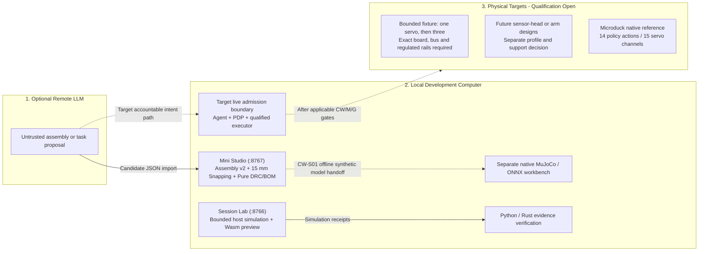
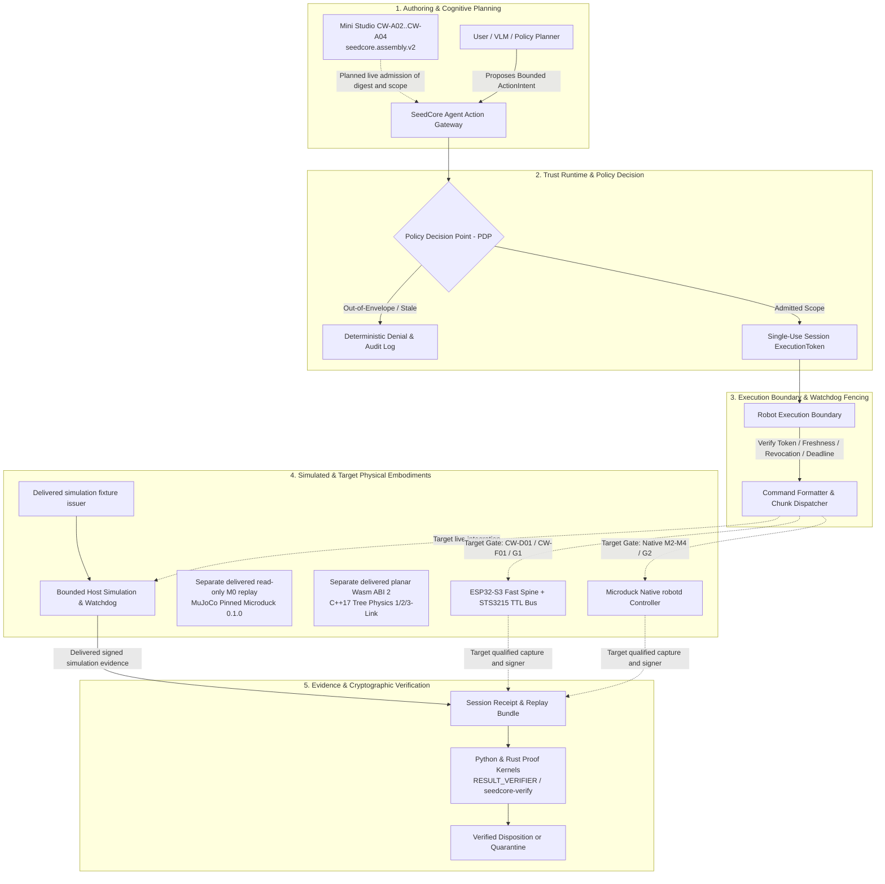

# SeedCore

[](https://github.com/NeilLi/seedcore/actions/workflows/unit-tests.yml)
[](LICENSE)
[-success.svg)](packages/mini-physics/)
[](tools/mini-sim/verify.cjs)
[](tools/robotics/verify-assembly.cjs)
[](tools/robotics/verify-authoring.cjs)
[](rust/)

**The Open Trust Runtime for Affordable Physical AI.**  
*Browser-first robot simulation · Canonical assembly authoring · Bounded execution authority · Verifiable action evidence.*

[Why SeedCore](#why-seedcore) · [Target Builder Setup](#target-builder-setup-local-ai-station--remote-llm--diy-robot-series) · [Delivered Now vs. Open Gates](#delivered-now-vs-open-gates) · [System Architecture](#system-architecture) · [Central World & Studios](#central-world--browser-studios) · [Quickstart & Verification](#quickstart--reproducible-verification) · [Repository Map](#repository-map) · [Roadmap](#roadmap--qualification-gates) · [Documentation](#key-technical-documentation)

---

## Why SeedCore

Small robots make supervised experiments more accessible. Each physical build
still needs reviewed mechanical, electrical and stopping limits. As models and
agents begin proposing motion, SeedCore makes the authority to act and the
evidence of the attempt explicit.

SeedCore builds the verifiable boundary between AI proposals and robot actuation:

1. **Canonical Authoring (`Central World`):** Assemble byte-pinned robot components under `seedcore.assembly.v2` (`seedcore.jcs-safe-integers.v1` RFC 8785 canonical JSON) inside an immutable revision store with deterministic `15 mm` port snapping, accessible numeric placement, and automatic invalidation of prior runtime admission on every edit.
2. **Bounded Authority (`Slow Brain, Fast Spine`):** High-level planners propose bounded action chunks (`ActionIntent`); the Policy Decision Point (PDP) issues **single-use session capability tokens** enforced with local deadlines, revocation fencing, and independent watchdog bounds.
3. **Verifiable Evidence (`Python & Rust Proof Kernels`):** The bounded host rehearsal emits signed simulation receipts checked by Python and Rust (`seedcore-verify`). Action-bound physical capture and signer enrollment remain qualification work.

> **Evidence Discipline:** SeedCore strictly separates **delivered software and simulation candidates** from **open physical hardware gates** (`physical_acceptance: false`). Simulation tokens, proxy assemblies, and draft catalog records never grant physical motor authority.

---

## Target Builder Setup: Local AI Station + Remote LLM + DIY Robot Series

The target workflow combines **one local development computer**, an **optional
remote LLM account**, and successive DIY robot designs. Start with the existing
computer and the dependencies for the chosen tool. Offline authoring and prepared
simulation lessons require no cloud account; this topology is not a hardware
purchase recommendation or a validated multi-robot deployment.



| Tier | Builder setup | Available scope / intended role | Boundary |
| :--- | :--- | :--- | :--- |
| **1. Optional remote LLM** | A separately configured provider account | Draft candidate assembly JSON or high-level task requests; the studio supports raw JSON import | Treat output as untrusted. Provider credentials, signing keys, capture/egress permissions and motor authority have distinct ownership. |
| **2. Local AI station** | Existing development computer with the relevant Python, Node, Rust and simulator dependencies | Run local authoring/DRC, prepared simulations, native model evaluation and offline receipt verification | Session Lab uses a simulation issuer, not the production PDP. Its configured watchdog poll is **5 ms**, not a physical stop-time guarantee. Live admission and physical enforcement remain gated. |
| **3. Successive DIY designs** | Draft component records for boards, servos, sensors, power and brackets | Each accepted assembly revision has a canonical digest and can receive a DRC/BOM report | Proxy data remains unqualified. Automatic custom-build simulation is CW-S01 onward; physical profiles and action evidence need separate acceptance. Microduck is a separately pinned native model. |

### The 5-Step DIY Robot Loop on Your Local Station

1. **Pick Reusable Parts (`packages/component-registry/`):** Browse the SHA-256-pinned part catalog (`:8770`) across MCUs, servos, sensors, power rails, and brackets.
2. **Author or LLM-Draft the Next Robot (`ts/apps/mini-studio/`):** Snap parts at `15 mm` / `5°` in Mini Studio (`:8767`) or import an LLM-proposed `seedcore.assembly.v2` JSON draft—strictly rejecting duplicate keys, invalid rest poses, or unpinned catalog hashes.
3. **Inspect DRC & BOM (`ts/packages/drc-solver/`):** Review bus, GPIO, power, mass/inertia and cost findings. The starter is currently `blocked`; a report does not authorize wiring or battery connection.
4. **Rehearse a Supported Simulation (`apps/mini-robot-simulator/`, `packages/models/`):** Use prepared planar lessons, the bounded `fast-spine-v1` session rehearsal, or the separate native Microduck workbench. Mini Studio can compile eligible serial assemblies and its separate synthetic reference to MJCF; browser runtime acceptance remains CW-S02.
5. **Inspect Evidence (`src/seedcore/`, `rust/`):** Verify Session Lab's signed simulation receipts. Physical attempts require the accepted Agent/PDP/executor path and hardware evidence gates.

See the [local service map](deploy/local/README.md) for exact URLs and commands.

The [mini-robotics cooperation strategy](docs/development/strategy/robotics_component_cooperation_strategy_2026.md)
prioritizes the existing one-to-three-servo fixture, printable structures and
bounded ODRI/CubeMars source studies. Compact BLDC joints are conditional future
profiles; CAN/CAN FD, fabrication, power and stop behavior need separate work.
The [two-tier product proposal](docs/development/strategy/mini_robotics_base_attachment_product_analysis.md)
starts with an affordable, complete dock-and-first-lesson kit, followed by
printable attachments and optional supplied packs. It tests reuse and pricing;
the dock, discovery flow and retail prices remain proposals.
The family/STEM direction assumes supervised use and reviewed limits for each
physical build. Industrial cells and large humanoids are outside this backlog.

---

## Delivered Now vs. Open Gates

Every delivered slice in this repository is backed by reproducible build-from-source verification runners:

| Surface | Status | Verified Evidence & Test Coverage | Reproducible Command |
| :--- | :--- | :--- | :--- |
| **SIM-1–SIM-3 Browser Physics & 3D Tree Studio** | **Delivered Slice** | Zero-allocation C++17 planar 1/2/3-link dynamics compiled to 13,242-byte dual-ABI Wasm (`ABI 1` & `ABI 2`), 3D orbit viewport, live $M(q)$ & $\mathbf{J}(q)$ inspectors; **78/78 Node tests + 30 native/Wasm invariant groups passing**. | `node tools/mini-sim/verify.cjs` |
| **CW1 Component Catalog Foundation** | **Delivered (Proxy Scope)** | Strict `.sc-part.json` v1 schema, 12 draft/proxy component records, original box-proxy GLB meshes, linter, and read-only part viewer; **107 passing registry/model tests**. | `pytest tests/test_component_registry.py -q` |
| **CW-A01 Assembly v2 Contract** | **Software Exit Passed** | `seedcore.assembly.v2` schema, cross-language `seedcore.jcs-safe-integers.v1` canonical bytes, exact catalog byte pins, `opposed_z_rx_pi` rest poses, explicit proxy `actuator_outputs`, and 5-part `tabletop-starter.sc-assembly.json` (`0.2.0`); **117 Python + 71 Node conformance tests passing**. | `node tools/robotics/verify-assembly.cjs` |
| **CW-A02–CW-A04 Mini Studio, Snapping, DRC & Unknown-Aware BOM** | **Phase 2 Offline Passed** | Strict duplicate-key raw JSON rejection, deep-frozen 32-entry / 2 MiB revision store, deterministic undo/redo, `authorityEpoch` invalidation, stale-load fencing, `15 mm` / `5°` candidate snapping (`CW-SNAP-01`), pure worker DRC (`CW-DRC-01..03`), routing proposals, 3D rotated/parallel-axis mass/inertia, and unknown-aware BOM; **97 TS + 14 FastAPI + 21 Chrome browser exercise groups passing**. | `node tools/robotics/verify-authoring.cjs --browser` |
| **CW-S01 Restricted Assembly-to-MJCF Compiler** | **Local Synthetic Slice Passed** | Deterministic primitive serial-chain MJCF, separate offline simulation readiness, source/DRC/model binding, **18 TS + 15 native Python tests** over 14 synthetic models, plus the Studio readiness inspector and canonical XML/model export handoff. The actual starter remains blocked; browser/live/hardware acceptance is open. | `node tools/robotics/verify-mjcf.cjs` |
| **Simulation-First `M0` & Bounded Sessions** | **Delivered (Simulation Scope)** | Pinned **Microduck 0.1.0** MJCF ($0.737\text{ kg}$, 14 actuators, **88 Python tests**), read-only `microduck-sim-v1` HAL adapter (`61` obs / `14` actions / `15` servo channels), **16 upstream ONNX (`alpha_walking.onnx`) goldens**, localhost split-screen `fast-spine-v1` session rehearsal, and Python/Rust receipt checks. | `.venv/bin/python scripts/robotics/review_m0_pins.py` |
| **M0 / CW-D01 Hardware Source Register** | **Inventory Recorded; Qualification Open** | Inventories `ESP32-S3-DevKitC-1-N8R8` and `Feetech STS3215` (TTL half-duplex spec `A/0`, `4–7.4 V` input) reference facts ([`m0_cw_d01_register_2026_10_19.md`](docs/development/robotics/m0_cw_d01_register_2026_10_19.md)). **No hardware is connected or qualified** (`STS3215` page 4 vs. page 8 pin numbering and regulated rail setpoints remain open). | `.venv/bin/python scripts/robotics/freeze_fast_spine_protocol.py` |

The [21 October CW-S01 record](docs/development/robotics/central_world_cw_s01_mjcf.md)
documents the implemented compiler/native-parity slice and the approved
simulation-readiness policy. It defers only proxy physical fit; the original
DRC report stays unchanged and other unresolved findings still block compilation.

Mini Studio also offers an optional [browser performance lab](docs/development/robotics/browser_performance_pipeline.md)
at `/performance.html`: compare separate Wasm/render workers, protected shared
snapshots and WebGPU display FK on a bounded synthetic planar workload. It
exports actual device measurements; general browser MuJoCo and physical gates
remain open.

The separate [static scene lab](docs/development/robotics/static_scene_streaming.md)
at `/scene.html` streams original Draco workbench tiles with HLOD, bounded
caches and origin rebasing beside an independent synthetic robot. Static
visuals remain outside collision, DRC and execution authority.

### What Remains Open / Gated
- **Central World Phase 3–5 (`CW-S01` → `CW-L03`):** Phase 2 offline assembly/DRC and the CW-S01 synthetic compiler/native-parity slice are complete locally. CW-S01 offline Studio handoff is available through a separately pinned synthetic reference; real-source physical readiness remains open under CW-D01. CW-S02 is the single next package. Subsequent work is `CW-S02–S04` (browser MuJoCo worker where [`mjswan 0.11.9`](docs/development/robotics/mjswan_integration_assessment.md) is a conditional candidate, ONNX adapter and Robot Moments), `CW-G01–G02` (live admission/replay), `CW-E01` (Build Pack exporter), conditional `CW-F01/F02` firmware qualification and the January alpha review.
- **Native Microduck & Physical Hardware (`M1–M4` / `G0–G2`):** Independent training-checkpoint export parity (`M1`), live native `M2` velocity/stop sessions, hardware-enrolled signer receipts (`M3`), physical MCU firmware & WebSerial bridge, and measured 1-servo → 3-servo / biped stopping behavior (`M4`).

---

## Positioning And Adoption

SeedCore combines open developer tools, qualified hardware profiles, and verifiable execution. Its advantage must be demonstrated through cost, qualification, trusted releases, and repeatable support.

| Pillar | Proposed Product Value | Validation Requirement Before Commercial Claims |
| :--- | :--- | :--- |
| **A — SeedCore Inside** | Open Fast Spine reference firmware and browser lessons for supported affordable robot kits | An independent integrator flashes/enrolls one supported board, connects it, and reproduces allowed, denied, and interrupted attempts |
| **B — Auditable Classroom Governance** | Teacher/operator roles, bounded sessions, privacy/egress controls, and replayable evidence | End-to-end enforcement, missing-evidence quarantine, privacy-path tests, and institutional acceptance for the named profile |
| **C — Opt-In Sim-to-Real Telemetry** | Versioned trajectories tied to model, calibration, action, signer, and verifier disposition | Adult developer bench data first; rights/consent controls, gap accounting, and measurable calibration improvement |

Selected kits below **$300** and a **$12 controller BOM** are recurring volume design targets (excluding an existing host computer) with explicit cost boundaries in the [18-month execution plan](docs/development/strategy/seedcore_physical_ai_execution_plan_2026_2028.md)—they are not established Microduck prices or supplier quotations. “Android + TrustZone” expresses a portable interface and execution-isolation ambition, not an OS, Arm TrustZone on ESP32-S3, or certified safety.

---

## System Architecture

SeedCore decouples high-level cognitive planning and offline assembly authoring from deterministic execution and cryptographic verification.

### 1. End-to-End Trust & Execution Lifecycle (Target Integration Architecture)

*Note: The simulation rehearsal, read-only Microduck adapter, and Python/Rust simulation receipt verifiers are delivered locally; the physical MCU bridge and live Microduck actuation path remain gated by `CW-D01`, `M1–M4`, and `G1–G2`.*



### 2. Central World (`CW1` → `CW-A04`) Authoring, Snapping, DRC & Verification Pipeline

```mermaid
flowchart LR
    P1[CW1 Component Catalog<br/>12 .sc-part.json + Box GLBs] -->|Exact File-Byte SHA-256 Pins| A1[CW-A01 Assembly v2<br/>seedcore.jcs-safe-integers.v1]
    A1 -->|parseStrictJson<br/>Reject Duplicate Keys & v1| A2[CW-A02 AssemblyStore<br/>Frozen Revisions · Undo/Redo]
    A2 -->|CW-A03 15 mm / 5° Snapping<br/>Ghost Preview & Numeric Place| V1[Localhost FastAPI Validator<br/>+ Epoch & Byte/Mesh Recheck]
    V1 -->|CW-A04 Pure DRC Worker<br/>Routing · 3D Inertia · BOM| C1[Three.js Proxy Viewport & DRC<br/>http://127.0.0.1:8767]
```



---

## Central World & Browser Studios

### 1. Central World Component Catalog & Mini Studio (`CW1`, `CW-A01 v2`, `CW-A02`, `CW-A03`, `CW-A04`)
- **Component Registry ([`packages/component-registry/`](packages/component-registry/README.md)):** Strict v1 component schema, 12 draft/proxy records (`ESP32-S3`, `Feetech STS3215`, sensor hats, power rails, brackets), original box-proxy `.glb` meshes, and SHA-256 catalog index.
- **Assembly v2 Contract ([`packages/component-registry/assemblies/`](packages/component-registry/assemblies/README.md), [`src/seedcore/robotics/assembly.py`](src/seedcore/robotics/assembly.py), [`ts/packages/contracts/`](ts/packages/contracts/src/robotAssemblyContracts.ts)):**
  - Enforces RFC 8785 canonical serialization with safe-integer bounds (`seedcore.jcs-safe-integers.v1`), rooted tree topology, `opposed_z_rx_pi` mating rest transforms, and explicit `actuator_outputs` (`basis: simulation_proxy`).
  - Reference starter: [`tabletop-starter.sc-assembly.json`](packages/component-registry/assemblies/tabletop-starter.sc-assembly.json) (version `0.2.0`, canonical digest `2550d184c44a064c6ad6a2245a08f430f257c40ca8f3627e73eeb3fedd452acb`).
- **Offline Mini Studio, Immutable Store, Proxy Snapping & Pure DRC/BOM ([`ts/apps/mini-studio/`](ts/apps/mini-studio/), [`ts/packages/robot-canvas/`](ts/packages/robot-canvas/), [`ts/packages/drc-solver/`](ts/packages/drc-solver/), [`src/seedcore/robotics/mini_studio_api.py`](src/seedcore/robotics/mini_studio_api.py)):**
  - `parseStrictJson()` ([`assemblyText.ts`](ts/packages/contracts/src/assemblyText.ts)) enforces a 256 KiB UTF-8 cap, 32 nesting levels, and 50,000 nodes while rejecting duplicate decoded JSON keys before schema validation.
  - `AssemblyStore` ([`store.ts`](ts/packages/robot-canvas/src/store.ts)) deep-freezes revisions, caps history at 32 entries / 2 MiB, increments `authorityEpoch` on accepted assembly changes (`admission: null`), and fences stale or abort-ignoring async loads via monotonic generation tickets. Selection and rejected imports do not create accepted assembly revisions.
  - `snapping.ts` ([`ts/packages/robot-canvas/src/snapping.ts`](ts/packages/robot-canvas/src/snapping.ts)) and `placement.ts` ([`ts/apps/mini-studio/src/placement.ts`](ts/apps/mini-studio/src/placement.ts)) provide deterministic `15 mm` / `5°` candidate capture under `seedcore.proxy_mount_v1`, non-committing green/red ghost preview, subtree reparenting, and accessible keyboard/numeric placement bound to the store's `authorityEpoch`.
  - `solver.ts` ([`ts/packages/drc-solver/src/solver.ts`](ts/packages/drc-solver/src/solver.ts)) and `worker.ts` ([`ts/packages/drc-solver/src/worker.ts`](ts/packages/drc-solver/src/worker.ts)) evaluate `CW-DRC-01..03` (TTL UART protocol/ID/voltage checks, I2C address/pull-up checks, ESP32-S3 reserved GPIO checks, power rail conversion/derating/brownout checks, 3D rotated/parallel-axis mass/COM/inertia, and unknown-aware BOM) with epoch-fenced worker coordination in [`drc.ts`](ts/apps/mini-studio/src/drc.ts).

### 2. Zero-Allocation C++17 Physics Kernel & 3D Tree Studio (`SIM-1`–`SIM-3`)
- **Analytical C++ Physics ([`packages/mini-physics/`](packages/mini-physics/)):**
  - **ABI 1 ([`mini_physics.h`](packages/mini-physics/include/mini_physics.h)):** Planar two-joint dynamics core.
  - **ABI 2 ([`mini_tree_physics.h`](packages/mini-physics/include/mini_tree_physics.h)):** Multi-link serial chain dynamics ($N \in \{1, 2, 3\}$) with analytical mass matrix $M(q) = \sum (m_i J_{v,i}^T J_{v,i} + I_i J_{\omega,i}^T J_{\omega,i})$, skew-symmetric Coriolis vector $c(q, v)$, gravity gradient $g(q) = \nabla U(q)$, analytical $3\times 3$ Cramer inversion, and RK4 integration in a caller-owned 64-double buffer (zero `malloc`/`new`, zero exceptions).
- **3D Kinematic Tree Studio ([`apps/mini-robot-simulator/tree-lab.html`](apps/mini-robot-simulator/tree-lab.html)) & 2D Planar Lab ([`index.html`](apps/mini-robot-simulator/index.html)):**
  - Interactive 3D orbit viewport, 1/2/3-link presets, live $M(q)$ and $\mathbf{J}(q)$ matrix inspectors, mechanical energy conservation tracking, and WebWorker checkpoint continuation.

### 3. Native MuJoCo Workbench, Microduck `M0` Profile & Proof Kernels
- **Pinned Microduck 0.1.0 & Read-Only HAL ([`packages/models/microduck/0.1.0/`](packages/models/microduck/0.1.0/manifest.json), [`src/seedcore/hal/drivers/microduck.py`](src/seedcore/hal/drivers/microduck.py)):**
  - Validated 38-mesh, 14-actuator MJCF model ($0.737\text{ kg}$), [`microduck-sim-v1.json`](packages/robotics-profiles/microduck-sim-v1.json) (`61` observations / `14` policy actions / `15` physical servo channels), and 16 upstream-derived observation/ONNX (`alpha_walking.onnx`) replay goldens.
- **Bounded Fast Spine Rehearsal & Verification ([`packages/robotics-profiles/fast-spine-v1/`](packages/robotics-profiles/fast-spine-v1/), [`rust/`](rust/)):**
  - Single-use token claim, refresh, revocation, authenticated wire framing, host watchdog, split-screen rehearsal, and offline receipt verification in Python and Rust (`seedcore-verify`).

---

## Quickstart & Reproducible Verification

### 1. Launch Central World Mini Studio (`CW-A02`–`CW-A04`) & Verify Assembly Contracts
```bash
# Install locked TypeScript workspace dependencies
npm --prefix ts ci

# Run CW-A01 v2 build-from-source conformance (117 Python + 71 Node tests)
node tools/robotics/verify-assembly.cjs

# Run authoring/DRC/compiler regressions and handoff (134 TS + 22 API + 27 UI groups + 2 native download tests)
node tools/robotics/verify-authoring.cjs --browser

# Run CW-S01 compiler/negative matrix and pinned native MuJoCo parity (robotics-sim extra required)
node tools/robotics/verify-mjcf.cjs

# Serve Mini Studio locally at http://127.0.0.1:8767
.venv/bin/python scripts/robotics/serve_mini_studio.py --port 8767
```

### 2. Launch the Zero-Install 3D Kinematic Tree Studio (`SIM-3`)
```bash
# Serve the browser simulator locally
python3 -m http.server 8080 --bind 127.0.0.1 --directory apps/mini-robot-simulator

# Open in browser:
# 3D Multi-Link Tree Studio: http://localhost:8080/tree-lab.html
# 2D Planar Physics Lessons: http://localhost:8080/index.html
```

### 3. Run the C++ / Wasm Simulator Qualification Suite (`78/78 Tests`)
```bash
# Run locked TypeScript contract checks, C++/Wasm parity, and all 78 Node.js tests
node tools/mini-sim/verify.cjs

# Build & run native C++ CMake/CTest mathematical invariants directly
cmake -B /tmp/mini-physics -S packages/mini-physics
cmake --build /tmp/mini-physics
ctest --test-dir /tmp/mini-physics --output-on-failure
```

### 4. Verify Microduck `M0` Pins, Fast Spine Schemas & Rust Proof Kernel
```bash
# Verify pinned Microduck runtime/RL/model hashes and Fast Spine v1 wire schemas offline
.venv/bin/python scripts/robotics/review_m0_pins.py
.venv/bin/python scripts/robotics/freeze_fast_spine_protocol.py

# Run Python model package, MuJoCo workbench, and Mini Studio API suites
.venv/bin/python -m pytest tests/test_model_package.py tests/test_mujoco_workbench.py tests/test_mini_studio_api.py -q

# Run the Rust cryptographic proof kernel & receipt verification suite
cargo test --workspace --manifest-path rust/Cargo.toml
```

---

## Repository Map

```text
seedcore/
├── apps/
│   ├── mini-robot-simulator/       # Zero-install SIM-1–SIM-3 browser simulator (2D lab & 3D Tree Studio)
│   └── neighborhood-guide/         # Digital City prototype (deferred outside active reference lane)
├── packages/
│   ├── component-registry/         # CW1 .sc-part.json catalog, box-proxy GLBs & CW-A01 v2 assembly schemas
│   ├── mini-physics/               # Zero-allocation C++17 analytical dynamics engine (ABI 1 & ABI 2)
│   ├── mini-sim-contracts/         # TypeScript schemas & canonical compiler for SIM-3 tree models
│   ├── models/                     # Versioned robot MJCF packages (pinned Microduck 0.1.0)
│   └── robotics-profiles/          # microduck-sim-v1, fast-spine-v1 wire schemas & M0/CW-D01 reviews
├── scripts/robotics/               # serve_mini_studio.py, review_m0_pins.py, freeze_fast_spine_protocol.py
├── src/seedcore/
│   ├── api/routers/                # Agent Action Gateway and intent ingress
│   ├── hal/                        # Hardware Abstraction Layer, Microduck read-only driver & revocation custody
│   ├── robotics/                   # Assembly v2 validator, Mini Studio FastAPI service & team coordination
│   └── security/                   # Policy Decision Point (PDP) and scoped authorization
├── ts/
│   ├── apps/mini-studio/           # CW-A02–CW-A04 offline Mini Studio UI, placement, DRC/BOM & Playwright checks
│   ├── packages/contracts/         # Assembly v2 TypeScript bindings, strict JSON parser & standalone Ajv
│   ├── packages/drc-solver/        # CW-A04 pure DRC/routing/3D-inertia/BOM solver & epoch-fenced worker coordinator
│   ├── packages/wasm-sim-bridge/   # CW-S01 primitive MJCF compiler and separate offline readiness; browser worker remains CW-S02
│   ├── packages/robot-canvas/      # Immutable AssemblyStore, 15 mm snapping math, GLB loader & Three.js viewport
│   └── tests/                      # CW-ASM-02, CW-SNAP-01 & CW-DRC-01..03 regression suites
├── rust/                           # High-assurance Rust proof kernel & CLI (seedcore-verify)
├── tests/                          # Python & Node conformance suites (assembly-v2, mini-sim, MuJoCo, authz)
├── tools/
│   ├── mini-sim/                   # Wasm compiler & SIM-1–SIM-3 verification runner
│   └── robotics/                   # verify-assembly.cjs, verify-authoring.cjs & schema codegen
└── docs/development/               # Active queue, 18-month execution plan, Central World & Microduck specs
```

---

## Roadmap & Qualification Gates

### Immediate Central World & Native Queue ([`current_next_steps.md`](docs/development/current_next_steps.md))

| Stage / Package | Focus Area | Current Status | Next Gate / Required Evidence |
| :--- | :--- | :--- | :--- |
| **`CW1` & `CW-A01 v2`** | Component Catalog & Assembly v2 Contract | **Passed Locally** | 107 catalog tests + 117 Python & 71 Node assembly v2 conformance checks passing. |
| **`CW-A02`–`CW-A04`** | Mini Studio Store, Snapping, DRC & Unknown-Aware BOM | **Phase 2 Offline Passed** | 97 TS + 14 API + 21 Chrome browser exercise groups passing (`CW-ASM-02`, `CW-SNAP-01` & `CW-DRC-01..03`). |
| **`CW-D01`** | Qualified Hardware Source Register | **Inventory Recorded; Open** | [19 Oct register](docs/development/robotics/m0_cw_d01_register_2026_10_19.md) logged; reconcile `STS3215` A/0 connector pinout and regulated `4–7.4 V` rails before physical pass. |
| **`CW-S01`–`CW-S04`** | MJCF Compiler, Browser MuJoCo & Gestures | **CW-S01 Offline Studio Handoff Passed; CW-S02 Next** | [Compiler/native evidence](docs/development/robotics/central_world_cw_s01_mjcf.md); actual starter stays blocked. Browser worker ([`mjswan 0.11.9` assessment](docs/development/robotics/mjswan_integration_assessment.md)) and Robot Moments remain planned. |
| **`CW-G01`–`CW-L03`** | Live Admission, Build Pack & Alpha Review | **Planned (Weeks 9–12)** | Live PDP admission/replay, Build Pack ZIP/SVG exporter, conditional `CW-F01/F02` firmware lane, and January authoring/simulation alpha. |
| **`M0`–`M4` (`G0`–`G2`)** | Native Microduck & Fast Spine Bench | **M0 Sim Delivered; M1–M4 Open** | Close independent checkpoint parity (`M1`), live native `M2` session stop, enrolled signer receipts (`M3`), and 1-servo → 3-servo / Microduck `M4` stop measurements. |

### 18-Month Strategic Horizon (October 2026–March 2028)

| Window | Technical & Hardware Milestones | Ecosystem & Commercial Validation |
| :--- | :--- | :--- |
| **Phase 1: Q4 2026** | `M0/M1` parity, `M2` native governed motion/stop, `CW-A01–CW-S04` studio milestones, and 1-servo → 3-servo bench qualification | Split-screen bounded-session demo (simulation-first delivered; physical demo gated on `G1/G2`); OEM and supervised lesson packets |
| **Phase 2: Q1 2027** | Complete Microduck `M3/M4` on native runtime; Central World authoring/simulation alpha; staged `10 → 25 → 100` developer kits after QA/support review | Start one adult-supervised school/maker pilot; expand toward 3–5 pilot sites after measured repeat delivery and support cost validation |
| **Phase 3: Q2–Q3 2027** | Conditional `SIM-3` remainder / `SIM-4–SIM-6`; one pinned LeRobot/SO-100-family adapter and one model-provider proposal adapter | Qualify one OEM shipping profile first, then expand toward 2–3 OEM relationships under a versioned *SeedCore Verified* conformance profile |
| **Phase 4: Q4 2027–Q1 2028** | Durable fleet enrollment, reservations, and per-robot closure across `3 → 10 → 30` robots; evaluate custom SoM / RP2350 secure partition only if volume justifies | Offer paid Governance / Cloud Workbench subscriptions to validated schools and labs while keeping local developer tools open |

---

## Key Technical Documentation

- **[CW-S01 Compiler & Native Parity](docs/development/robotics/central_world_cw_s01_mjcf.md):** Restricted deterministic MJCF, separate simulation readiness, synthetic native parity and the Oct 21–27 regression record; actual starter remains blocked.
- **[Reusable Base & Printable Attachments](docs/development/strategy/mini_robotics_base_attachment_product_analysis.md):** Robosen reference, two-tier pricing hypotheses, complete-kit/attachment economics and product validation.
- **[Current Next Steps (Active Queue)](docs/development/current_next_steps.md):** Canonical execution order across Central World (`CW-A04` → `CW-S01`) and native `M0–M5` milestones.
- **[18-Month Physical AI Execution Plan](docs/development/strategy/seedcore_physical_ai_execution_plan_2026_2028.md):** Oct 2026–Mar 2028 strategy, `G0–G5` gate definitions, Oct 14–Nov 12 tactical schedule, and cost/evidence discipline.
- **[Central World Remaining Delivery Schedule](docs/development/robotics/central_world_remaining_delivery_schedule.md) & [Acceptance Matrix](docs/development/robotics/central_world_acceptance_matrix.md):** Owner roles, dependencies, and positive/negative/fault fixtures (`CW-CAT-01` through `CW-REL-01`).
- **[CW-A04 Worker DRC & Unknown-Aware BOM](docs/development/robotics/central_world_cw_a04_drc.md), [CW-A03 Proxy Snapping](docs/development/robotics/central_world_cw_a03_snapping.md), [CW-A02 Mini Studio Store](docs/development/robotics/central_world_cw_a02_authoring.md) & [CW-A01 v2 Exit Plan](docs/development/robotics/central_world_cw_a01_acceptance_plan.md):** Implementation records for `CW-DRC-01..03` pure DRC/routing/3D-inertia/BOM, `15 mm` / `5°` candidate snapping, the immutable authoring store, Three.js proxy canvas, and `seedcore.assembly.v2` cross-language conformance.
- **[M0 / CW-D01 Source-Register Review (2026-10-19)](docs/development/robotics/m0_cw_d01_register_2026_10_19.md):** Pinned Microduck commit verification and `ESP32-S3-DevKitC-1-N8R8` / `Feetech STS3215` (spec A/0) hardware qualification gaps.
- **[Simulation-First Acceptance Record](docs/development/robotics/simulation_first_acceptance.md):** Read-only Microduck adapter, 16 ONNX goldens, localhost split-screen rehearsal, and Python/Rust receipt checks.
- **[mjswan 0.11.9 Integration Assessment](docs/development/robotics/mjswan_integration_assessment.md):** Feasibility and version-reconciliation analysis for `CW-S02`/`CW-S03` browser MuJoCo integration.
- **[Fast Spine Protocol Specification](docs/development/robotics/fast_spine_protocol_spec.md) & [Microduck Integration Plan](docs/development/robotics/microduck_integration_plan.md):** Session framing, watchdog semantics, and native `M0–M4` acceptance requirements.

---

## License

SeedCore is licensed under the Apache-2.0 License. See [LICENSE](LICENSE).
