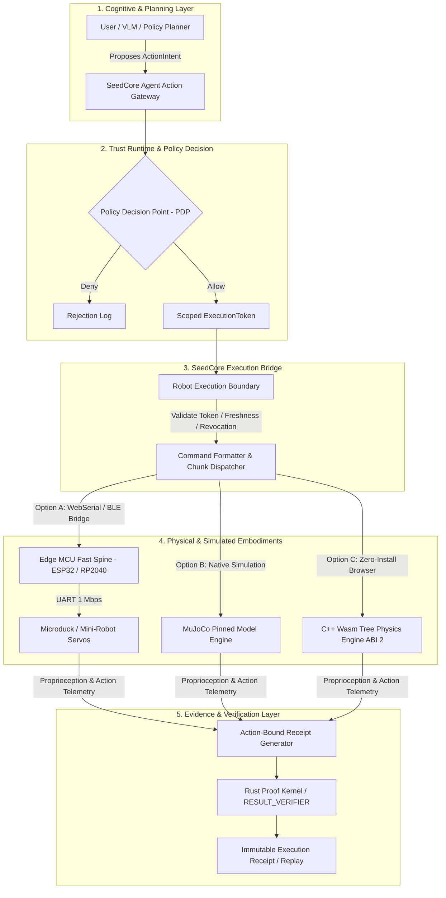

# SeedCore

[](https://github.com/NeilLi/seedcore/actions/workflows/unit-tests.yml)
[](LICENSE)
[](packages/mini-physics/)
[](tools/mini-sim/verify.cjs)

**The Verifiable Trust Runtime & Operating Foundation for Mini-Robotics and Physical AI.**

SeedCore bridges high-level AI policies (Vision-Language-Action models, Diffusion Policies, and cloud VLMs) to physical mini-robots, educational kits, tabletop manipulators, and maker embodiments. It replaces dangerous unchecked motor access with **scoped capability tokens**, **cryptographic receipts**, and a **"Slow Brain, Fast Spine"** receding-horizon execution architecture.

---

## The Paradigm Shift: Industrial Giants vs. DIY & Mini-Robotics

Industrial robotics literature and enterprise foundations (e.g., Franka Emika Panda, Unitree H1, Boston Dynamics, UR5) are engineered for **heavy, high-inertia platforms** operating under catastrophic physical and financial hazard. Scaling down an industrial factory stack to a desktop or classroom fails because the fundamental constraints of mini-robotics are completely inverted:

| Architectural Dimension | Classical Industrial Robotics (Factories / Heavy Humanoids) | DIY & Mini-Robotics (Desktop / Maker / Kids / Education) |
| --- | --- | --- |
| **Physical Hazard Profile** | High mass (15–100+ kg), high torque (20–150+ Nm). Crushing, pinch, and impact hazard. | **Featherweight (< 500g – 2 kg), micro-torque (< 0.2–2 Nm).** Inherent, passive mechanical safety. |
| **Safety Paradigm** | **Active Enforced Containment:** Hard real-time C++ geofencing, optical light curtains, ISO 10218 / ISO/TS 15066 force clamping. | **Safe-by-Physics:** Actuator stall torque cannot break human skin or living room objects. Passive compliance via 3D-printed PETG/PLA/TPU. |
| **Compute & Power** | Heavy onboard SoCs (Jetson AGX Orin, 60W+) or multi-GPU servers (8x H100s). High thermal and battery load. | **Ultra-low power microcontrollers:** ESP32, RP2040, STM32, or host laptops/Chromebooks. 5V USB / 2S LiPo (7.4V). |
| **Communication Bus** | Industrial fieldbuses: CAN-FD (5 Mbps), EtherCAT (100 Mbps), industrial MIPI CSI-2 camera DMA (<3.5ms). | **Consumer serial & Web APIs:** UART / RS-485 serial bus (1 Mbps), USB-CDC, WebSerial, BLE, Wi-Fi WebSocket. |
| **Simulation & Tooling** | Heavy local Linux workstation dependencies, complex ROS 2 distributions, NVIDIA Isaac Sim / Omniverse. | **Browser-Native & Zero-Install:** Zero-allocation C++/Wasm simulation, WebGPU/Canvas rendering, runs on any Chromebook/laptop. |
| **Model Strategy** | Monolithic 7B–70B parameter generalist VLAs running on remote GPU clusters. | **Hierarchical Edge-Microbrains:** Lightweight policies (ACT, Diffusion Policy, Octo-Small at 27M–93M) or cloud VLMs dispatching bounded action chunks. |
| **Data Collection** | $100k+ optical motion-capture rigs, master-slave industrial arms, dedicated telemetry cages. | **Maker Teleoperation:** Passive 3D-printed leader arms (like SO-100), browser webcams, smartphone AR, gamepads, hand-pose vision. |
| **Trust & Governance** | Rigid industrial PLC interlocks, closed proprietary firmware gates. | **SeedCore Verifiable Governance:** Policy-bounded execution, cryptographically signed receipts, scoped capability tokens, parental/educator supervision. |
| **Cost Profile** | $15,000 – $150,000+ per unit. | **$50 – $300 total Bill of Materials (BOM).** |

### SeedCore's Central Role in the Mini-Robotics Ecosystem

Because mini-robots like **Microduck**, tabletop arms, and desktop companions are *safe-by-physics*, safety shifts from kinetic hazard containment to **behavioral, permission, and privacy governance**:

1. **Scoped Capability Tokens:** An AI planner never receives raw motor access. It requests a bounded motion session (e.g., *"Walk forward 10 cm to inspect toy within 3.0s"*). SeedCore's Policy Decision Point (PDP) admits the request into a cryptographic token.
2. **The "Slow Brain, Fast Spine" Bridge:** Rather than fighting 15–40ms consumer bus jitter (USB/BLE), SeedCore pairs an asymmetric pipeline:
   - **The Slow Brain (Cloud / Laptop / Browser):** Computes action chunks (30–50 future waypoints covering 0.5–1.0s) every 100–200ms.
   - **The Fast Spine (Edge MCU ESP32 / RP2040):** A deterministic C++ spline interpolator running at 200–500 Hz smoothly drives serial bus servos (e.g. Feetech STS3215 or 9g servos). If communication drops, a hardware watchdog brings the robot to a stable resting posture.
3. **Action-Bound Receipts & Evidence:** Every physical attempt generates a replayable, cryptographically signed receipt. Parents, teachers, and developers can verify exactly why the robot moved, what sensor data triggered it, and whether it complied with policy.
4. **Revocation at the Boundary:** If an action exceeds safe limits (tilt threshold, table edge detection, or manual stop), SeedCore immediately revokes the token at the bridge.

---

## Technical Stack Architecture

SeedCore is structured in clean, decoupled layers separating governance, mathematical simulation, hardware abstraction, and cryptographic proofs:



### 1. Trust Runtime & Policy Decision Layer
- **Agent Action Gateway (`src/seedcore/agents/`):** Validates caller identity, intent taxonomy, and rate limits.
- **Policy Decision Point (PDP):** Evaluates intents against fine-grained policy rules; issues bounded `TaskExecutionToken` instances with cryptographic signatures, strict expiration timestamps, and capability masks.
- **Revocation Custody (`src/seedcore/hal/custody/`):** [`execution_token_revocation.py`](src/seedcore/hal/custody/execution_token_revocation.py) provides sub-millisecond revocation lookups to cancel in-flight sessions instantly.

### 2. Hardware Abstraction Layer (HAL) & Drivers
- **Base Interfaces (`src/seedcore/hal/interfaces.py`):** Unified [`BaseRobotDriver`](src/seedcore/hal/interfaces.py), [`ProprioceptionState`](src/seedcore/hal/interfaces.py), [`RobotCapabilities`](src/seedcore/hal/interfaces.py), and operational [`RobotState`](src/seedcore/hal/interfaces.py).
- **Driver Implementations (`src/seedcore/hal/drivers/`):**
  - [`robot_sim_driver.py`](src/seedcore/hal/drivers/robot_sim_driver.py): Extensible execution framework with in-memory and physics-backed profiles.
  - Microduck HAL simulation driver (M1): Pinned 61-dim observation vector, 14-dim action vector, home poses, and zero-drift startup verification.

### 3. Native MuJoCo Workbench & Model Packages
- **Model Ingestion (`packages/models/`):** Validated, versioned model packages with SHA-256 integrity manifests. Includes the pinned **Microduck 0.1.0** MJCF model ([`packages/models/microduck/0.1.0/manifest.json`](packages/models/microduck/0.1.0/manifest.json), $0.737\text{ kg}$, $nq=21, nv=20, nu=14$).
- **Integrity & Parity Verifier:** [`tests/test_model_package.py`](tests/test_model_package.py) verifies total mass, joint limits, kinematic trees, and dynamics against upstream CAD sources.

### 4. Zero-Allocation C++ Physics Kernel & WebAssembly Core
- **Analytical C++ Physics (`packages/mini-physics/`):**
  - [`include/mini_physics.h`](packages/mini-physics/include/mini_physics.h) & [`src/mini_physics.cpp`](packages/mini-physics/src/mini_physics.cpp): **ABI 1** planar two-joint dynamics core.
  - [`include/mini_tree_physics.h`](packages/mini-physics/include/mini_tree_physics.h) & [`src/mini_tree_physics.cpp`](packages/mini-physics/src/mini_tree_physics.cpp): **ABI 2** general multi-link serial chain dynamics ($N \in \{1, 2, 3\}$). Features exact analytical mass matrix $M(q) = \sum \left( m_i J_{v, i}^T J_{v, i} + I_i J_{\omega, i}^T J_{\omega, i} \right)$, skew-symmetric Coriolis vector $c(q, v)$, gravity torque $g(q) = \nabla U(q)$, analytical $3\times 3$ Cramer matrix inversion, and RK4 integration. Zero heap allocations (`malloc`/`new`), zero exceptions, and caller-owned 64-double buffer.
- **Dual-ABI WebAssembly Build (`apps/mini-robot-simulator/mini-physics.wasm`):**
  - Compiled via Clang and `wasm-ld` (`tools/mini-sim/build-physics.cjs`).
  - Exports: `mini_abi`, `mini_eval`, `mini_scratch` (ABI 1) and `mini_tree_abi`, `mini_tree_eval`, `mini_tree_scratch` (ABI 2).
  - Compact transfer footprint ($\sim 13\text{ KB}$), standalone host math imports (`sin`, `cos`).

### 5. Simulator Contracts & Verification
- **Schema Contracts (`packages/mini-sim-contracts/`):**
  - [`schemas/tree-model.schema.json`](packages/mini-sim-contracts/schemas/tree-model.schema.json): Schema `seedcore.mini-sim.tree-model.v1`.
  - [`src/index.ts`](packages/mini-sim-contracts/src/index.ts) & [`src/tree_contracts.ts`](packages/mini-sim-contracts/src/tree_contracts.ts): TypeScript bindings for model compilation, bounded ASCII/UTF-8 canonical SHA-256 digests, 3D forward kinematics, Jacobian, and Wasm buffer serialization.
  - Built via locked `tsc` into zero-dependency [`sim-contracts.js`](apps/mini-robot-simulator/sim-contracts.js) and [`sim-contracts.d.ts`](apps/mini-robot-simulator/sim-contracts.d.ts).

### 6. Zero-Install 3D Browser Studio & Workbench
- **3D Kinematic Tree Studio ([`apps/mini-robot-simulator/tree-lab.html`](apps/mini-robot-simulator/tree-lab.html)):**
  - Interactive 3D perspective viewport ([`tree-lab.js`](apps/mini-robot-simulator/tree-lab.js), [`tree-lab-ui.js`](apps/mini-robot-simulator/tree-lab-ui.js)) with drag-to-orbit camera controls, depth clipping, and perspective scaling.
  - Preset models: 1-link pendulum, 2-link serial arm, 3-link articulated manipulator.
  - Real-time analytical inspectors: live mass matrix $M(q)$, end-effector Jacobian $\mathbf{J}(q)$, kinetic/potential/total mechanical energy meters, and JSON experiment export.
- **Planar Beginner Lessons ([`apps/mini-robot-simulator/index.html`](apps/mini-robot-simulator/index.html)):**
  - WebWorker isolated simulation ([`simulation-worker.js`](apps/mini-robot-simulator/simulation-worker.js)) with resumable checkpoints, predictive learning challenges, and 480 Hz real-time stepping.

### 7. Cryptographic Proof Kernel & Verifier
- **Rust Proof Engine (`rust/`):** Offline and embedded high-assurance proof kernel (`seedcore-verify`) validating transfer chains, state transitions, and custody handoffs.
- **TypeScript Proof Surfaces (`ts/`):** Verification APIs, typed schema contracts, and operator console bindings.

### 8. Multi-Robot Team Orchestration
- **Team Coordination (`src/seedcore/robotics/`):**
  - [`coordinator.py`](src/seedcore/robotics/coordinator.py): Round barriers, uncertainty tracking, and execution halt controls.
  - [`contracts.py`](src/seedcore/robotics/contracts.py): Cognitive proposals, organ reservations, and team mission definitions.

---

## Repository Map

```text
seedcore/
├── apps/
│   ├── mini-robot-simulator/       # Zero-install browser simulator: 2D lessons & 3D Tree Studio
│   │   ├── index.html              # Planar beginner lessons UI
│   │   ├── tree-lab.html           # SIM-3 3D Kinematic Tree Studio UI
│   │   ├── tree-lab.js             # 3D Projector, preset models & controller
│   │   ├── tree-lab-ui.js          # Orbit controls & live diagnostic inspectors
│   │   ├── tree-physics-wasm.js    # High-level JS bridge for ABI 2 Wasm
│   │   ├── mini-physics.wasm       # Dual-ABI (ABI 1 & ABI 2) compiled Wasm core
│   │   └── sim-contracts.js        # Compiled TypeScript contracts runtime
│   └── neighborhood-guide/         # Digital City Godot & Blender prototype
├── packages/
│   ├── mini-physics/               # C++ analytical physics engine (CMake / CTest)
│   │   ├── include/                # mini_physics.h (ABI 1), mini_tree_physics.h (ABI 2)
│   │   └── src/                    # Analytical kinematics, Coriolis, Jacobian, RK4
│   ├── mini-sim-contracts/         # TypeScript schemas & compiler for robot models
│   └── models/                     # Versioned robot packages (Microduck 0.1.0 MJCF)
├── src/seedcore/
│   ├── agents/                     # Agent Action Gateway and intent routing
│   ├── hal/                        # Hardware Abstraction Layer & robot drivers
│   │   ├── drivers/                # Robot simulation & physical adapters
│   │   └── custody/                # Token validation and revocation registry
│   ├── robotics/                   # Multi-robot team coordination & reservations
│   ├── models/                     # Database models & identity entities
│   └── security/                   # Policy Decision Point (PDP) and authz
├── rust/                           # High-assurance proof kernel & CLI (seedcore-verify)
├── ts/                             # TypeScript contracts, verification API & console
├── tests/
│   ├── mini-sim/                   # Tree contracts, Wasm physics & 3D lab tests
│   ├── test_model_package.py       # Microduck MJCF integrity & dynamics tests
│   └── test_mujoco_workbench.py    # MuJoCo development workbench tests
├── tools/mini-sim/                 # Wasm compilation & verification test runners
└── docs/development/robotics/      # Blueprints, execution contracts & specs
```

---

## Active Robotics Milestones & Status

| Stage | Focus Area | Status | Deliverables & Acceptance Gates |
| --- | --- | --- | --- |
| **SIM-1** | Worker Isolation | **Complete** | WebWorker isolation, versioned run/model/command contracts, reproducible checkpoints. |
| **SIM-2** | C++ Wasm Planar Core | **Complete** | Zero-allocation C++ two-link dynamics (ABI 1), Wasm build, JS/native/Wasm parity (< 1e-12 error). |
| **SIM-3** | Multi-Link Tree & 3D Studio | **Complete** | $N$-link serial tree dynamics (ABI 2), Wasm dual-ABI, 3D perspective viewport with orbit controls, live $M(q)/\mathbf{J}(q)$ inspectors, **68/68 tests passing**. |
| **M0** | Microduck Model Pinning | **Complete** | Ingested Microduck 0.1.0 MJCF ($0.737\text{ kg}$, 14 actuators), integrity manifests, mass/joint parity. |
| **M1** | Microduck Simulation Driver | **In Progress** | MuJoCo HAL driver, 61-dim observation vector, 14-dim action vector, zero-drift startup verification. |
| **M2** | Governed Motion Intent | **Upcoming** | Bounded velocity sessions, ActionIntent $\rightarrow$ ExecutionToken $\rightarrow$ local MCU command bridge. |
| **M3** | Evidence & Receipts | **Upcoming** | Action-bound telemetry, cryptographic receipts, replay, and `RESULT_VERIFIER` closure. |
| **M4** | Supervised Hardware | **Upcoming** | Physical Microduck bring-up, WebSerial/BLE bridge, local MCU watchdog preemption. |

---

## Quickstart & Verification

### 1. Launch the Zero-Install Browser Simulator
Serve the simulator locally using any static web server:

```bash
# Using Python
python3 -m http.server 8080 --directory apps/mini-robot-simulator

# Open in browser:
# 3D Multi-Link Studio: http://localhost:8080/tree-lab.html
# 2D Beginner Lessons:  http://localhost:8080/index.html
```

### 2. Run the Comprehensive Simulator Test Suite
Runs the locked TypeScript contract checks, syntax audits, native C++ invariants, and all 68 Node.js tests:

```bash
node tools/mini-sim/verify.cjs
```

### 3. Build & Test the C++ Physics Engine Natively
Build with CMake and execute CTest native invariant assertions:

```bash
cmake -B /tmp/mini-physics -S packages/mini-physics
cmake --build /tmp/mini-physics
ctest --test-dir /tmp/mini-physics --output-on-failure
```

### 4. Run Python Robot Model & Workbench Tests
Verify the pinned Microduck MJCF model and MuJoCo simulation workbench:

```bash
pytest tests/test_model_package.py tests/test_mujoco_workbench.py
```

### 5. Run the Rust Proof Kernel
Execute the offline verification engine and transfer proof fixtures:

```bash
cargo test --workspace --manifest-path rust/Cargo.toml
```

---

## Key Technical Documentation

- **[Mini-Robotics Developer Blueprint](docs/development/robotics/mini_robot_developer_blueprint.md):** Complete guide covering the $150 BOM, ESP32/RP2040 fast spine firmware, WebSerial communication, and SeedCore trust tokens.
- **[Embodied AI Architecture Reference](docs/development/robotics/embodied_ai_architecture_reference.md):** Deep-dive contrasting industrial robotics with DIY/mini-robotics, receding-horizon action chunking, and verifiable governance.
- **[Mini-Robot Simulator Implementation Plan](docs/development/robotics/mini_robot_simulator_implementation_plan.md):** Engineering roadmap and qualification gates for SIM-1 through SIM-6.
- **[Microduck Integration Plan](docs/development/robotics/microduck_integration_plan.md):** Milestones M0 through M4 for the reference bipedal embodiment.
- **[Microduck RL & Sim2Real Study](docs/development/robotics/microduck_rl_study.md):** Technical analysis of the 61/14 tensor interface, observation normalization, and policy transfer.
- **[Robot Execution Contract Proposal](docs/development/robotics/robot_execution_contract.md):** Reusable session bounds, local interruption, and evidence closure contracts.

---

## License

SeedCore is licensed under the Apache-2.0 License. See [LICENSE](LICENSE).
