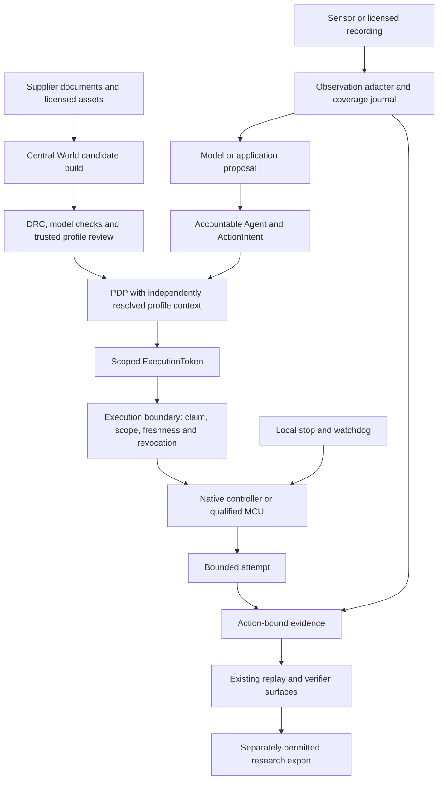

# Robotics partner integration architecture

Date: 2026-10-20
Status: Proposed integration design; no partner adapters, new schemas or token fields implemented

This design implements the boundaries required by the
[cooperation strategy](../strategy/robotics_component_cooperation_strategy_2026.md).
The [robot execution contract](../robotics/robot_execution_contract.md),
[policy matrix](../policy_gate_matrix.md) and existing token/replay contracts
remain authoritative. The [roadmap](../robotics/robotics_ecosystem_integration_roadmap.md)
owns proposed work; the [pilot briefs](../../application/robotics_component_partner_pilot_briefs.md)
own experiment scope.

## Integration shape

Keep authoring, observation, proposal generation, execution and research export
as explicit interfaces. A supplier may occupy several interfaces, but does not
acquire authority merely by supplying the hardware, model or SDK.

This is a target integration diagram. Current Fast Spine dispatch terminates
in a mathematical simulation; the physical route is not delivered. Imported
human demonstrations enter the observation/research lane and have no robot
action or motor-authority claim.

## Reuse the existing seams

| Existing surface | Proposed use | Boundary to preserve |
| --- | --- | --- |
| [Component schema/catalog](../../../packages/component-registry/README.md) and [registry validator](../../../src/seedcore/robotics/component_registry.py) | Describe a reviewed supplier part using the supported schema; retain sources and unknowns | Do not insert speculative runtime bindings or silently change pinned part bytes |
| [Assembly implementation](../../../src/seedcore/robotics/assembly.py), [TS contracts](../../../ts/packages/contracts/src/robotAssemblyContracts.ts) and [authoring store](../../../ts/packages/robot-canvas/src/store.ts) | Pin build identity and invalidate admission after edits | `seedcore.assembly.v2` remains authoritative; proxy mounts do not establish commercial fit |
| [Model package loader](../../../src/seedcore/robotics/model_package/loader.py) | Review licensed URDF/MJCF/assets and explicit frame/joint mapping | Model import does not establish real dynamics, policy parity or hardware qualification |
| [HAL interfaces](../../../src/seedcore/hal/interfaces.py) and [read-only Microduck driver](../../../src/seedcore/hal/drivers/microduck.py) | Reuse lifecycle/observation conventions; implement only the needed device-specific adapter | A driver class or capability flag is not an execution gate; preserve read-only startup |
| [ActionIntent/ExecutionToken](../../../src/seedcore/models/action_intent.py), [PDP](../../../src/seedcore/coordinator/core/governance.py) and [Fast Spine authority](../../../src/seedcore/robotics/fast_spine/authority.py) | Bind the exact behavior/profile payload through reviewed existing fields | No arbitrary additions to frozen constraints, token shape or deny codes |
| [Fast Spine sessions](../../../src/seedcore/robotics/fast_spine/session.py) and [simulation evidence](../../../src/seedcore/robotics/fast_spine/evidence.py) | Reuse lifecycle/negative-case patterns and compare verifier behavior | These implementations deliberately enforce simulation-only scope; do not relabel them as hardware adapters |
| [Physical telemetry proposal](../evidence/physical_telemetry_processing_contract.md) and [Rust verification](../../../rust/README.md) | Design action-bound capture and independent disposition | Vendor logs and host signatures need explicit assurance/provenance; no fabricated device attestation |

Proposed adapter locations are `src/seedcore/hal/drivers/` for robot/device
translation and a reviewed robotics observation module for sensor-only input.
Use a separate optional dependency group for any selected vendor SDK. Paths,
types and package names must be reviewed in the implementation package; this
document creates none of them and does not expand `BaseRobotDriver` prematurely.

## Candidate-specific responsibilities

| Candidate / layer | Proposed boundary | First implementation scope |
| --- | --- | --- |
| D-Robotics / host compute | Linux inference/proposal host; robotd or an independently qualified MCU retains motor control | Offline recorded-input parity and performance; no motor connection |
| Orbbec / perception and capture | Observation producer, with explicit source clock, calibration and loss accounting | One licensed local recording; derived depth kept distinct from raw measured streams |
| Viam / device middleware | Read-only resource adapter first; governed mutation requires enforcement below every accessible motion ingress | Simulated machine status/observations and an ingress map; no production credentials or live motors |
| Bota / wrench; Contactile / tactile | Sensor-specific observations and calibrated predicates; gripper local control declared separately | Licensed replay of force/slip samples on a future manipulation task |
| RobCo / Inovo / modular arms | Explicit topology/configuration revision plus a qualified native controller boundary | Model/configuration study; physical reconfiguration invalidates prior acceptance |
| Mimic / hand platform | Hand/controller and demonstration mapping require a new embodiment profile | Access/semantics study; no assumed universal wrist or policy compatibility |
| Skild / Field AI / behavior provider | High-level requests are proposals; any low-level policy must sit upstream of the actual governed actuator boundary | One documented bounded skill/mission interface only after access and local stop semantics are established |

These placements are SeedCore design proposals. Vendor product evidence and
access uncertainties are recorded in the [strategy assessment](../strategy/robotics_component_cooperation_strategy_2026.md#assessment-of-all-ten-candidates).

## Records to design before writing an adapter

The following are conceptual review records, **not new JSON schemas**. A first
implementation may use a reviewed sidecar/source register. Decide its schema,
canonicalization, size limits and migration rules before making it authoritative.
Do not attach undocumented fields to strict component or assembly schemas.

| Record | Required concepts | Admission and evidence role |
| --- | --- | --- |
| Supplier source record | Product/SKU/revision, dated manuals, SDK/firmware/artifact hashes, license/asset rights, support and unverified claims | Discovery evidence only; a vendor declaration cannot approve itself |
| Reviewed integration profile | Exact endpoint/body/controller, command ingress, capabilities, immutable local limits, firmware/config/model/adapter/calibration pins and qualification references | Trusted service resolves the accepted profile independently; browser submissions remain candidates |
| Observation description | Stream IDs, SI units, axes/frames, raw/derived provenance, sample ordering, source/host timestamps, clock error, calibration and validity | Determines whether required context is present/fresh; unavailable semantics remain unsupported |
| Behavior/provider binding | Skill/mission identity, provider version/artifact, input/action mapping, allowed transformations, parameter extrema and deadline | Signed action/payload binding covers exact semantics; model/provider changes invalidate prior admission |
| Capture/closure record | Action/session/boot/endpoint joins when applicable, coverage/gaps, source and signer assurance, expected predicate, closure deadline and verifier disposition | Distinguishes simulated, host-observed, vendor-reported and accepted device-rooted evidence |
| Data-use record | Capture and egress permissions, purpose, permitted recipients/reuse, retention/deletion and recording/license references | Export admission is separate from motion authority and successful evidence verification |

Preserve `seedcore.jcs-safe-integers.v1` for the existing assembly contract.
Sensor values need a separately specified numeric encoding; do not silently
force arbitrary floating-point streams through assembly canonicalization.
Keep private keys, credentials and personal recordings out of public manifests.

## Command and control requirements

1. Inventory every mutating ingress: SDK RPCs, raw commands, motion services,
   teleoperation, vendor UI, scripts, module/config updates, startup routines,
   diagnostics and direct bus/debug access. Reuse the accepted native boundary
   where possible. A Python wrapper around one method is insufficient if another
   path can still move the same actuator.
2. Admit one scoped session through the accountable Agent/PDP path. Bind the
   endpoint and exact profile/behavior payload using reviewed token semantics.
   If existing fields cannot express the binding, stop at read-only operation
   until a versioned contract extension is reviewed across Python/Rust/TS.
3. Claim a single-use token once. Refresh commands use authenticated session
   identity and monotonic sequence; they cannot widen limits, extend expiry or
   reopen a terminal session. Reject stale inference and changed profile epochs.
4. Enforce local deadlines and stop without browser/cloud/PDP availability.
   A valid token cannot override native interlocks. Define observed physical
   stopping separately from request cancellation and watchdog response initiation.
5. Fence an attempt on controller/config/model changes, restart, reconnect,
   revocation or loss of required fresh context. Clear queued commands; resume
   needs state reconciliation and fresh admission. Updates do not inherit old grants.

For Viam, evaluate its actual session semantics alongside SeedCore's. The
[session documentation](https://docs.viam.com/dev/reference/apis/sessions/)
describes heartbeats, safety-monitored resources and last-user behavior; a live
client heartbeat does not establish fresh SeedCore intent. Include multiple
clients, reconnection and resource handoff in testing. Its
[generic API](https://docs.viam.com/reference/apis/components/generic/)
also exposes model-specific commands, so fencing ordinary motion methods alone
would leave a material review gap. These are documented interfaces, not a
finding of a defect in Viam.

For low-level model providers, do not convert arbitrary torques into a nominal
high-level proposal and claim governance. Either intercept and enforce the real
dispatch/control envelope on the supported body or keep the evaluation offline.
Never stretch Microduck's 61 observations / 14 actions / 15 physical channels
to cover another hand, arm or mobile chassis.

## Sensor and model assurance

Declare force/torque frames, tare/gravity compensation, saturation and calibration;
declare tactile taxel layout, slip/friction estimator version and confidence;
declare camera intrinsics/extrinsics, depth scale, missing pixels, dropped frames
and clock mapping. Freeze acceptable age and uncertainty for the actual task.
These concepts become mandatory only in a reviewed profile that uses them.

Required stale, missing or contradictory observations must prevent admission or
trigger the profile's local stop/uncertain closure behavior. Optional streams
can be absent without inventing measurements. An unavailable or saturated
sensor is not zero force or proof of no contact. Independent reference tests
are needed for any claim of measured force, speed, grip or object state.

Treat quantized/compiled models as new artifacts. D-Robotics documents a
[conversion/performance/accuracy workflow](https://developer.d-robotics.cc/rdk_x_doc/en/Advanced_development/toolchain_development/intermediate/ptq_process);
ONNX import alone cannot establish output parity or BPU acceleration. Retain
the original baseline, conversion settings, calibration data rights and CPU/BPU
placement. Measure complete input-to-proposal latency and rejected late outputs,
alongside inference-only timing, power and thermal behavior.

## Minimum conformance evidence

| Case | Required result / retained evidence |
| --- | --- |
| Read-only discovery/startup | No actuation or unsolicited capture/egress; exact device/resource revision and permissions visible |
| Wrong/unknown profile or unsupported required constraint | Refuse the requested operation; no optimistic capability fallback |
| Invalid, expired, forged, replayed, revoked or wrong-endpoint authority | Zero motion dispatches; preserve decision/claim/dispatch evidence |
| Alternate UI/RPC/raw command or second client | Cannot bypass the accepted execution boundary; otherwise remain read-only |
| Fresh heartbeat but stale proposal/authority | Local fence within frozen deadlines; no extension from connectivity |
| Crash, stall, reconnect, reset or update | Stop/fence as specified; no queued motion or automatic resume |
| Reconfigured assembly, policy, calibration or firmware | Prior admission invalidated; changed inputs independently reviewed |
| Clock jump, out-of-order frame, missing/saturated sensor | Explicit freshness/validity failure and correct task disposition |
| Late, malformed or nonfinite model output | Reject before dispatch; preserve original provider/artifact identity |
| Capture overflow, missing signer or conflicting evidence | Required closure fails or quarantines; stop does not wait for export |
| Host log presented as device-rooted evidence | Reject the stronger assurance claim; retain true capture class |
| Research export without required rights/permission | No export; basic local lesson remains usable |

Freeze numeric thresholds, sample plan, units and test conditions before each
experiment. Reuse CW/M/G acceptance rather than introducing a separate badge.
An authenticated receipt proves integrity under the declared key assumptions;
it does not prove sensor truth or physical task success. Existing simulation
receipt formats cannot accept new physical streams without reviewed schema
and verifier work. Preserve original artifacts and existing RCT regressions.
