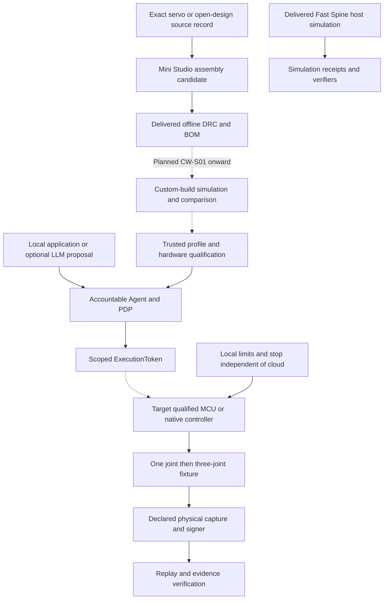

# Mini-robotics partner integration architecture

Date: 2026-10-20
Status: Proposed design for small desktop fixtures; no new adapters, schemas or physical qualification

This revision narrows the [cooperation strategy](../strategy/robotics_component_cooperation_strategy_2026.md)
to small servos, printable structures and selected compact/open joint research.
The [robot execution contract](../robotics/robot_execution_contract.md),
[policy matrix](../policy_gate_matrix.md) and existing token/replay contracts
remain authoritative. The [roadmap](../robotics/robotics_ecosystem_integration_roadmap.md)
owns sequencing; the [pilot briefs](../../application/robotics_component_partner_pilot_briefs.md)
own bounded experiment proposals.

## Smallest useful integration

Use one existing local computer, a directly connected qualified controller and
one desktop fixture. A cloud LLM is an optional untrusted proposer. A camera,
GPU board, middleware service, ROS deployment or fleet manager is not required
by the first integration. Preserve the existing native Microduck lane separately.



This diagram distinguishes delivered offline tools and rehearsal from the
planned custom-build and physical paths. Neither a valid assembly nor a
simulation token grants motor authority. Scaling to a small arm or leg needs
new physical acceptance for that exact body.

## Reusable desktop dock and attachment discovery

The proposed **Fast Spine Desktop Dock** centralizes controller/USB transport,
reviewed power distribution, local stop and watchdog circuitry in one reusable
bench unit. Attachments reuse that unit within one qualified mechanism family;
servos may remain on, or be moved between, attachments. A fixed four-actuator
base is not assumed. The [product/pricing analysis](../strategy/mini_robotics_base_attachment_product_analysis.md)
defines the complete starter offer and incremental attachment economics.

| Boundary | Proposed responsibility | Open before a hardware design or catalog record |
| --- | --- | --- |
| Local computer | Authoring, optional model proposals, preview and verification | Supported browser/serial setup; no mandatory cloud account |
| Dock | Controller/bridge, reviewed supply/distribution, physical local stop, local deadline/watchdog and sole mutation ingress | Exact circuit, firmware, rail ratings, current capacity, protection, device identity and measured stop/holding behavior |
| Attachment | Printed/mechanical parts, declared actuator/sensor set, mount/axis map and calibration | Process/load qualification, applicable harness, complete cost and compatibility with dock limits |
| Source/profile record | Separately pin dock and attachment revisions plus their combined build/model/calibration context | Versioned composite binding and trusted registry resolution; no new fields are implemented here |

First review a **wired, externally supplied bench dock**. Charging/battery,
speaker/display and automatic ID hardware are optional later features, not
first-kit cost assumptions. USB-C is a connector/transport choice, not proof
that a host port can supply servo load or that USB Power Delivery is supported.

The proposed 5 V and 7.4 V rails are **not frozen**. The current STS3215 source
range ends at 7.4 V; a nominal 7.4 V output cannot ignore tolerance, transient
overshoot or source/battery maximum. Set the servo rail only after exact-part
review, including current, wiring, protection and load tests. Keep 3.3 V and
5 V logic domains distinct, with level handling and any USB backfeed controls
reviewed. A physical stop button is not a certified emergency-stop system;
its electrical interruption and load-holding behavior need measured acceptance.

### Physical interface proposal

`seedcore.proxy_mount_v1` and **15 mm / 5°** specify candidate capture distance
and angular alignment in software. They do not define a manufactured 15 mm or
20 mm hole grid, connector geometry or physical tolerance. Review grid pitch,
fasteners, stiffness, retention, print clearances and load cases independently.

Prefer a simple keyed cable and mechanical fastener for the first fixture.
JST-GH-style or pogo/magnetic systems are candidates, not selected pinouts.
For each exact connector, review current/contact rating, polarity/orientation,
keying, wear, exposed-contact faults and mating sequence. Initially require
actuator power disabled for changes; **no hot-swap claim** is made. TTL servo
power/data and sensor logic/I2C need explicit domains and grounding/level rules;
sharing one connector cannot imply arbitrary sensor compatibility. Pin numbers,
connector SKUs, rail setpoints and PCB footprints remain unknown.

### Discovery proposes a build; it does not authorize it

Begin with manual selection or a label/QR referencing an approved build record.
A later EEPROM, 1-Wire memory or ESP32 NVS value may provide a candidate
`assemblyDigest`; a passive chip needs a reader, and the dock can report the
value over a reviewed USB protocol. None of these storage methods is by itself
an authenticated device identity or evidence that the attached mechanics still
match the stored digest.

```text
connect / attachment change -> motors disabled and prior session fenced
read bounded candidate ID (or select manifest manually)
resolve trusted exact build, dock and attachment revisions
check current catalog/DRC bindings, controller limits and calibration
load compatible pinned preview only if its compiler/model path is supported
operator reconciles physical build; accepted profile and enrollment checked
accountable Agent/PDP admits a fresh bounded attempt
qualified local executor claims token -> enable only within admitted limits
```

Digest matching can prepare a read-only preview and candidate policy request.
It cannot mint authority, establish a DRC pass from a chip's assertion, certify
a physical build, or silently choose a fallback model. Custom-build simulation
is still CW-S01 onward. Include boot/session identity, firmware, calibration,
combined build/profile and freshness in the reviewed binding; do not invent
fields in frozen token contracts. Read untrusted IDs with explicit size/format
limits and map them to trusted records, not executable scripts or arbitrary URLs.

Unknown, cloned, stale or unsupported records keep motor enable unavailable.
Attachment removal/change, a power/firmware/calibration change or reconnect
invalidates the applicable admission and queued commands even when the USB
device remains connected. Review how a physical change is detected; absent a
qualified presence/identity mechanism, require explicit reconciliation rather
than assuming software can observe a changed bracket. A stored digest and an
enrolled dock identity cannot independently attest to every printed part.

This concept is the proposed **dock source/design record**. Keep it in design
review until topology, schema representation and source/asset assumptions are
reviewed. A later illustrative `.sc-part.json` must retain unknown ratings,
draft geometry and no execution authority; updating the catalog also requires
new asset/index pins and relevant registry checks. Do not convert this paragraph
into a documented or qualified dual-rail part by filling speculative numbers.

## Three integration paths

| Path | Initial scope | Additional work before physical execution |
| --- | --- | --- |
| Existing STS3215 TTL fixture | Complete exact board/servo/harness/source record; use current simulation and offline contracts | Qualified half-duplex interface, reviewed rails/pinout, firmware, isolated command ingress, enrollment and measured stop/fault behavior |
| Compact integrated joint: CubeMars or conditional WHJ03 / BCSA / igus | Exact module/driver/protocol and mechanical-model study; no live bus | Task-specific profile, supported bus and adapter, feedback/units, controller-owned limits, supply/regen review and complete CW/M/G evidence |
| Open actuator: ODRI; OpenQDD as larger research reference | Pin CAD/BOM/electronics/code and record fabrication/calibration dependencies | Reproducible build record, driver and encoder calibration, manufacturing inspection, electrical protection and physical characterization |

CAN and CAN FD are absent from the current component bus enum, assembly nets
and DRC routing model. Keep unsupported joint interfaces in a review sidecar;
do not relabel them `TTL_UART_BUS`. A future implementation needs a versioned
contract/validator/DRC/driver change with explicit frame sizes, bitrate,
termination, node identity, error behavior and stale-command handling. A USB
bridge or vendor GUI alone does not provide these guarantees. BCSA's interface
remains unknown until an applicable datasheet is available.

RP1/ROMOMO, industrial arm integrations and general robot brains are outside
these paths. Small family fixtures do not inherit their controllers, policies
or acceptance evidence.

## Reuse existing contracts

| Surface | Reuse | Limit |
| --- | --- | --- |
| [Component registry](../../../packages/component-registry/README.md) and [validator](../../../src/seedcore/robotics/component_registry.py) | Versioned part/source identity, byte-pinned assets and explicit unknowns | Twelve existing entries are illustrative; supported schema fields only |
| [Assembly implementation](../../../src/seedcore/robotics/assembly.py), [TS contracts](../../../ts/packages/contracts/src/robotAssemblyContracts.ts) and [store](../../../ts/packages/robot-canvas/src/store.ts) | Rooted topology, axis/rest transforms, exact content identity and change invalidation | Proxy mating does not establish hole patterns, bearings or load capacity |
| [DRC solver](../../../ts/packages/drc-solver/README.md) | Supported bus/power checks, supplied mass/inertia and unknown-aware cost | No current CAN/CAN FD, regeneration, printed-fatigue or physical stop qualification |
| [Model loader](../../../src/seedcore/robotics/model_package/loader.py) | Licensed model/assets and explicit joint/frame mapping | CW-S01 compilation is planned; model validity does not establish real dynamics |
| [HAL](../../../src/seedcore/hal/interfaces.py) and [Microduck driver](../../../src/seedcore/hal/drivers/microduck.py) | Lifecycle/observation conventions and read-only startup patterns | Do not stretch Microduck's 61 observations / 14 actions / 15 channels to another body |
| [ActionIntent](../../../src/seedcore/models/action_intent.py), [PDP](../../../src/seedcore/coordinator/core/governance.py) and [Fast Spine authority](../../../src/seedcore/robotics/fast_spine/authority.py) | Reviewed action/profile binding, single-use session and negative cases | No undocumented token fields, arbitrary constraint additions or authority from an LLM |
| [Fast Spine session](../../../src/seedcore/robotics/fast_spine/session.py), [evidence](../../../src/seedcore/robotics/fast_spine/evidence.py) and [Rust verifier](../../../rust/README.md) | Rehearsal lifecycle and verifier patterns | Simulation-only scope; physical capture/signing requires reviewed contracts |

## Power and mechanical review

Choose a supply **after** selecting the exact actuator revision and fixture.
“12 V versus 24 V” is not a universal menu for all mini joints. The existing
[source register](../robotics/m0_cw_d01_register_2026_10_19.md) records STS3215
A/0 at 4–7.4 V; neither 12 V nor 24 V is an accepted direct rail for that
candidate. No power supply, BEC, fuse, harness or pinout is selected. Keep MCU
and actuator rails explicit, with reviewed signal reference/backfeed behavior.

For any future compact BLDC joint, record its documented operating range,
continuous/peak load, duty cycle, thermal conditions, startup/inrush and energy
returned during braking. Supply current limits, derating, overvoltage handling,
fusing and wire/connector limits need actual component data and measurements.
Motor phase current is not automatically DC-supply current. A worm gear,
software brake, torque-disable command and power removal can produce different
holding/falling behavior; define the required stopped state on the fixture.
See the source-linked [candidate assessment](../strategy/robotics_component_cooperation_strategy_2026.md#assessment-of-the-seven-supplied-initiatives).

For printed structures or an open joint, record CAD revision/units, material,
printer/process, orientation, layer/profile settings, inserts, bearings,
fasteners and required machined parts. Inspect fit/concentricity, backlash,
belt/gear setup, encoder alignment, thermal behavior and replacement intervals.
A STEP/STL download does not demonstrate that an arbitrary home printer can
produce a loaded actuator. Use the selected upstream version's instructions;
qualify substitutions explicitly rather than issuing a universal filament or
infill prescription.

## Source, build and profile records

Use review documents/sidecars initially, not unversioned fields in strict JSON.

| Record | Required content |
| --- | --- |
| Source/fit | Exact SKU or upstream commit, dated manual/CAD/code/BOM hashes, applicable licenses and redistribution permissions, claimed versus measured values, access/support/price unknowns |
| Fabricated unit | Printed/machined parts, process settings, substitutions, inspection, encoder zero/direction, gearing, assembly/rework and actual unit identity |
| Trusted profile | Assembly/model/controller/firmware/calibration revisions, ingress inventory, joint units/sign/limits, supply/mount/load and qualification references |
| Attempt/capture | Principal, endpoint/session/boot joins, command and observation timing, coverage/gaps, source/signer assurance and verifier disposition |

A public repository's description is not a license grant for all of its assets.
Record per-artifact terms and required notices before copying or redistribution.
Freeze numeric encoding and canonicalization before any new record becomes
authoritative. Existing assembly safe-integer canonicalization is not a
floating-point telemetry format. Keep credentials and private keys out of
public build records.

## Command, stop and evidence boundaries

Admit a bounded attempt through the accountable Agent/PDP path and independently
resolved profile. The local executor validates authority, freshness, sequence,
revocation and endpoint binding. A model can propose a position/velocity/torque
only when that exact mode and mapping are supported and qualified; a position
servo does not acquire torque control through a generic API name.

Inventory vendor GUIs, USB/CAN tools, raw commands, calibration, startup,
diagnostics, firmware/config changes and direct bus access. The accepted motor
boundary must fence every accessible mutation route. One wrapper around a
vendor method is insufficient. Keep discovery/read-only operation until the
actual ingress and local interruption paths are accepted.

The executor owns deadline and stop behavior without browser/cloud availability.
Reset, reconnect, revision change, command expiry or revocation must fence
queued commands; reconciliation and fresh admission precede resume. A torque
disable may release a gravity load, so measure the required fixture behavior.
The simulation's 5 ms watchdog poll is not a physical stopping measurement.

Retain command/feedback identity, timing, missing samples, intervention and
uncertain outcomes. Host-signed observations remain host-observed evidence;
vendor feedback is not automatically calibrated load sensing or device-rooted
attestation. A verified receipt establishes integrity within its declared
capture/trust assumptions, not physical safety or task success.

## Minimum acceptance cases

| Case | Required evidence |
| --- | --- |
| Discovery/startup, unsupported bus or missing source data | No motion; accurate known/unknown and capability reporting |
| Wrong, expired, forged, replayed or revoked authority | Zero accepted motion dispatch; retained decision/claim/dispatch record |
| Alternate tool, second client or calibration command | Accepted boundary cannot be bypassed; otherwise remain read-only |
| Browser loss, executor stall, stale command, reset or reconnect | Measured local fence and specified holding/stopped state; no automatic resume |
| Brownout, supply fault or returned braking energy where applicable | Observed behavior within the frozen fixture limits; no successful closure from missing evidence |
| Changed CAD, printed part, gearing, encoder zero, firmware or model | Prior acceptance/admission invalidated at the applicable boundary |
| Missing/nonfinite feedback or incomplete capture/signer | Explicit failure/uncertain closure; original artifacts retained |

Freeze limits, sample plan and fixture conditions before testing; map evidence
to existing CW/M/G gates. No family label, vendor protection feature, open-source
license or partner logo overrides those gates. This document performs no
procurement, hardware connection or contract migration.
