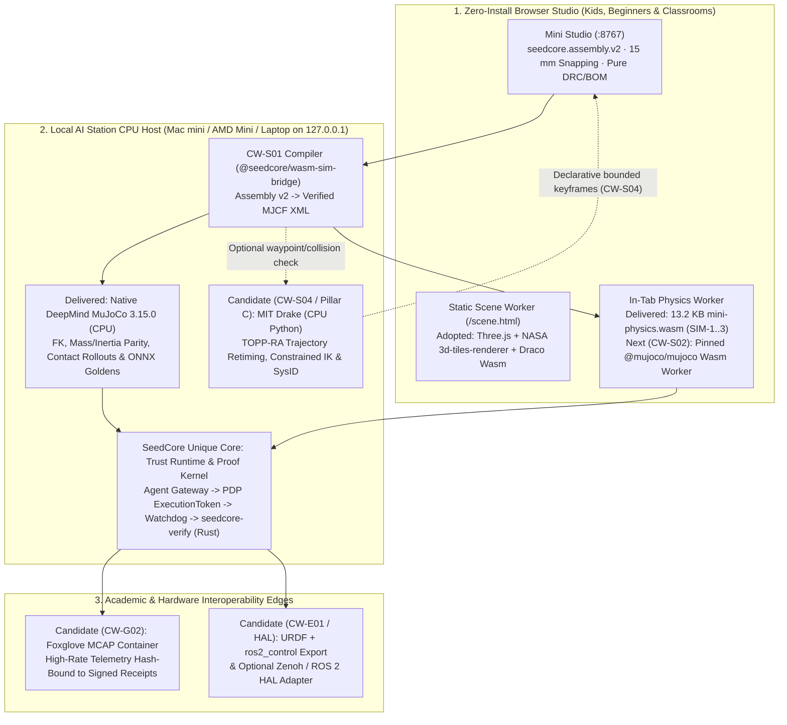

# Open-Source Academic Robotics Ecosystems (MuJoCo, MIT Drake, ROS 2): Applicability & Adoption Reference

Date: 2026-10-22
Status: Supporting architectural reference and ecosystem evaluation; no new runtime dependency, mandatory installation, or hardware authority is granted by this document
Baseline: `2dd11d4` (`CW-S01` MJCF compiler/native parity, WebGPU performance lab, and pinned HLOD static scene streaming)

---

## 1. Executive Decision: Reuse Academic CPU Engines, Own the Trust & Beginner Studio Boundary

Unlike GPU-bound industrial simulation stacks (such as NVIDIA Isaac Sim / Omniverse) that require dedicated Linux x86 workstations with high-VRAM RTX GPUs, open-source academic ecosystems—**DeepMind MuJoCo**, **MIT Drake**, and **Open Robotics ROS 2** (alongside **Foxglove MCAP** and **Pinocchio**)—are engineered to run deterministically on **standard, diverse CPU configurations** (macOS Apple Silicon Mac mini, AMD Ryzen Mini PCs, Linux/Windows laptops, and WebAssembly workers).

To avoid reinventing wheels while keeping the **Mini Studio (`:8767`)** zero-install and effortless for beginners and kids, SeedCore adopts a **strict division of labor**:

1. **DeepMind MuJoCo (`Apache-2.0`) — Primary 3D Multibody & Contact Engine (Adopted & Pinned at `3.15.0`):**
   - **Do not** expand `packages/mini-physics` (`13,242 B` C++17 Wasm) beyond its 1–3 link planar teaching scope (`SIM-1–SIM-3`).
   - Reuse **MuJoCo `3.15.0`** on the Local AI Station CPU (`src/seedcore/robotics/mujoco_workbench/` and `tests/test_cw_s01_native.py`) and adopt a pinned **MuJoCo Wasm worker** in `CW-S02` inside the existing 3-slot `SharedArrayBuffer` / `Transferable` pipeline (`ts/packages/wasm-sim-bridge/src/frameTransport.ts`).
2. **MIT Drake (`BSD-3-Clause`) — Selective Local-Station Optimization, IK & Safety Verification Candidate (Optional Host Helper, Never Browser Wasm):**
   - **Do not** write custom nonlinear trajectory optimizers, time-optimal path parameterizers, or 3D minimum-distance collision solvers from scratch.
   - Evaluate **MIT Drake (`drake` Python wheel)** on the Local AI Station (`127.0.0.1`) as an optional, bounded planning/verification helper for **`CW-S04` Robot Moments** (`Toppra` time-optimal trajectory retiming and collision-free `InverseKinematics`) and **Pillar C system identification** (`SpatialInertia` and friction/backlash parameter fitting).
   - **Do not** compile Drake into browser WebAssembly or make Drake a required dependency for basic offline authoring.
3. **ROS 2 (`Apache-2.0`) & Foxglove `MCAP` — Interoperability Formats at the Export & Replay Edges, Zero Setup Burden for Beginners:**
   - **Do not** require beginners, students, or schools to install Ubuntu, ROS 2 (`colcon`, `DDS`), or C++ build toolchains to design or rehearse a desktop mini-robot.
   - Adopt **`MCAP`** (`@mcap/core` in TypeScript, `mcap` in Python) as a candidate multimodal telemetry container in `CW-G02` (with the container SHA-256 bound inside SeedCore's signed `SessionReceipt`), and emit **`URDF` + `ros2_control` launch templates** in the `CW-E01` Build Pack Exporter so academic users can move from SeedCore's browser studio into `MoveIt 2`, `rviz2`, or `Gazebo` without redoing their design.

> **Schedule & Gate Precedence:** Neither MIT Drake nor ROS 2 is a prerequisite for `CW-S01` real-source readiness, `CW-S02` browser MuJoCo worker qualification, the January authoring/simulation alpha, or `Microduck` `M1–M4` acceptance. The [active queue](../current_next_steps.md) and [Central World schedule](central_world_remaining_delivery_schedule.md) retain priority.

---

## 2. Two-Tier Architecture: Beginner Browser Tab vs. CPU Local AI Station

---

## 3. Subsystem Comparison: MuJoCo vs. MIT Drake vs. ROS 2

| Dimension | DeepMind MuJoCo (`3.15.0`) | MIT Drake (`drake`) | Open Robotics ROS 2 (`Jazzy` / `Kilted` + `MCAP`) |
| :--- | :--- | :--- | :--- |
| **License & Core Language** | `Apache-2.0` · C99 / C++ with official Python & experimental Wasm bindings | `BSD-3-Clause` · C++20 with official prebuilt Python wheels (`macOS arm64`, `Linux x86_64/aarch64`) | `Apache-2.0` · C++ / Python middleware, message schemas, and tooling |
| **Hardware Requirement** | Runs on any CPU (plus optional MJX/Warp for batch RL training); **zero NVIDIA GPU required** for interactive work. | Pure CPU mathematical programming (`Eigen`, `OSQP`, `CLP`, `Ipopt`); **zero GPU required**. | Runs on standard Linux/macOS/SBC CPUs (`Raspberry Pi`, `Orin`, `x86`, `Mac`). |
| **Primary Academic Strength** | Fast forward time-stepping (`mj_step`), generalized coordinates, soft convex contact, actuators, sensors, and RL policy evaluation. | Analytical multibody kinematics/dynamics, **trajectory optimization (`Toppra`, `KinematicTrajectoryOptimization`)**, constrained IK, hydroelastic contact, and Lyapunov/CBF verification. | Standardized hardware drivers (`ros2_control`), `URDF`/`Xacro` descriptions, distributed pub/sub (`DDS`/`Zenoh`), and `MCAP` recording/inspection. |
| **Browser Wasm Suitability** | **High:** Compact C core compiles cleanly to single-thread or pthread Wasm (`@mujoco/mujoco`, `mjswan`). | **Low (Avoid in Browser):** Heavy C++ template and numerical solver graph is too large for a beginner browser tab; keep on the Local AI Station Python host. | **Low for Core Middleware; High for Formats:** Do not run DDS in a browser tab; use pure-TS `@mcap/core`, `urdf-loader`, or WebSocket/Zenoh edge bridges. |
| **Current SeedCore Status (`2dd11d4`)** | **Adopted & Pinned:** `mujoco==3.15.0` in Python workbench, Microduck `0.1.0` loader, and `CW-S01` native parity (`13/13` tests). | **Evaluated Candidate:** Not yet installed; targeted for optional `CW-S04` trajectory retiming/IK and Pillar C calibration. | **Evaluated Candidate:** `URDF` ingestion supported in `model_package.py`; `CW-E01` URDF export and `CW-G02` MCAP framing planned. |

---

## 4. Concrete Opportunities to Avoid Reinventing Wheels

### A. DeepMind MuJoCo: Forward Dynamics, Contacts & Browser Worker (`CW-S01`–`CW-S03`)

1. **Already Delivered (`CW-S01` & `mujoco_workbench`):**
   - [`ts/packages/wasm-sim-bridge/src/compiler.ts`](../../../ts/packages/wasm-sim-bridge/src/compiler.ts) compiles validated `seedcore.assembly.v2` serial trees into deterministic MJCF XML (`seedcore.cw-s01.model.v1`).
   - [`tests/test_cw_s01_native.py`](../../../tests/test_cw_s01_native.py) proves that SeedCore's TypeScript FK and `CW-A04` rotated 3D inertia tensors match native MuJoCo `3.15.0` (`mj_forward`, body positions/orientations, subtree mass, and inertia).
2. **Next Adoption Step (`CW-S02` Browser Worker):**
   - Instead of writing a custom 3D rigid-body contact engine in C++, wrap a pinned **MuJoCo Wasm build** inside the worker architecture proven in [`ts/apps/mini-studio/src/performance/physics-worker.ts`](../../../ts/apps/mini-studio/src/performance/physics-worker.ts) and [`ts/packages/wasm-sim-bridge/src/frameTransport.ts`](../../../ts/packages/wasm-sim-bridge/src/frameTransport.ts).
   - Reconcile the engine version (`3.15.0` baseline vs. `mjswan 0.11.9`'s `3.11.0` pin documented in [`mjswan_integration_assessment.md`](mjswan_integration_assessment.md)) and enforce the `CW-SIM-04` per-substep control veto inside the worker loop before calling `mj_step`.
3. **Model Ecosystem Reuse ([MuJoCo Menagerie](https://github.com/google-deepmind/mujoco_menagerie)):**
   - When adding supported reference arms (such as `SO-ARM100` or educational manipulators in Phase 3), ingest curated Menagerie or [`onshape-to-robot`](robot_design_toolkit_assessment.md) exports through [`src/seedcore/robotics/model_package/loader.py`](../../../src/seedcore/robotics/model_package/loader.py) with SHA-256 manifest pins rather than hand-coding kinematic XML.

### B. MIT Drake: Trajectory Retiming (`TOPP-RA`), Constrained IK & System ID (`CW-S04` & Pillar C)

When beginners or remote LLM copilots (OpenAI / Google Gemini) author robot motions, they specify **what** they want (waypoints, poses, or gestures), not continuous twice-differentiable splines. Writing custom trajectory optimizers and self-collision solvers from scratch is error-prone.

1. **`CW-S04` Robot Moments — Time-Optimal Path Parameterization (`drake.multibody.optimization.Toppra`):**
   - **Problem:** A kid places 4 gesture keyframes in Mini Studio, or an LLM drafts a waving sequence. Naive linear interpolation produces infinite acceleration spikes at waypoints, violating `STS3215` velocity (`max_velocity_rad_s`) and torque (`max_torque_nm`) bounds.
   - **Drake Solution on Local Host:** Given a geometric path $q(s)$ for $s \in [0, 1]$ and the robot's `CW-S01` multibody plant, Drake's **`Toppra`** solves a convex reachability program on CPU in milliseconds to compute the time-optimal scaling $s(t)$ subject to:
     $$\dot{q}_{\min} \le \dot{q}(t) \le \dot{q}_{\max}, \quad \ddot{q}_{\min} \le \ddot{q}(t) \le \ddot{q}_{\max}, \quad \tau_{\min} \le \tau(t) \le \tau_{\max}$$
   - **SeedCore Integration Boundary:** The Local AI Station runs `Toppra` as a **proposal refiner** and returns a declarative `CW-S04` keyframe/chunk manifest. SeedCore's own deterministic validator (`CW-MOM-01`) still checks the resulting extrema before admitting the trajectory.
2. **Collision-Free Inverse Kinematics (`drake.multibody.inverse_kinematics.InverseKinematics`):**
   - For multi-link arms where a user drags an end-effector target in 3D, Drake's `InverseKinematics` coupled with `SceneGraph` (`AddMinimumDistanceLowerBoundConstraint`) solves for joint configurations that maintain a strict clearance (e.g., $\ge 10\text{ mm}$) between non-adjacent links and the tabletop dock.
3. **Physical Realizability & System Identification (`drake.multibody.tree.SpatialInertia`):**
   - Drake's `SpatialInertia.IsPhysicallyValid()` provides an independent reference check alongside SeedCore's `isValidInertiaTensor()` (`ts/packages/drc-solver/src/solver.ts`), and Drake's multibody parameter estimation routines can fit actuator damping, coulomb friction, and armature inertia from opt-in bench trajectories (Pillar C).

### C. ROS 2 & Foxglove `MCAP`: Standard Formats & Academic Bridge (`CW-G02` & `CW-E01`)

1. **Adopt `MCAP` for High-Rate Telemetry & Replay (`CW-G02`):**
   - Instead of designing a proprietary binary telemetry container for joint positions, velocities, bus voltages, and camera frames, adopt **[MCAP](https://mcap.dev/)** (the default ROS 2 recording format, usable standalone via `@mcap/core` in TypeScript and `mcap` in Python without any ROS 2 installation).
   - **SeedCore Cryptographic Binding:** Record the indexed `MCAP` channels during a simulated or physical session, compute the canonical SHA-256 digest of the `MCAP` payload, and bind that digest inside SeedCore's signed `SessionReceipt` verified by `seedcore-verify` (`rust/crates/seedcore-verify`). Users get both **cryptographic non-repudiation** (SeedCore) and **instant compatibility with Foxglove Studio / ROS 2 tooling**.
2. **One-Click `URDF` + `ros2_control` Export in `CW-E01` (Build Pack Exporter):**
   - Extend the `CW-E01` Build Pack ZIP exporter so that alongside `assembly.sc-assembly.json`, `drc-report.json`, `bom.csv`, and `model.mjcf.xml`, it generates a standard **`robot.urdf`** and minimal **`ros2_control` hardware interface YAML**.
   - A student can start in SeedCore's zero-install browser studio on day one, and later export their exact DIY robot into a university ROS 2 (`MoveIt 2` / `rviz2`) course with zero manual XML translation.
3. **Optional `Zenoh` / `ros2_control` Adapter at the HAL Boundary:**
   - For laboratories that already operate ROS 2 robots, any bridge (such as [Eclipse Zenoh](https://zenoh.io/) or `rosbridge_suite`) must terminate at SeedCore's **Agent Action Gateway / HAL boundary** (`src/seedcore/hal/`). ROS 2 nodes never bypass `ExecutionToken` verification, revocation checks, or local watchdog deadlines.

---

## 5. What SeedCore Must Never Outsource to Academic Engines

While MuJoCo, Drake, and ROS 2 solve physics, optimization, and message formatting, **none of them provide an end-to-end physical AI trust boundary or beginner electrical/assembly DRC**:

| Capability | Why Academic Ecosystems Do Not Solve It | SeedCore Authoritative Owner |
| :--- | :--- | :--- |
| **Canonical Byte-Pinned Assembly & Electrical DRC** | `URDF` and `MJCF` ignore MCU GPIO strapping pins, UART servo ID collisions, I2C pull-ups, BEC current derating, and unknown part costs. | [`@seedcore/contracts`](../../../ts/packages/contracts) (`seedcore.assembly.v2`) + [`@seedcore/drc-solver`](../../../ts/packages/drc-solver) (`CW-DRC-01..03`). |
| **Epoch-Fenced Authoring & Ghost Snapping** | Academic simulators assume static text files edited by experts; they do not invalidate runtime permissions when a beginner moves a part in the browser. | [`@seedcore/robot-canvas`](../../../ts/packages/robot-canvas) (`AssemblyStore`, `authorityEpoch`, `15 mm` / `5°` snapping). |
| **Scoped Capability Tokens & Revocation** | ROS 2 topics (`cmd_vel`, `joint_trajectory`) and MuJoCo control arrays (`mjData.ctrl`) accept any float written by any local process. | SeedCore **PDP**, single-use `ExecutionToken`, and `fast-spine-v1` session framing (`src/seedcore/security/`, `src/seedcore/hal/`). |
| **Cryptographic Action Receipts & Quarantine** | Standard `rosbag2` / `MCAP` files log raw messages without proving which policy, assembly digest, or capability token authorized the physical attempt. | Python `RESULT_VERIFIER` & Rust [`seedcore-verify`](../../../rust/README.md) proof kernels. |

---

## 6. Phased Adoption Checklist (Aligned with Central World Queue)

| Work Package | Open-Source Component to Reuse | Integration Rule & Verification Gate |
| :--- | :--- | :--- |
| **`CW-S02` (Next Active)** | Official **`@mujoco/mujoco` Wasm** (or reconciled `mjswan` runtime) + existing `frameTransport.ts` (`SharedArrayBuffer` / `Transferable` ring) | Pin exact Wasm SHA-256 bytes, verify parity against native `mujoco==3.15.0` on `CW-S01` models, and enforce `CW-SIM-04` per-substep control gating inside the worker. |
| **`CW-S03`** | **`onnxruntime-web` (Wasm EP first)** + pinned `Microduck` / tabletop ONNX policies | Pin ORT Wasm binaries and model SHA-256 digests; verify against the 16 native Python/MuJoCo ONNX goldens (`CW-POL-01`). |
| **`CW-S04`** | Optional **MIT Drake (`Toppra` / `InverseKinematics`)** on the Local AI Station Python API | Keep the browser timeline declarative (`CW-MOM-01`); if `drake` is installed on the host, expose an optional endpoint to retime waypoints into jerk/torque-bounded splines, then re-verify extrema in TypeScript/Python. |
| **`CW-G02`** | **Foxglove `MCAP`** (`@mcap/core` / `mcap`) | Wrap recorded telemetry streams in `MCAP` or canonical JSONL, and bind the exact payload SHA-256 inside the signed `SessionReceipt` checked by `seedcore-verify`. |
| **`CW-E01`** | **Standard `URDF` + ` MJCF` + `ros2_control` templates** | Generate deterministic `URDF` alongside `CW-S01` `MJCF` in the Build Pack ZIP, preserving explicit notices when source components use `simulation_proxy` geometry. |
