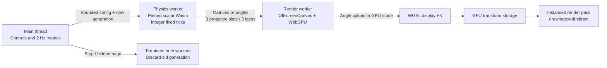

# Browser performance pipeline and advanced stack adoption

Date: 2026-10-21
Status: Opt-in synthetic planar lab implemented and exercised locally; CW-S02 fixed-preset runtime delivered separately, CW-S03 preflight delivered with policy execution blocked; broader runtime/live/hardware gates open
Baseline: CW-S01 compiler/native parity and the existing pinned SIM-3 ABI 2 engine; engine bytes unchanged

22 October extension: the separate [static scene lab](static_scene_streaming.md)
now applies HLOD, pinned Draco decoding and origin rebasing to original static
visuals beside a synthetic actor. It adds the NASA renderer and development
encoder described there; this page continues to own the earlier WebGPU
transport/compute comparison.

## What is available now

Mini Studio links to `http://127.0.0.1:8767/performance.html`. The lab compares
three actual pipelines on the current browser, with selectable 1–256 three-link
chains, a 500 or 1000 Hz fixed-step target and a bounded 2–30 second run. Change
the chain count and repeat **Compare all three** to inspect scaling; export the
result table and raw measurements as JSON. There are no invented latency curves.

This is an independent synthetic SIM-3 workload, not the authored assembly or
the separately delivered [CW-S02 fixed-preset runtime](central_world_cw_s02_mujoco.md).
The main editor keeps selection, snapping, keyboard
placement, immutable revisions and its current Three.js viewport. No blocked
assembly is compiled or promoted by opening the lab.

| Mode | Physics worker output | Physics → render transport | Render worker |
| --- | --- | --- | --- |
| `transfer` | 3 × 4×4 f32 matrices per chain | Three reusable transferable `ArrayBuffer` loans over a direct `MessageChannel` | Upload matrices; one instanced WebGPU draw |
| `shared` | Same matrices | Three `SharedArrayBuffer` slots with atomic ownership | Upload a protected shared view; same instanced draw |
| `gpu` | One padded vec4 of joint angles per chain | Same shared-slot protocol | Upload angles; WGSL FK writes GPU storage; the following draw reads that storage |

All modes use the same pinned, scalar, f64, allocation-free C++ Wasm ABI 2
solver and synthetic model/PD controller. No state objects are constructed per
body/substep. The physics worker retains its explicit f64 state and packs only
visual snapshots. The existing engine's **unshared Wasm memory cannot alias an
arbitrary SAB**; this implementation makes that packing boundary explicit.



The lab draws a shared indexed quad per link in an orthographic planar view.
Its indirect instance count is fixed by the bounded configuration. It does not
implement GPU culling, geometry compaction, bindless materials, a CAD mega-buffer,
contact dynamics or a replacement editor renderer. Compute and vertex shaders
share a `STORAGE` buffer; it is read through a vertex-stage storage binding,
so `VERTEX` usage is not required on that buffer.

## Copy, timing and authority boundaries

`SharedArrayBuffer` removes worker-payload cloning, not the CPU→GPU upload.
`GPUQueue.writeBuffer()` still copies input data; the WebGPU
[explainer](https://gpuweb.github.io/gpuweb/explainer/) describes the extra copy.
The protected shared slot stays reader-owned until `writeBuffer()` returns.
GPU FK avoids reading the resulting transforms back to the CPU during rendering.
For this three-link fixture, matrix payload is **192 bytes/chain** versus
**16 bytes/chain** for padded angles: a 12:1 payload ratio, not a speedup claim.

Each shared slot moves through `FREE → WRITING → READY → READING → FREE` using
atomic compare/exchange and publication. A producer may replace an unread READY
snapshot, but never a reader-owned slot. Only one producer and one consumer are
supported. Transfer returns must match an outstanding slot and exact sequence;
duplicate, stale, detached or wrong-sized returns fail. Neither path transfers
the engine's own memory. Visual drops do not represent complete telemetry and
must never substitute for CW-SIM-03/CW-G02 capture.

Physics advances by integer ticks at frozen dt = 1/500 or 1/1000 s. A callback
performs at most eight ticks; wall pacing uses batched timers, not a promise of
one timer callback per millisecond. Ticks are retained with bounded catch-up.
A wall-time gap or cumulative pacing deficit over 250 ms fails the run rather
than enlarging dt, dropping simulation ticks or resuming later. UI hidden-page,
stop, initialization timeout, worker error, device loss and run timeout terminate
both workers. The final visual tick must be acknowledged within one second.
GPU submission is capped at two outstanding batches. Run count, sample arrays,
pixel dimensions, geometry and transport memory are bounded.

`requestAnimationFrame` follows the browser/display. **120 FPS and 500–1000 Hz
are targets to measure**, not hard real-time or physical stop-time guarantees.
The UI reports world ticks/s, submitted-frame intervals, CPU packing/publication
time, upload time/bytes, CPU encoding/submission time and backpressure. It does
not measure GPU execution time or input-to-photon latency. Packing time includes
FK/packing and publication/transport overhead; it is not isolated serialization
time. Array storage for timing samples is bounded. Host sin/cos and device WGSL
math do not establish cross-platform bitwise determinism.

All output is `synthetic_simulation_measurement`, `physicalAcceptance: false`,
`executionAuthority: none`. Digests in a measurement are compatibility identities,
not signed action receipts. The lab has no policy inference, cloud connection,
serial, actuation, signer or token endpoint. High frame rate cannot bypass DRC,
Agent/PDP, ExecutionToken, qualified executor or evidence closure.

## Hosting and capability failure

The existing localhost service already provides COOP `same-origin`, COEP
`require-corp` and CORP `same-origin`. Shared modes require actual secure-context
cross-origin isolation; capability presence alone is not adapter availability.
The renderer requests a real WebGPU device inside its worker. An unavailable
adapter, OffscreenCanvas or API fails explicitly; the authoring editor remains
available. Transfer mode avoids SAB, but still needs worker WebGPU. No fallback
changes the numerical engine or reports a different backend under the same name.

When shared memory or isolation is unavailable, shared pipeline choices and
**Compare all three** are disabled with an explanation. **Run measurement**
continues to offer transferable matrices, subject to the same worker/WebGPU
requirements. Completing that run does not imply the shared pipelines ran.
Browser regression checks exercise both a missing SAB constructor and missing
isolation, including successful transferable completion and disabled comparison
afterward. This capability behavior is not a Chromebook/tablet qualification.

Build-time and worker-startup SHA-256 checks bind the exact existing Wasm bytes.
The performance document and physics worker receive CSP `'wasm-unsafe-eval'`; no
JavaScript `'unsafe-eval'` or inline scripts are allowed. The editor's original
no-eval policy remains. The static service uses an exact asset allowlist.
That performance slice added the direct declaration dependency
`@webgpu/types@0.1.74`, already present transitively. The later static-scene slice
adds its own pinned renderer/codec dependencies and narrowly scoped blob-worker
permissions; neither slice installs a new physics engine or neural runtime.

## Reproduce and inspect evidence

From the repository root:

```bash
npm --prefix ts ci
node tools/robotics/verify-browser-performance.cjs --browser
.venv/bin/python scripts/robotics/serve_mini_studio.py --port 8767
```

Open `/performance.html` on that localhost service. The verifier rebuilds its
workspace dependencies from source and checks workspace types, nine asset/transport/
clock/FK tests and the current API suite. `--browser` requires a real Chrome WebGPU adapter;
it fails rather than silently skipping the GPU exercise. Without that flag the
report explicitly says `core_checks_passed_browser_not_run`. `--skip-python`
is used by CI after the Python lane. CI runs the source/transport lane and
retains its report; a hosted runner's GPU is not presumed qualified.

Local, ignored artifacts are in `artifacts/robotics/browser-performance/`:
`verification.json` binds source/output hashes; `browser-verification.json`
records browser, GPU metadata, parity and failure checks; `measurement.json`
contains exported measurements; desktop/mobile PNGs support visual inspection.
The browser check independently reads WGSL FK output back **only in the test**
and compares full matrices within 1e-6. A separate test compares CPU display
matrix endpoints to existing Wasm FK. Real producer/consumer contention tests
look for torn shared snapshots; mode-independent fixed-tick runs compare exact
same-build terminal state hashes.

The 21 October local exercise used macOS 26.5.1 arm64, Chrome 155.0.8059.85,
an Apple/Metal-3 adapter, 16 independent chains / 48 links and two-second runs.
All three 500 Hz modes completed 1000 ticks in approximately two wall seconds,
with matching final state hashes. A separate 1000 Hz GPU-FK run completed 2000
ticks. Observed p95 submitted-frame intervals were about 16.67 ms (~60 FPS),
and diagnostic GPU matrix max absolute error was about 1.16e-8. These short
headless measurements establish functionality on this device; they do not
establish 120 FPS, sustained thermal performance, interactive display latency,
industrial-scale performance or superiority to the existing editor. All three
measured paths already use worker rendering, so this is not a controlled
main-thread Three.js versus WebGPU comparison.

## Adoption decisions for the remaining proposed stacks

The order below keeps the mini/family tabletop scope. The engineering judgment
is that engine/model parity and measured UI isolation are more useful now than
a factory-room renderer or a remote training cluster.

| Stack | Current decision | Required next result / acceptance owner |
| --- | --- | --- |
| SAB + OffscreenCanvas + WGSL FK | Implemented in the optional lab | Before editor integration, preserve picking, camera/placement gestures, revision fencing, accessibility, visual asset hashes and resource cleanup; benchmark the same authored task |
| Wasm SIMD128 | Separate build candidate; not enabled in the frozen scalar artifact | Pin compiler/flags/binary; prove actual emitted vector work, native/scalar/SIMD numerical parity and named-device p50/p95 improvement. No generic 2.5–4× claim; `-msimd128` alone is insufficient evidence |
| Wasm pthreads | Separate engine profile, distinct from having two JS workers | Qualify threaded memory ownership and pool, COOP/COEP deployment, cancellation and thread-count determinism. Build separately from single-thread; small 1–3 joint models may not justify overhead |
| Official MuJoCo Wasm / `@mujoco/mujoco/mt` | Single-thread `@mujoco/mujoco@3.15.0` adopted in the separate [CW-S02 fixed-preset slice](central_world_cw_s02_mujoco.md); `/mt` remains a candidate | Preserve native/Chrome parity, pinned model/engine bytes, bounded clocks/capture and per-substep vetoes; qualify broader models, devices and deployments separately; threaded builds do not inherit single-thread acceptance |
| Rapier SIMD / GPU physics | Optional future scene-collision backend; no replacement for current tabletop/native model | Exact package/features and model profile, multibody/constraint support, contact and inertia tests, determinism evidence, versions and licenses. Modern Rapier has multibody joints; do not classify every Rapier joint as a drifting maximal-coordinate constraint |
| GPU culling / CAD batching | Follow measured draw/CPU pressure; currently one indexed instance draw | Freeze batch/material/visibility semantics and compare GPU output to CPU reference; handle compacted draw counts, bounds, resource ceilings and optional features. One indirect call does not render arbitrary materials/meshes automatically |
| WGSL synthetic depth/LiDAR | Deferred sensor extension | Freeze model geometry/BVH bytes, frame convention, intrinsics, timestamp/sample coverage and analytical/native ray goldens. Visual splats are not collision or depth truth by default; no 100k rays/s claim without timing |
| Gaussian splats | Optional visual background after authoring/runtime gates | Bounded locally pinned assets, capture rights, camera calibration, sorting/depth/compositing tests, device memory and frame budget. No physical mass/contact inference from appearance |
| ONNX Runtime WebGPU / WebNN | CW-S03 explicit execution-provider candidates; not enabled | Pin ORT and model bytes, operator/backend/device support, exact observation/action mapping, independent output vectors, numerical tolerances, inference p95/deadlines and generation-fenced async results. No silent backend change inside an attempt |
| Neural physics surrogate | Separate non-authoritative model proposal/evaluation lane | Domain/error envelope, held-out physical/native reference, out-of-domain rejection and uncertainty. Approximate learned contact is not verified actuator dynamics or execution authority |
| WebTransport + remote Isaac Sim/MJX | Deferred explicit remote simulation profile; no cloud resources provisioned | Named endpoint/service/build, authenticated session, consent/egress/cost policy, model/state digests and ticks, reorder/loss/deadline handling, reconciliation and disconnect fencing. Local predicted state must be labeled and never counted as remote evidence or physical authority |

Official MuJoCo documents separate
[single-thread and `/mt` builds](https://github.com/google-deepmind/mujoco/blob/main/wasm/README.md).
Emscripten documents [SIMD flags](https://emscripten.org/docs/porting/simd.html)
and [separate pthread build requirements](https://emscripten.org/docs/porting/pthreads.html).
These establish available mechanisms, not SeedCore performance or compatibility.
The existing [mjswan assessment](mjswan_integration_assessment.md) still records
its engine-version mismatch and missing worker/control/capture seams.

The proposed `wgrapier` path needs a dated correction: Dimforge describes
[Nexus](https://www.dimforge.com/blog/2026/07/01/dimforge-Q2-technical-report/)
as its experimental successor to former WGSL work. Evaluate an exact repository
revision and toolchain; do not add a guessed `wgrapier` npm package. Rapier's
[multibody documentation](https://rapier.rs/docs/user_guides/javascript/joint_constraints/)
also makes a blanket game-engine/robotics-solver distinction inaccurate.

ORT documents [WebGPU](https://onnxruntime.ai/docs/tutorials/web/ep-webgpu.html)
and [WebNN](https://onnxruntime.ai/docs/tutorials/web/ep-webnn.html) execution
providers. [WebNN](https://www.w3.org/TR/webnn/) remains a draft specification;
support and available hardware paths are browser/device specific. Its presence
does not promise access to an Apple Neural Engine or a particular NPU.
[WebTransport](https://developer.mozilla.org/en-US/docs/Web/API/WebTransport)
provides transport primitives, not remote simulator admission or zero-latency
authority. The service retains `connect-src 'self'` until a reviewed remote lane
actually needs a named endpoint.

CW-SIM-02/03/04 have local fixed-preset evidence in the separate CW-S02 record;
broader model/device/deployment qualification remains open. The
[CW-S03 preflight](central_world_cw_s03_preflight.md) records artifact replay and
blocked runtime candidates; full CW-POL-01 remains open. The lab exercises
transport and display techniques only. The [active queue](../current_next_steps.md)
selects CW-S04 next; CW-G01/G02, Microduck M1–M4 and physical qualification remain independent.
