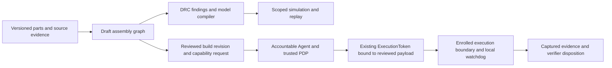

# Central World: Mini Robotics Studio engineering plan

Date: 2026-10-20
Horizon: 19 October 2026–10 January 2027 (12 weeks)
Status: Phase 1/2 offline and first CW-S01 compiler/native-parity slice implemented; real starter readiness and browser/live/hardware gates open

The product direction unifies component authoring, visual assembly, browser
rehearsal and separately governed deployment inside the SeedCore monorepo.
The Phase 1 software foundation is committed as `c16b805`. No hardware is
connected. Do not treat the dates below as release approval.

This master plan owns the calendar and architecture. The
[remaining delivery schedule](central_world_remaining_delivery_schedule.md)
owns CW-A01 through CW-L03 work packages, owner roles and dependency handoffs;
the [acceptance matrix](central_world_acceptance_matrix.md) owns required tests,
measurement records and suggestion traceability. The CW-A01 assembly/joint
v1 draft is committed as `9c5aaf7`. Its
[v2 acceptance closure](central_world_cw_a01_acceptance_plan.md) now addresses
all eight findings with passing local software checks. The
[CW-A02 offline store/import slice](central_world_cw_a02_authoring.md) is now
implemented with local browser/store evidence. The
[CW-A03 placement slice](central_world_cw_a03_snapping.md) adds proxy snapping,
ghosts and atomic numeric/subtree placement; the
[CW-A04 DRC/BOM slice](central_world_cw_a04_drc.md) adds pure worker DRC,
routing proposals, field-linked findings and unknown-aware BOM, closing Phase 2's
offline software scope. CW-S01 now supplies the first restricted compiler slice.
Exact physical catalog data remains an independent open gate.

The [21 October CW-S01 record](central_world_cw_s01_mjcf.md) adds a restricted
primitive compiler and synthetic native parity. A separate versioned offline
readiness check defers only proxy physical fit; the full DRC report and actual
starter remain blocked. This does not deliver a browser MuJoCo worker or close
the real-source/Studio handoff.

The [18-month execution plan](../strategy/seedcore_physical_ai_execution_plan_2026_2028.md)
retains the commercial horizon. [Microduck M0–M5](microduck_integration_plan.md)
retain their native-runtime acceptance meanings. Central World is a product
workstream above them; its CW gates do not rename or close the M stages.

## Outcome and first supported scope

The first alpha lets an adult maker inspect a draft part, assemble one supported
tabletop simulation profile, understand its wiring/power readiness, rehearse a bounded
gesture and export an accurately labeled build record. Native Microduck remains
a separate imported reference. A physical move becomes available only after
that exact board/body/profile passes authority, evidence and hardware acceptance.
Proxy data can support that explicit simulation profile; physical readiness
requires the separate exact-part data review.

The default January target is a useful **simulation/authoring alpha**. A
physical demonstration is a conditional lane. Tuya T5, arbitrary imported
robots, locomotion transfer, a public community write API and universal firmware
are not prerequisites for that first alpha. One lead cannot assume full-time
parallel delivery of this plan, native M2–M4 and custom-engine research; review
capacity weekly, keeping the existing enforcement/evidence gates intact.

## Monorepo ownership and dependency direction

| Surface | Responsibility | Current state |
| --- | --- | --- |
| `packages/component-registry/` | `.sc-part.json` schema, versioned part/asset hashes, source review and local viewer | Implemented draft-only foundation |
| `packages/skill-packages/` | Behavior/policy manifests, observations/actions, compatible model/calibration, licenses and retained evaluation artifacts | Planned; do not duplicate the existing ignored ONNX cache into a distribution |
| `ts/packages/robot-canvas/` | Immutable store, rendering/selection/ghost adapter and pure port alignment proposals, independent of policy state | CW-A02/CW-A03 proxy slice implemented |
| `ts/packages/drc-solver/` | Pure deterministic assembly/electrical/mass checks, typed findings and bounded worker messages | CW-A04 offline slice implemented |
| `ts/packages/wasm-sim-bridge/` | Versioned compiler/runtime adapters, worker lifecycle, clocks and telemetry provenance | CW-S01 restricted compiler/native parity implemented; CW-S02 worker/runtime adapter remains planned |
| `ts/apps/mini-studio/` | Local Central World shell: assembly authoring, placement and DRC/BOM; timeline remains later work | CW-A02–CW-A04 localhost slice; not a deployed site |
| `src/seedcore/robotics/component_registry.py` | Read-only structural, semantic and integrity validation | Implemented; creates no authority |
| Existing Agent Gateway/PDP/HAL and Rust verifier | Independently admitted execution, device enforcement and evidence closure | Shared foundations; custom-build/native/hardware integration still gated |

Keep pure graph/transform/DRC code outside React/Zustand. Application stores own
the UI and immutable draft revisions; they do not become policy state. Use
existing package/workspace tooling and pin dependencies/asset licenses before
adopting a rendering or simulation dependency. Add directories when their first
working slice exists rather than empty packages implying delivered integration.



## Phase 1 delivered baseline

The [component registry](../../../packages/component-registry/README.md)
contains the strict four-block v1 schema, 12 draft records, original hashed GLB
box proxies, port frames, a frozen index and local read-only viewer. Validation
checks units, normalized quaternions, inertia consistency, ranges, unknown-data
handling and file integrity. The existing Microduck body manifest is referenced
and checked without converting or reinterpreting it.

The count is two controller families, two joint-actuator families, two sensors,
one display, a battery and a BEC as separate power entries, and three original
chassis proxies. Every price is unknown; no SKU, board pinout, electrical rating,
commercial mount or hard hardware limit is invented. Runtime binding is null,
qualification is unqualified and execution authority is none.

The software foundation passes schema/semantic checks and renders the authored
proxy geometry. **Actual manufacturer drawing accuracy and mechanical fit stay
open.** These proxies are neither production components nor printable chassis.
Obtain exact SKUs, reviewed drawings and source evidence before closing CW1's
qualified-data gate or advancing a physical design.

## Five engineering pillars and acceptance boundaries

### 1. Component and assembly contracts

The registry README defines units/frames, GLB-to-part conversion, tensor origin,
version/hash ownership, unknown values and contribution review. Add reviewed
connector polarity, signal voltage, bus/protocol details, board pin constraints,
output rail/derating and mounting tolerances before a physical DRC claims a pass.
Sensor mounting frames and calibration must be explicit. Catalog authors cannot
enroll themselves by setting a qualification field.

CW2 adds a separate assembly contract: stable node IDs, immutable part revision
and asset digests, one root, at most one parent per node, unique occupied port
pairs, bounded counts and no cycles. Mechanical edges, electrical nets and
behavior/joint bindings are distinct. Reject missing parts, changed hashes,
disconnected required nodes and incompatible mount genders/standards. Undo/redo
and import preserve exact revisions; never silently repair an invalid graph.

The implemented [assembly v2 contract](../../../packages/component-registry/assemblies/README.md)
provides this offline proxy subset, with exact catalog-byte pins and explicit
proxy output declarations. CW-A02 adds immutable revision history, duplicate-key
safe browser text import and stale asynchronous-result handling around it.

### 2. Magnetic assembly and DRC

Use the 15 mm capture radius as a UI proposal, not evidence of a mechanical fit.
For a child under the selected parent frame:

```text
T_parent_child = T_parent_port · T_mate · inverse(T_child_port)
T_world_child  = T_world_parent · T_parent_child
```

`T_mate` defines opposing outward normals and allowed twist; identity is valid
only for a mount convention explicitly defining coincident frames. Preview a
compatible candidate, then validate the whole graph on drop. Multiple candidates
need deterministic selection/hysteresis. Test transformed parents, quaternion
order, occupied ports, rotated mounts, unit scale and rejected cyclic drops.
Keep a keyboard/numeric placement path alongside dragging.

The pure DRC solver returns **pass / blocked / conflict** with field references
and exact build digest. Unknown data blocks qualification rather than counting
as zero or a permissive voltage range. Findings cannot authorize deployment.

| Check | Required behavior |
| --- | --- |
| UART servo routing | Group by compatible protocol, voltage, duplex/timing and controller capacity; assign stable unique IDs within each device's reviewed range; reject duplicate IDs/resource conflicts. Feetech and Dynamixel are not interchangeable bus drivers. |
| I2C routing | Group by actual bus, logic/pull-up voltage and selectable address; reject collisions without a reviewed address change/mux. Do not infer GPIO availability from a chip family name. |
| GPIO/pinout | Account for input/output modes, reserved USB/flash/PSRAM/boot pins, mux conflicts, connectors and shared peripherals on the exact board. |
| Power | Evaluate each rail, conversion efficiency, simultaneous/stall loads, headroom/derating, wiring/fuses and thermal limits. Include MCU consumption once; mA values at different voltages cannot simply be summed. |
| Recommendations | A distribution board can improve routing/fusing, not increase battery/BEC capacity. Recommend a compatible higher-rated source/regulator or reduced load where required. |
| Mechanics/mass | Check positive inertias, transformed COM/tensors, joint axes, contact/clearance assumptions and mount qualification; do not sum inertia tensors without rotations and parallel-axis terms. |

### 3. Browser simulation, policy and motion timeline

Keep two explicit backends: the existing custom planar 1–3-link Wasm engine for
its supported lessons, and a separately pinned MuJoCo-Wasm adapter for general
MJCF/contact/floating-base models. `tools/mini-sim` does not accept arbitrary
MJCF or simulate biped ground contact. Do not relabel a planar preview as a
Microduck digital twin or supply a silent fallback when general simulation fails.

The [mjswan assessment](mjswan_integration_assessment.md) selects 0.11.9 as a
conditional interactive-runtime candidate for CW-S02/CW-S03. Its MuJoCo 3.11.0
pin differs from this repository's 3.15.0 baseline; its DOM-bound public engine
does not expose the required control veto or worker-owned state/capture contract.
Prove those seams before adopting a runtime dependency. Its reviewed ONNX path
uses Wasm, not WebGPU. Follow the active queue for the current authoring package.

The browser assembly compiler must define inertial/joint frames, axes/ranges,
actuator mapping/gains/limits and fixed versus floating root behavior; sanitize
names and reject unsupported graphs. Keep meshes local/digest-bound. Compare
native MuJoCo compilation and representative FK/mass/limit outputs against the
Wasm engine before enabling a model. Arbitrary uploaded XML, meshes, ZIPs and
policies need bounded parsing/resources and no uncontrolled remote resolution.

A worker owns physics state and simulation time. Separate physics dt,
50 Hz policy ticks and rendering frequency; measure p50/p95 and dropped work on
named devices rather than promising 60 FPS. Pin ONNX bytes and observation/action
adapters. Microduck needs its exact 61/14 order, normalization, home and action
scale plus independent training-reference parity; its policy cannot transfer
automatically to an edited body. Bound outputs, memory, inference deadlines and
model operator/external-data support. Worker isolation is not hardware authority.

Use COOP/COEP and local compatible asset headers when threaded Wasm is selected;
verify `crossOriginIsolated`. An explicitly tested single-thread profile may be
offered where supported. ONNX's proxy-worker option does not support WebGPU;
qualify a worker-owned WebGPU implementation separately. Sources:
[ONNX Runtime flags](https://onnxruntime.ai/docs/tutorials/web/env-flags-and-session-options.html),
[MuJoCo XML reference](https://mujoco.readthedocs.io/en/stable/XMLreference.html).

Test the proposed portal/subdomain/iframe arrangement with its actual parent
and asset origins and isolation policies. A localhost top-level isolation pass
does not qualify an embedded studio on `seedcore.ai`.

For Robot Moments, start with a bounded joint-keyframe schema, visible units,
stable joint IDs, interpolation rules and velocity/acceleration/jerk extrema
checks. Add LEDs as a distinct output stream; no camera capture/egress by default.
Time stretching, loops and edited curves invalidate previous admission/replay
identities. Compile gestures to bounded proposals, never privileged motor tools.

### 4. Governance and meaningful evidence

“Review & freeze build” computes a candidate content digest; it cannot issue a
trusted hardware profile from the browser. A trusted service may sign a reviewed
profile only after checking registered board/body identity, calibrated limits,
runtime/firmware/configuration digests and qualification evidence. Limits are
per resource/joint and intersect hardware, operator/deployment policy and
requested behavior; a global minimum across unrelated components is insufficient.

Use the existing Agent/ActionIntent/PDP/ExecutionToken boundary. Duration,
velocity, workspace and tilt belong to a reviewed versioned payload/profile,
bound by existing digest fields where supported. Do not add fields to the frozen
token constraints or bypass registration, approval context, revocation and
single-use claim checks. Any required contract evolution needs explicit review.
Fresh chunk/heartbeat messages cannot extend admission or revive a fenced run.

Replay UI distinguishes draft, admission denied, simulated, interrupted,
evidence incomplete/quarantined and verified under a named scope. Replace a
global “Verified Safe” badge with facts such as “Simulation evidence verified”
or “Hardware profile qualified” plus exact revision, signer and limitations.
Neither signature validation nor DRC certifies universal physical safety.
The current [session rehearsal](simulation_first_acceptance.md) remains a
host-signed simulation fixture, not live custom-build PDP integration or
production RESULT_VERIFIER closure.

### 5. Export and separately qualified provisioning

First export a design/BOM/DRC record with unknown costs omitted from totals and
an explicit unpriced count. Later build ZIPs need owned/licensed printable CAD,
correct unit labels, safe filenames/size limits, mesh/license inventory,
interactive wiring derived from reviewed nets, CSV formula-injection protection
and reproducible content hashes. A draft pack must not look like approved wiring.

Start firmware qualification with one exact ESP32-S3 board and one TTL arm
profile. Tuya T5 needs its own toolchain/update path; it is outside ESP Web Tools'
listed chip families. Microduck retains its native runtime and controller; a
universal ESP32 image is not a Microduck firmware replacement.
[ESP Web Tools](https://esphome.github.io/esp-web-tools/) owns its manifest and
merged-image requirements, not device enrollment or motor permission.

NVS is a versioned flash format, not raw JSON copied to a partition. Compare any
future browser packer byte-for-byte with a pinned official generator, including
namespace/type/string/blob handling, page boundaries and malformed inputs;
match the actual board partition table and firmware configuration ABI.
Source: [Espressif NVS generator](https://docs.espressif.com/projects/esp-idf/en/stable/esp32s3/api-reference/storage/nvs_partition_gen.html).

The firmware must reject unsigned/unbound or stale configuration and enforce
immutable board limits even if NVS is edited. Bind configuration digest into
enrollment, admission and receipts. Never put enrollment/private signing keys
into public builds or browser-generated partitions. Review every motor ingress,
boot state, watchdog, local stop, signer, reset/replay, update/rollback and
interrupted-flash recovery. Flashing must not enable motion. The existing
release-packet preparer is review tooling, not firmware or a qualified installer.
“Under three minutes” remains an unmeasured onboarding hypothesis.

## 12-week schedule

Dates include the original five phases. Each downstream stage depends on its
gate; a missed gate moves dependent dates. Simulation work may continue while
physical work is blocked, with its profile visibly distinct.

| Week / dates | Main output | Exit evidence / next decision |
| --- | --- | --- |
| 1 · Oct 19–25 | CW1 schema, 12 draft parts, hash/semantic linter, original proxy GLBs, source/license inventory and viewer | Software foundation implemented early on Oct 15; reproduce schema/negative/geometry/viewer checks. List unknown data, not a hardware pass. |
| 2 · Oct 26–Nov 1 | Select exact first board/servo/base; review drawings/ports/ratings and freeze assembly contract | Reviewed provenance/units and mount/pin/rail data for the selected profile. If unavailable, keep CW1 qualified-data gate open and constrain CW2 to proxy assemblies. |
| 3 · Nov 2–8 | CW2 Mini Studio shell and canvas adapter; immutable node/port graph, selection, undo/redo | Pinned dependency/asset review; graph roundtrip, missing revision and cycle/port occupancy tests. No privileged browser credentials. |
| 4 · Nov 9–15 | Magnetic placement, green candidate preview and keyboard placement | Rigid transform/normal/mating tests, transformed-parent cases and atomic rejected drops. Measure completion time with the named starter; two-minute assembly is a target. |
| 5 · Nov 16–22 | Worker DRC, explicit routing proposals, unknown-aware BOM and findings | UART/protocol/ID, I2C address/voltage, GPIO and per-rail negative matrix. Unknown data blocks physical readiness; drawings still required. |
| 6 · Nov 23–29 | CW3 restricted assembly-to-MJCF compiler; native reference comparison | Joint/body/inertia/axis/limit parity, safe asset resolution and unsupported-graph rejection. General MuJoCo Wasm selected/pinned separately. |
| 7 · Nov 30–Dec 6 | Browser MuJoCo worker, runtime profiles and model-bound policy adapter | Native/Wasm parity, bounded resources, missing engine failure, CPU/thread/device measurements; Microduck policy disabled until independent compatibility/training gates pass. |
| 8 · Dec 7–13 | Bounded gesture timeline and scoped simulation replay | Joint/curve extrema, edit invalidation, stop/hidden-tab/fault and complete-capture tests; named-device frame/inference timing report. A custom tabletop gesture is sufficient for alpha. |
| 9 · Dec 14–20 | CW4 reviewed build/profile request and live Agent/PDP admission integration | No browser-issued authority; frozen-token bindings and negative expiry/forgery/replay/revocation/wrong-profile tests at the actual execution boundary. |
| 10 · Dec 21–27 | Design build-pack exporter; conditional ESP32-S3 configuration/installer evaluation | Owned CAD/ZIP/CSV/wiring integrity. Hardware lane requires real reviewed firmware, NVS golden parity, enrollment, recovery and one-servo → three-servo qualification; otherwise release no flasher. |
| 11 · Dec 28–Jan 3 | CW5 curated local gallery manifests, fork provenance, lesson/help and integration candidate | Forks retain source/license and create a new unqualified build revision; old signatures/tokens never transfer. Read-only gallery before user uploads or writes. |
| 12 · Jan 4–10 | Independent maker alpha exercise and launch review | Reproduce inspect/customize/simulate/export on named browsers; privacy/support/asset and deployment review. Public publication is a separate authorized action. Hardware demo only after physical G2 and recovery acceptance. |

## Week 1 tracker and gates

- [x] Four-block schema and bounded, read-only semantic/integrity validator.
- [x] Twelve draft records; battery/BEC separated; unknown ratings/prices explicit.
- [x] Original GLBs, hashed assets, meter/frame conversion, inertia and port checks.
- [x] Microduck native package reference without asset or policy reinterpretation.
- [x] Local read-only viewer with part search, orbit, port orientation and inspection.
- [x] Pinned upstream revisions and license/dependency observations; no copied code.
- [x] Negative tests and local desktop/mobile viewer checks.
- [ ] Select exact supplier SKUs and dated cost/volume evidence; freeze board pins.
- [ ] Verify manufacturer geometry/mounts, sensor frames and electrical ratings.
- [ ] Close CW1 qualified-data review for the one initial physical profile.

| Gate | Required evidence | Permission granted |
| --- | --- | --- |
| CW1 software foundation | Versioned schema/index, draft integrity/semantic checks and authored proxy render tests | Prototype assembly and DRC development using explicitly illustrative data |
| CW1 qualified data | Exact board/parts/drawings/limits/rails and reviewed model/source/license evidence | Treat selected data as inputs to physical DRC; still no execution permission |
| CW2 assembly/DRC | Graph/transform/negative matrix and revision-bound findings | Compile the supported assembly subset for simulation |
| CW3 simulation | Native/browser model parity, compatible policy/gesture, timing/resource/capture reports | Named-profile simulation alpha with scoped outcomes |
| CW4 execution | Live authority enforcement, device enrollment, actual firmware/configuration/watchdog and sufficient physical evidence | Separately supervised hardware attempt on the accepted profile, subject to native/physical gates |
| CW5 launch | Independent maker repeat, artifact/rights/privacy/support/security review and deployment decision | Authorized publication of the reviewed scope; no automatic community write access |

## Source decisions and unresolved risks

The [source review](../../../packages/component-registry/references/upstream-sources.json)
records inspected files and exact revisions:

| Reference | Pin / decision |
| --- | --- |
| [URDF-Studio](https://github.com/OpenLegged/URDF-Studio/tree/23b96e2f3d5b1b68ad9629925d4479e9847d35a5) | Apache-2.0 observed; evaluate the stable canvas package in CW2. Its React 19/R3F 9/Three peer requirements need an explicit workspace integration decision. No fork/import yet. |
| [mjswan](https://github.com/ttktjmt/mjswan/tree/8f57ab5024de57a577c17e6ca7bb3d31f6ae7518) | Conditional 0.11.9 candidate for CW-S02/CW-S03; [source assessment and qualification gates](mjswan_integration_assessment.md). Apache-2.0 observed; no import or runtime qualification yet. |
| [robot-motion-editor](https://github.com/project-instinct/robot-motion-editor/tree/bee9fc67773b80fb5daafed5726498c45e3d0bdc) | No root license found in inspected tree; design reference only. Do not copy code/assets pending permissions; a separately authored timeline may be implemented. |

Open risks are exact catalog data and mechanical qualification, browser
MuJoCo/ONNX parity and performance, missing Microduck training references,
firmware/device trust/recovery, staffing and ongoing native integration.
`studio.seedcore.ai` / `seedcore.ai` are proposed destinations; this pass does not
establish hosting ownership/configuration, contact partners, procure parts,
flash a device, publish community data or deploy a site.
