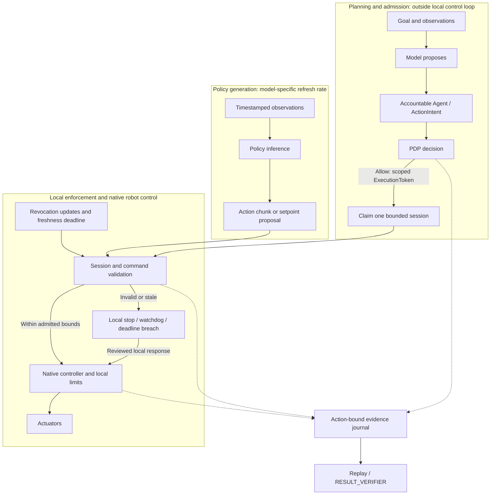

# Embodied AI Application-Layer Architecture Reference

Date: 2026-10-12  
Status: Reviewed research interpretation and proposed integration guidance. No new runtime behavior, token fields, simulator qualification, hardware limits or safety certification is established here.

## Purpose and evidence status

The [archived research report](../reports/embodied_ai_research_report.md) preserves
the external Google Doc and its normalized content digest. Successful ingestion
validates the export format and archive integrity; it does not validate the
report's scientific or implementation claims. This reference records selected
corrections and implications for SeedCore rather than endorsing the full report.

The [robot execution contract](robot_execution_contract.md),
[Microduck integration plan](microduck_integration_plan.md),
[policy gate matrix](../policy_gate_matrix.md) and
[active queue](../current_next_steps.md) retain their scope and precedence.
The Microduck motion adapter and hardware acceptance remain planned work.
Robotics session bindings need schema review; this document adds no fields to
the frozen `ExecutionToken` contract.

```text
model proposes -> accountable Agent -> ActionIntent -> PDP
  -> scoped ExecutionToken -> robot execution boundary
  -> onboard controller attempts action; local safety may refuse or stop
  -> action-bound evidence -> replay / RESULT_VERIFIER
```

---

## 1. Separate planning, policy inference and local control

Separating slower planning from local execution supports SeedCore's existing
boundary design. The report's planning (0.5–5 Hz), policy (20–50 Hz) and embedded
control (500–2000 Hz) ranges are illustrative literature ranges, not a selected
Microduck profile. Action execution frequency must not be read as the frequency
of fresh sensor-conditioned policy inference.

For constant velocity and uncompensated delay, displacement during the delay is
approximately `v * tau`. This illustrates why latency matters; it is not a
general tracking-error model, stability proof or collision criterion.

The following diagram is a proposed integration boundary, not a deployed stack:



| Responsibility | Proposed integration requirement | Evidence needed |
| --- | --- | --- |
| Planning and admission | A model proposes; deterministic PDP evaluation must finish before authority is issued. Admission is outside the motor loop. | Policy decision, principal and endpoint binding; reviewed schema |
| Policy generation | Record observation age, inference latency, chunk horizon and refresh cadence independently of action execution. | Pinned model, observation/action contract and measured traces |
| Edge enforcement | Validate the active session and current commands locally; native robot control owns the motor bus, balance and local safety response. | Adapter negative cases and measured timing for the selected profile |
| Evidence closure | Capture enough action-bound evidence to distinguish completion, interruption and uncertainty without blocking local stops. | Capture coverage, receipts and independent verifier outcome |

---

## 2. Timing budgets require a measured profile

The source report proposes the following **illustrative allocation** for a
hypothetical pipeline that completes a fresh sensor-to-action cycle at 50 Hz.
These numbers are not measured SeedCore performance or hardware acceptance limits.

| Stage | Illustrative allocation | Required qualification |
| --- | ---: | --- |
| Sensor acquisition and transfer | 4.0 ms | Exposure, timestamps, transfer and observation age |
| Preprocessing | 1.5 ms | Actual preprocessing and placement of visual encoding |
| Complete policy inference | 10.5 ms | All encoders and sampling steps for the selected model and precision |
| Local enforcement and applicable kinematics | 1.5 ms | Session checks and robot-specific constraints |
| Command dispatch | 1.5 ms | Actual transport, queueing and actuator interface |
| Scheduling margin | 1.0 ms | Measured load, jitter, deadline misses and response |
| Total | 20.0 ms | Arithmetic allocation only; no frequency guarantee |

The [original π0 paper, Appendix A-D](https://arxiv.org/html/2410.24164v1)
reports 73 ms onboard inference on an RTX 4090 and 86 ms including off-board
network latency. Its 50 Hz robots execute 25 actions between inference calls
every 0.5 seconds; its 20 Hz robots refresh every 0.8 seconds. It uses ten flow
integration steps. Those results do not support a 10.5 ms full-inference budget
or fresh visual feedback for every 50 Hz action.

In practice, production mini-robotics does not require a monolithic model to infer in 10.5 ms. Instead, it relies on the **"Slow Brain, Fast Spine"** architecture: high-level policies (ACT / Diffusion / Flow Matching) run at 2–10 Hz on a host laptop, smartphone, or cloud, generating receding-horizon action chunks (30–50 future waypoints), while a lightweight microcontroller Spine (ESP32 / RP2040) executes smooth C++ spline interpolation at 200–500 Hz over standard UART/serial buses. See the [Mini-Robotics Developer Blueprint](mini_robot_developer_blueprint.md) for concrete implementation details.

For each SeedCore profile, specify sensor cadence, observation age, inference
refresh, action consumption, native control period and authority-enforcement
deadlines separately. Measure latency distributions and deadline misses under
the stated load. Define chunk underrun, stale observation and interruption
behavior. Quantization, zero-copy transport and real-time scheduling are
candidate optimizations whose benefits require measurement on the selected
hardware; none establishes a timing guarantee by itself.

### Admission caching and continuing enforcement

Network PDP calls, remote database access and evidence upload stay outside the
local control loop. Initial cryptographic validation and session admission may
produce locally cached authority state. That cache must remain subject to the
[execution contract's session rules](robot_execution_contract.md#session-lifecycle-and-time):

- Claim a single-use token once for one session; command refreshes carry an
  authenticated session binding and monotonically increasing sequence.
- Reject duplicate, stale or changed bindings, including endpoint, policy and
  admitted command scope. Refresh cannot widen scope or revive a terminal session.
- Derive a non-increasing local monotonic deadline from admitted expiry and
  bounded clock skew. Enforce expiry and maximum session duration independently.
- Check latest-command age independently of transport heartbeat or buffered
  trajectory availability. A live connection does not establish fresh intent.
- Enforce both observed revocation and the maximum permitted age of revocation
  state. A clear cached flag cannot authorize indefinite disconnected execution.
- On a bound violation, terminate the attempt through the reviewed local
  response and capture the outcome. Reconnection cannot replay stale motion;
  renewed work requires valid admission and reconciliation.

These checks need explicit local deadlines even when scheduled separately from
the native motor controller. A remote revocation cannot arrive instantaneously
during a partition; the profile must bound disconnected authority and reject
new remote sessions against stale authority context. These are integration
requirements, not a claim that the pending adapter implements them.

---

## 3. The Paradigm Shift: Industrial Giants vs. DIY & Mini-Robotics

The state-of-the-art literature and industrial blueprints—reflected across models like OpenVLA, $\pi_0$, HumanPlus, and industrial collaborative cells—are designed around **heavy, high-inertia industrial and humanoid platforms** (e.g., Franka Emika Panda, Unitree H1, Boston Dynamics, UR5). These systems operate in environments where physical mistakes carry catastrophic physical, financial, and legal consequences.

When pivoting to the **DIY, maker, and mini-robotics field (desktop companions, educational kits, tabletop manipulators, and kid-safe embodiments like Microduck)**, the fundamental constraints of robotics change completely. Rather than attempting to shrink down a factory robot, building a mini-robotics ecosystem requires an inverted set of design priorities:

### Comparative Architecture Matrix

| Architectural Dimension | Classical Giant Robotics (Industrial / Enterprise) | DIY & Mini-Robotics (Desktop / Maker / Kids) |
| :--- | :--- | :--- |
| **Physical Hazard Profile** | High mass (15–100+ kg), high torque (20–150+ Nm). High risk of crushing and impact injuries. | **Featherweight (< 500g – 2 kg), micro-torque (< 0.2–2 Nm).** Inherent, passive mechanical safety. |
| **Safety Paradigm** | **Active Enforced Containment:** C++ geofencing, optical light curtains, ISO 10218 / ISO/TS 15066 140N force clamping. | **Safe-by-Physics:** Actuator stall torque cannot break human skin or living room objects. Passive compliance via 3D-printed PETG/PLA/flexible TPU. |
| **Compute & Power Envelope** | Heavy onboard SoCs (Jetson AGX Orin, 60W+) or remote multi-GPU servers (8x H100s). High thermal and battery load. | **Ultra-low power microcontrollers:** ESP32, RP2040, STM32, or host smartphones/Chromebooks. Battery: 5V USB / 2S LiPo (7.4V). |
| **Communication Bus** | Industrial fieldbuses: CAN-FD (5 Mbps), EtherCAT (100 Mbps), industrial MIPI CSI-2 camera DMA (<3.5ms). | **Consumer serial & Web APIs:** UART/RS-485 serial bus (1 Mbps), USB-CDC, WebSerial, BLE, Wi-Fi WebSocket. |
| **Simulation & Tooling** | Heavy local Linux workstation dependencies, complex ROS 2 distributions, NVIDIA Isaac Sim / Omniverse. | **Browser-Native & Zero-Install:** C++/Wasm simulation (e.g., MuJoCo compiled to WebAssembly), WebGPU rendering, runs on any Chromebook/laptop. |
| **Model Strategy** | Monolithic 7B–70B parameter generalist VLAs running on remote cloud clusters. | **Hierarchical Edge-Microbrains:** Lightweight policies (ACT, Diffusion Policy, Octo-Small at 27M–93M) or cloud VLM planners dispatching bounded motor chunks to edge controllers. |
| **Data Collection** | $100k+ optical motion-capture rigs, master-slave industrial teleop arms, dedicated data facilities. | **Maker Teleoperation:** Passive 3D-printed leader arms (like SO-100), browser webcams, smartphone AR, gamepads, hand-pose vision via MediaPipe. |
| **Trust & Governance** | Rigid industrial PLC interlocks, closed proprietary firmware safety gates. | **SeedCore Verifiable Governance:** Policy-bounded execution, cryptographically signed receipts, scoped capability tokens, and parental/teacher supervision. |
| **Cost Profile** | $15,000 – $150,000+ per unit. | **$50 – $300 total Bill of Materials (BOM).** |

---

### Core Distinctions for the Mini & DIY Field

#### 1. Inherent "Safe-by-Physics" vs. Active Industrial Containment
- **Industrial Reality:** If a 7B foundation model driving a Franka Panda hallucinates an arm trajectory, the arm can punch through a workstation at 2 m/s. It requires complex C++ real-time supervisor threads (`SCHED_FIFO`) enforcing ISO/TS 15066 force clamps and virtual geofences.
- **The Mini/Kid-Friendly Advantage:** A robot like **Microduck** or a desktop arm driven by micro serial bus servos (e.g., Feetech STS3215 or 9g micro-servos) possesses very low mechanical inertia. If the policy outputs an erratic trajectory, the motor simply stalls against a toy block or a child's hand without injury.
- **Engineering Impact:** You do not need millisecond-level hard-real-time emergency braking PLCs to protect human life. Safety shifts from **kinetic hazard prevention** to **behavioral and permission governance** (e.g., preventing inappropriate actions, protecting privacy, bounding workspace exploration, and ensuring parental/educator control).

#### 2. The Communication & Latency Reality: Embracing "Slow Brain, Fast Spine"
- **Industrial Reality:** Demands a rigid 20ms end-to-end loop over MIPI CSI-2 and EtherCAT to prevent phase lag oscillations on heavy arms.
- **The Mini/DIY Reality:** Mini-robots communicate over USB serial, WebSerial, or BLE, which inherently incur 15–40 ms of jitter.
- **The Solution:** Rather than fighting this bus jitter with expensive industrial transceivers, adopt **receding-horizon action chunking** (as proven by $\pi_0$ and ACT):
  - **The Brain (Cloud/Local Host/Browser):** Runs a compact model (or receives high-level cloud VLM plans) and emits a chunk of 30–50 future waypoints (covering 0.5–1.0s) every few hundred milliseconds.
  - **The Spine (Onboard ESP32/RP2040):** A deterministic C++ spline interpolator running locally at 200–500 Hz executes the waypoints smoothly over standard UART/serial. If a communication drop occurs, the spine smoothly brings the robot to a resting posture.

#### 3. Browser-First Simulator & Web Workbench vs. Heavy Linux Tooling
- **Industrial Friction:** Classical robotics development requires Ubuntu LTS, ROS 2 workspace configuration, CUDA toolchains, and NVIDIA Isaac Sim—an insurmountable barrier for children, students, and hobbyist makers.
- **SeedCore's Edge:** SeedCore’s direction—**C++/Wasm physics compilation and browser-delivered MuJoCo workbenches**—is the ideal technical approach for this space:
  - *Zero-install:* Anyone can open a URL on a Chromebook, Mac, or Windows machine.
  - *Resumable checkpoints:* Kids and makers can test robot gaits, run experiments, and inspect digital twins in the browser.
  - *Deterministic qualification:* Validating numerical agreement between native MuJoCo and browser Wasm ensures that skills trained or qualified in the browser transfer cleanly to physical devices like Microduck.

#### 4. Trust Runtime & Verifiable Governance: The Missing Piece for Kids' Robotics
Classical robotics assumes either an isolated factory cage or full user trust. In a consumer, school, or kids' environment, autonomous physical agents introduce new risks: privacy leaks, unvetted model outputs, and unauthorized physical actions. This is where **SeedCore’s Trust Runtime** becomes the defining layer:
- **Scoped Capability Tokens:** The AI policy does not have raw, unchecked access to the motors. It requests a motion session (e.g., *"Walk forward 10 cm to inspect toy"*).
- **Action-Bound Evidence & Receipts:** Every physical movement is cryptographically bounded, verified, and logged into a replayable receipt. Parents and developers can see exactly why the robot moved, what sensor data triggered it, and whether it complied with policy.
- **Revocation at the Boundary:** If an action exceeds safe operational limits (e.g., edge-of-table detection, tilt limits, or explicit human pause), the SeedCore boundary revokes the token instantly at the command interface.

---

## 4. Evaluate action representations: Continuous vs discrete for mini-bots

Discrete action tokenization introduces quantization whose physical resolution
depends on action units, ranges and normalization. On mini-robots with plastic
geartrains, excessive quantization steps can induce chatter and motor hunting.

ACT, diffusion and flow matching are candidate policy families. Diffusion and
flow matching can represent multimodal action distributions, but their sampling
procedures and step counts differ. A straight interpolation used in a flow
training objective does not guarantee a straight learned sampling path or a
jerk-bounded physical trajectory. Continuous outputs alone do not enforce
collision avoidance, actuator limits, stability or smoothness.

Compare candidates using task success, inference cost, observation age, command
continuity and out-of-distribution behavior. Apply explicit trajectory and
controller constraints where required. SeedCore does not require diffusion or
flow matching for fluid motion. The first Microduck biped integration starts
with a compatible pinned upstream policy; a new VLA or training pipeline is not
a prerequisite for M0–M3.

---

## 5. Local limits and stop behavior: Shifting from kinetic containment to behavioral governance

On lightweight mini-robots, physical stopping does not risk crushing human operators, but predictable local limits remain essential for mechanical longevity and operator confidence:

| Concern | Required review and evidence | Mini-Robotics Adaptation |
| :--- | :--- | :--- |
| Workspace and kinematics | Validate applicable workspace, collision and joint constraints. Any projection or clamping must preserve admitted semantics. | Prevent tipping off tabletops or twisting 3D-printed limbs beyond physical joint stops. |
| Velocity, acceleration and jerk | Check explicit extrema and transitions for the executed trajectory. | Protect small plastic servo geartrains (e.g., STS3215 / BAM M6) from shock stripping. |
| Power and force limiting | Determine contact force limits by body region and contact type. | Leverages passive mechanical compliance and low stall torque (<1–2 Nm). |
| Local interruption | Specify and measure detection delay, response initiation, physical stopping time/distance and resulting posture. | Local MCU safe-posture settling when communication or token expires. |

The report's 140 N quasi-static / 280 N transient pair is **an industrial collaborative standard (ISO/TS 15066)**, not a mini-robot spec. For tabletop and kid-safe robots, forces are naturally capped under 5–10 N by motor sizing. Safety governance therefore focuses on **permission scoping, behavioral bounding, and verifiable evidence closure**.

---

## 6. Reward synthesis and simulation workbench

[Eureka](https://eureka-research.github.io/) studies LLM-generated rewards, and
[DrEureka](https://eureka-research.github.io/dr-eureka/) extends the approach to
sim-to-real transfer through reward design and domain randomization. Their
demonstrations do not guarantee transfer to another robot or task.

SeedCore's [MuJoCo workbench](mujoco_development_workbench.md) currently provides
bounded passive, constant-torque and PD-controller experiments. Its agent helper
proposes constrained parameters and interprets recorded checks. The
[model-package loader](model_package_ingestion.md) verifies assets and compiled
model parity. Neither provides an automated reward-generation or RL-training
pipeline, and package integrity does not establish physical fidelity.

A future reward-synthesis experiment would need a separately reviewed training
interface, resource bounds, reproducible baseline/candidate evaluation, sim-to-real
measurements and rollback artifacts. Training results remain advisory;
policy installation and physical execution require their own admission. This
research does not complete M0–M3 or implement the proposed
[skill-package contract](robot_skill_contract.md).

---

## 7. Framework reading map

This is a research reading map, not a deployment benchmark or list of SeedCore
integrations:

| Reference | Question for SeedCore research | Qualification boundary |
| :--- | :--- | :--- |
| LeRobot / ACT / Diffusion Policy | How to collect demonstrations and compare task-specific policies? | Evaluate the selected policy, dataset, body and runtime |
| π0 | How to combine visual-language representations with continuous action chunks? | Separate inference refresh from action rate; original measurements are cited above |
| OpenVLA | What are the tradeoffs of tokenized actions and semantic transfer? | Measure precision and throughput rather than inferring gear wear or a universal rate ceiling |
| Mobile ALOHA | How do teleoperation and co-training support mobile manipulation? | Its embodiment and tasks do not establish Microduck readiness |
| Eureka / DrEureka | Can automated reward design help a bounded future training study? | Research extension; no reward-training integration or guaranteed transfer |

---

## 8. Application to SeedCore's Microduck milestone

SeedCore's active proof point—**"One governed Microduck movement with verifiable evidence"**—grounds this paradigm shift in three concrete technical focus areas:

1. **Lightweight Kinematic Models (MJCF/URDF for Mini-Bots):**
   - Maintain pinned, versioned models of Microduck in MuJoCo, optimized for fast Wasm evaluation.
   - Parameter tuning for small-scale physical dynamics (plastic gear backlash, low-friction feet, micro-servo deadbands).
2. **The Command Boundary Integration:**
   - Map the SeedCore Trust Runtime (scoped token $\rightarrow$ verified policy check $\rightarrow$ cryptographic receipt) directly to the Microduck serial/BLE command bridge.
   - Ensure the robot's local microcontroller verifies the token before executing motor setpoints.
3. **Action-Bound Telemetry:**
   - Record golden observation datasets from the browser simulator and compare them against physical Microduck execution telemetry to generate audit receipts.

This separates SeedCore from industrial robotics stacks: rather than building high-power, hazardous industrial arm controllers, SeedCore is architecting a **verifiable, safe, browser-accessible operating foundation for the coming wave of desktop and mini-robotics**.

---

## Related documentation

- [External report](../reports/embodied_ai_research_report.md): preserved source claims and archive digest.
- [Physical AI strategy](physical_ai_strategy.md): product scope, market positioning and governance boundaries.
- [Microduck integration plan](microduck_integration_plan.md): active milestone gates M0–M5.
- [Robot execution contract](robot_execution_contract.md): proposed execution, admission, and session contracts.
- [Mini robot simulator plan](mini_robot_simulator_implementation_plan.md): C++/Wasm browser physics architecture.
- [Mini-robotics developer blueprint](mini_robot_developer_blueprint.md): concrete $150 BOM, C++ MCU spine pattern, and WebSerial deployment.
- [MuJoCo development workbench](mujoco_development_workbench.md): native MuJoCo simulation environment and evaluation tools.
