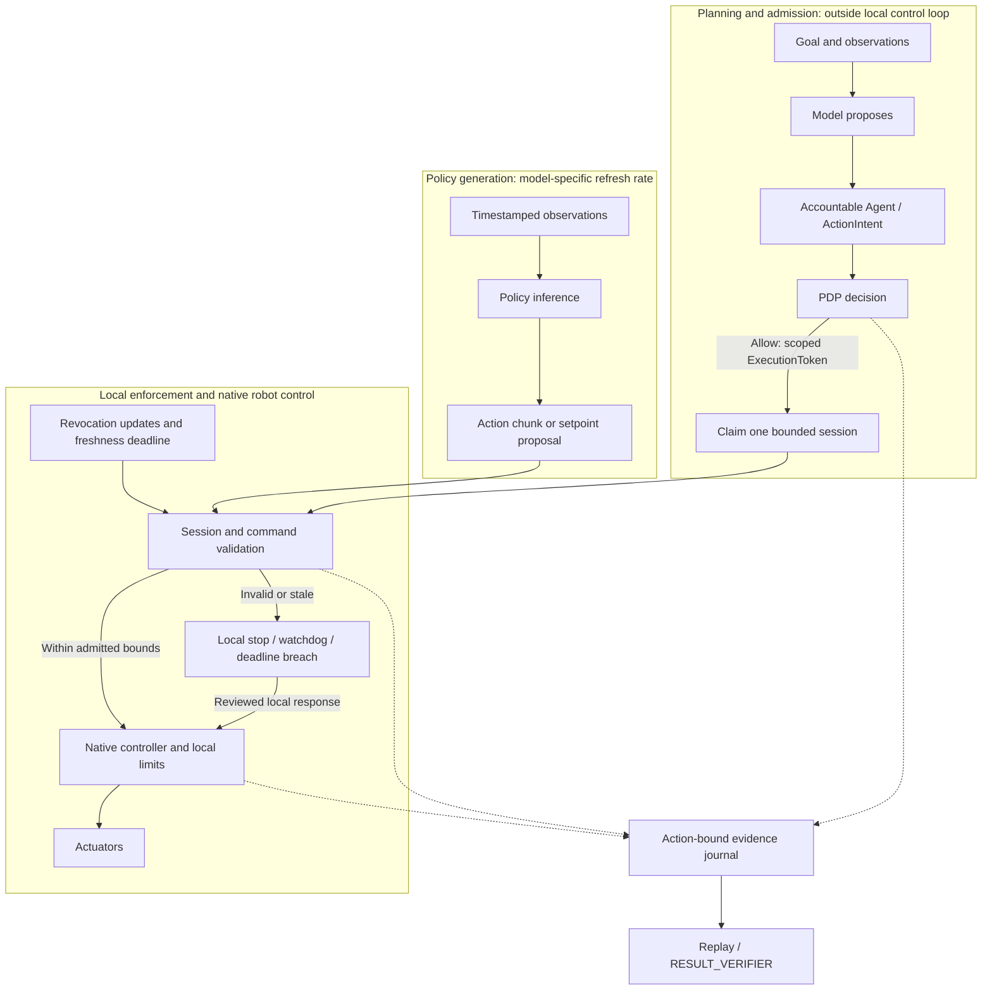

# Embodied AI Application-Layer Architecture Reference

Date: 2026-10-14
Status: Reviewed research interpretation and proposed integration guidance. No new runtime behavior, token fields, simulator qualification, hardware limits or safety certification is established here.

## Purpose and evidence status

The [archived research report](../reports/embodied_ai_research_report.md) preserves
the external Google Doc and its normalized content digest. Successful ingestion
validates the export format and archive integrity; it does not validate the
report's scientific or implementation claims. This reference records selected
corrections and implications for SeedCore rather than endorsing the full report.

The [robot execution contract](robot_execution_contract.md),
[Microduck integration plan](microduck_integration_plan.md),
[policy gate matrix](../policy_gate_matrix.md) and
[active queue](../current_next_steps.md) retain their scope and precedence.
The Microduck motion adapter and hardware acceptance remain planned work.
Robotics session bindings need schema review; this document adds no fields to
the frozen `ExecutionToken` contract.

```text
model proposes -> accountable Agent -> ActionIntent -> PDP
  -> scoped ExecutionToken -> robot execution boundary
  -> onboard controller attempts action; local safety may refuse or stop
  -> action-bound evidence -> replay / RESULT_VERIFIER
```

---

## 1. Separate planning, policy inference and local control

Separating slower planning from local execution supports SeedCore's existing
boundary design. The report's planning (0.5–5 Hz), policy (20–50 Hz) and embedded
control (500–2000 Hz) ranges are illustrative literature ranges, not a selected
Microduck profile. Action execution frequency must not be read as the frequency
of fresh sensor-conditioned policy inference.

For constant velocity and uncompensated delay, displacement during the delay is
approximately `v * tau`. This illustrates why latency matters; it is not a
general tracking-error model, stability proof or collision criterion.

The following diagram is a proposed integration boundary, not a deployed stack:



| Responsibility | Proposed integration requirement | Evidence needed |
| --- | --- | --- |
| Planning and admission | A model proposes; deterministic PDP evaluation must finish before authority is issued. Admission is outside the motor loop. | Policy decision, principal and endpoint binding; reviewed schema |
| Policy generation | Record observation age, inference latency, chunk horizon and refresh cadence independently of action execution. | Pinned model, observation/action contract and measured traces |
| Edge enforcement | Validate the active session and current commands locally; native robot control owns the motor bus, balance and local safety response. | Adapter negative cases and measured timing for the selected profile |
| Evidence closure | Capture enough action-bound evidence to distinguish completion, interruption and uncertainty without blocking local stops. | Capture coverage, receipts and independent verifier outcome |

---

## 2. Timing budgets require a measured profile

The source report proposes the following **illustrative allocation** for a
hypothetical pipeline that completes a fresh sensor-to-action cycle at 50 Hz.
These numbers are not measured SeedCore performance or hardware acceptance limits.

| Stage | Illustrative allocation | Required qualification |
| --- | ---: | --- |
| Sensor acquisition and transfer | 4.0 ms | Exposure, timestamps, transfer and observation age |
| Preprocessing | 1.5 ms | Actual preprocessing and placement of visual encoding |
| Complete policy inference | 10.5 ms | All encoders and sampling steps for the selected model and precision |
| Local enforcement and applicable kinematics | 1.5 ms | Session checks and robot-specific constraints |
| Command dispatch | 1.5 ms | Actual transport, queueing and actuator interface |
| Scheduling margin | 1.0 ms | Measured load, jitter, deadline misses and response |
| Total | 20.0 ms | Arithmetic allocation only; no frequency guarantee |

The [original π0 paper, Appendix A-D](https://arxiv.org/html/2410.24164v1)
reports 73 ms onboard inference on an RTX 4090 and 86 ms including off-board
network latency. Its 50 Hz robots execute 25 actions between inference calls
every 0.5 seconds; its 20 Hz robots refresh every 0.8 seconds. It uses ten flow
integration steps. Those results do not support a 10.5 ms full-inference budget
or fresh visual feedback for every 50 Hz action.

For the proposed **"Slow Brain, Fast Spine"** fixture, evaluate bounded action
chunks and 200–500 Hz local interpolation instead of tying every control tick
to model inference. These are engineering candidates, not current SeedCore
firmware or universal robot timing. The
[developer blueprint](mini_robot_developer_blueprint.md) records the selected
profile and qualification work.

For each SeedCore profile, specify sensor cadence, observation age, inference
refresh, action consumption, native control period and authority-enforcement
deadlines separately. Measure latency distributions and deadline misses under
the stated load. Define chunk underrun, stale observation and interruption
behavior. Quantization, zero-copy transport and real-time scheduling are
candidate optimizations whose benefits require measurement on the selected
hardware; none establishes a timing guarantee by itself.

### Admission caching and continuing enforcement

Network PDP calls, remote database access and evidence upload stay outside the
local control loop. Initial cryptographic validation and session admission may
produce locally cached authority state. That cache must remain subject to the
[execution contract's session rules](robot_execution_contract.md#session-lifecycle-and-time):

- Claim a single-use token once for one session; command refreshes carry an
  authenticated session binding and monotonically increasing sequence.
- Reject duplicate, stale or changed bindings, including endpoint, policy and
  admitted command scope. Refresh cannot widen scope or revive a terminal session.
- Derive a non-increasing local monotonic deadline from admitted expiry and
  bounded clock skew. Enforce expiry and maximum session duration independently.
- Check latest-command age independently of transport heartbeat or buffered
  trajectory availability. A live connection does not establish fresh intent.
- Enforce both observed revocation and the maximum permitted age of revocation
  state. A clear cached flag cannot authorize indefinite disconnected execution.
- On a bound violation, terminate the attempt through the reviewed local
  response and capture the outcome. Reconnection cannot replay stale motion;
  renewed work requires valid admission and reconciliation.

These checks need explicit local deadlines even when scheduled separately from
the native motor controller. A remote revocation cannot arrive instantaneously
during a partition; the profile must bound disconnected authority and reject
new remote sessions against stale authority context. These are integration
requirements, not a claim that the pending adapter implements them.

---

## 3. Affordable Mini-Robotics: Reference Constraints

The active direction targets maker, tabletop and supervised educational kits.
Select architecture from a measured body/runtime profile rather than assuming
that industrial robots need one uniform stack or small robots are harmless.
The [18-month execution plan](../strategy/seedcore_physical_ai_execution_plan_2026_2028.md)
sets adoption targets; it does not establish hardware acceptance.

### Comparative Architecture Matrix

| Dimension | Profile decision for SeedCore |
| --- | --- |
| Mechanical envelope | Measure mass, torque, pinch/contact, fall and load behavior. Passive compliance reduces some hazards but does not certify safety. |
| Compute | Keep model planning on a reviewed host/cloud path and local execution on the existing controller or qualified MCU. |
| Bus | Qualify part-specific electrical and protocol behavior. STS3215 is TTL; RS-485 is a separate servo/profile option. |
| Timing | Separate planning refresh, interpolation, bus transactions, telemetry, authority freshness and observed stopping. |
| Browser tools | Current C++/Wasm lessons and planar 1/2/3-link studio need no learner installation. Microduck uses the separately pinned native MuJoCo path. |
| Permissions | Existing PDP/token/revocation primitives need enforcement at the actual robot ingress; camera/egress paths need their own controls. |
| Evidence | Captured state and signer provenance support replay under declared coverage. An ACK, hash or valid signature alone does not prove physical completion. |
| Cost | Selected kit below $300 and controller BOM of $12 are quoted/qualified design targets with exclusions, not established Microduck prices. |

### Slow Brain, Fast Spine

Receding-horizon chunks can separate model inference from local trajectory
execution. Evaluate a 200 Hz interpolation baseline and 500 Hz target on one
MCU while measuring chunk refresh, queue limits, bus writes/reads and watchdog
deadlines independently. Exact latency/jitter depends on the host, browser,
transport, board and traffic; fixed 15–40 ms examples are not accepted limits.

Microduck retains `robotd` balance/control and sole bus ownership. The
[Fast Spine protocol](fast_spine_protocol_spec.md) proposes authenticated MCU
sessions for a separate arm fixture. Its implementation is not present, and it
must not introduce a raw remote motor bypass into the native Microduck profile.

### Browser Simulation And Physical Transfer

The delivered 13,242-byte dual-ABI Wasm module handles fixed-base planar arms.
Its orbit view is 3D presentation, not general spatial/contact dynamics.
Broad SIM-3 gates and SIM-4–SIM-6 remain independently qualified research.
The planar engine is not a browser MuJoCo build or a Microduck digital twin.

Native/Wasm numerical agreement supports consistency for the tested model; it
does not ensure sim-to-real transfer. Physical servo calibration, backlash,
contact and observation semantics require separate measurement. State JSON
exports from the narrow tree studio are not signed hardware receipts or
restorable replay checkpoints.

### Governance For Supervised Lessons

Use an accountable Agent, scoped admission, authenticated command/session
binding, independent local interruption and action-bound captured evidence.
A model or browser client cannot mint authority. Deny out-of-envelope proposals
or explicitly re-admit any changed trajectory under reviewed transform rules.

The teacher/operator experience should explain what was permitted, attempted,
interrupted and verified. Current browser lessons have no gateway/hardware
connection; physical claims require the named profile's acceptance. Privacy
controls must cover actual capture/storage/egress, separately from motor tokens.
Remote revocation has a measured propagation deadline, including a bounded
disconnected authority window; local stop remains independent of the network.

---

## 4. Evaluate action representations: Continuous vs discrete for mini-bots

Discrete action tokenization introduces quantization whose physical resolution
depends on action units, ranges and normalization. On mini-robots with plastic
geartrains, excessive quantization steps can induce chatter and motor hunting.

ACT, diffusion and flow matching are candidate policy families. Diffusion and
flow matching can represent multimodal action distributions, but their sampling
procedures and step counts differ. A straight interpolation used in a flow
training objective does not guarantee a straight learned sampling path or a
jerk-bounded physical trajectory. Continuous outputs alone do not enforce
collision avoidance, actuator limits, stability or smoothness.

Compare candidates using task success, inference cost, observation age, command
continuity and out-of-distribution behavior. Apply explicit trajectory and
controller constraints where required. SeedCore does not require diffusion or
flow matching for fluid motion. The first Microduck biped integration starts
with a compatible pinned upstream policy; a new VLA or training pipeline is not
a prerequisite for M0–M3.

---

## 5. Local Limits And Stop Behavior

Low mass does not remove force, pinch, electrical or fall hazards. Freeze limits
from the selected mechanism, load and controller before supervised operation.

| Concern | Required evidence |
| --- | --- |
| Workspace / kinematics | Applicable path, collision and joint constraints; check the whole executed spline and any admitted transform |
| Velocity / acceleration / jerk | Extrema and transitions within the reviewed envelope |
| Power / force | Actual servo supply, load, contact and thermal behavior; no force guarantee inferred from stall torque alone |
| Local interruption | Detection delay, response initiation, observed stopping time/distance and resulting posture measured separately |
| Lost communication | Body-specific hold/deceleration/torque-off behavior and bounded authority lifetime; no automatic resume |

Industrial collaborative-robot force examples in the research report do not
define this profile's limits. Do not substitute unsupported “naturally capped”
contact-force numbers or a safe-by-physics claim for measurements.

---

## 6. Reward synthesis and simulation workbench

[Eureka](https://eureka-research.github.io/) studies LLM-generated rewards, and
[DrEureka](https://eureka-research.github.io/dr-eureka/) extends the approach to
sim-to-real transfer through reward design and domain randomization. Their
demonstrations do not guarantee transfer to another robot or task.

SeedCore's [MuJoCo workbench](mujoco_development_workbench.md) currently provides
bounded passive, constant-torque and PD-controller experiments. Its agent helper
proposes constrained parameters and interprets recorded checks. The
[model-package loader](model_package_ingestion.md) verifies assets and compiled
model parity. Neither provides an automated reward-generation or RL-training
pipeline, and package integrity does not establish physical fidelity.

A future reward-synthesis experiment would need a separately reviewed training
interface, resource bounds, reproducible baseline/candidate evaluation, sim-to-real
measurements and rollback artifacts. Training results remain advisory;
policy installation and physical execution require their own admission. This
research does not complete M0–M3 or implement the proposed
[skill-package contract](robot_skill_contract.md).

---

## 7. Framework reading map

This is a research reading map, not a deployment benchmark or list of SeedCore
integrations:

| Reference | Question for SeedCore research | Qualification boundary |
| :--- | :--- | :--- |
| LeRobot / ACT / Diffusion Policy | How to collect demonstrations and compare task-specific policies? | Evaluate the selected policy, dataset, body and runtime |
| π0 | How to combine visual-language representations with continuous action chunks? | Separate inference refresh from action rate; original measurements are cited above |
| OpenVLA | What are the tradeoffs of tokenized actions and semantic transfer? | Measure precision and throughput rather than inferring gear wear or a universal rate ceiling |
| Mobile ALOHA | How do teleoperation and co-training support mobile manipulation? | Its embodiment and tasks do not establish Microduck readiness |
| Eureka / DrEureka | Can automated reward design help a bounded future training study? | Research extension; no reward-training integration or guaranteed transfer |

---

## 8. Application To SeedCore's Microduck Milestone

1. Use the pinned native MJCF package and add the selected scene, actuator,
   policy and normalization profile. Current browser planar lessons do not
   provide Microduck golden observations.
2. Map bounded intent/session authority to the native RPC/`robotd` path.
   Preserve local balance/safety and sole bus ownership; test alternative ingress
   instead of claiming that a serial/BLE link establishes enforcement.
3. Capture action-bound observations with sequence/time coverage, policy/runtime
   identity and an enrolled signer. Compare simulation and hardware separately;
   missing evidence cannot become successful closure.
4. Keep the arm's proposed WebSerial MCU path a bounded bench fixture with its
   own physical acceptance. It does not complete Microduck M4.

M1/M2 target Q4 2026 and M3/M4 target Q1 2027; minimum evidence and hardware
gates precede anything shown physically. The dates are planning targets in the
[execution plan](../strategy/seedcore_physical_ai_execution_plan_2026_2028.md).

---

## Related documentation

- [External report](../reports/embodied_ai_research_report.md): preserved source claims and archive digest.
- [Physical AI strategy](physical_ai_strategy.md): product scope, market positioning and governance boundaries.
- [Microduck integration plan](microduck_integration_plan.md): active milestone gates M0–M5.
- [Robot execution contract](robot_execution_contract.md): proposed execution, admission, and session contracts.
- [Mini robot simulator plan](mini_robot_simulator_implementation_plan.md): C++/Wasm browser physics architecture.
- [Mini-robotics developer blueprint](mini_robot_developer_blueprint.md): concrete $150 BOM, C++ MCU spine pattern, and WebSerial deployment.
- [MuJoCo development workbench](mujoco_development_workbench.md): native MuJoCo simulation environment and evaluation tools.
