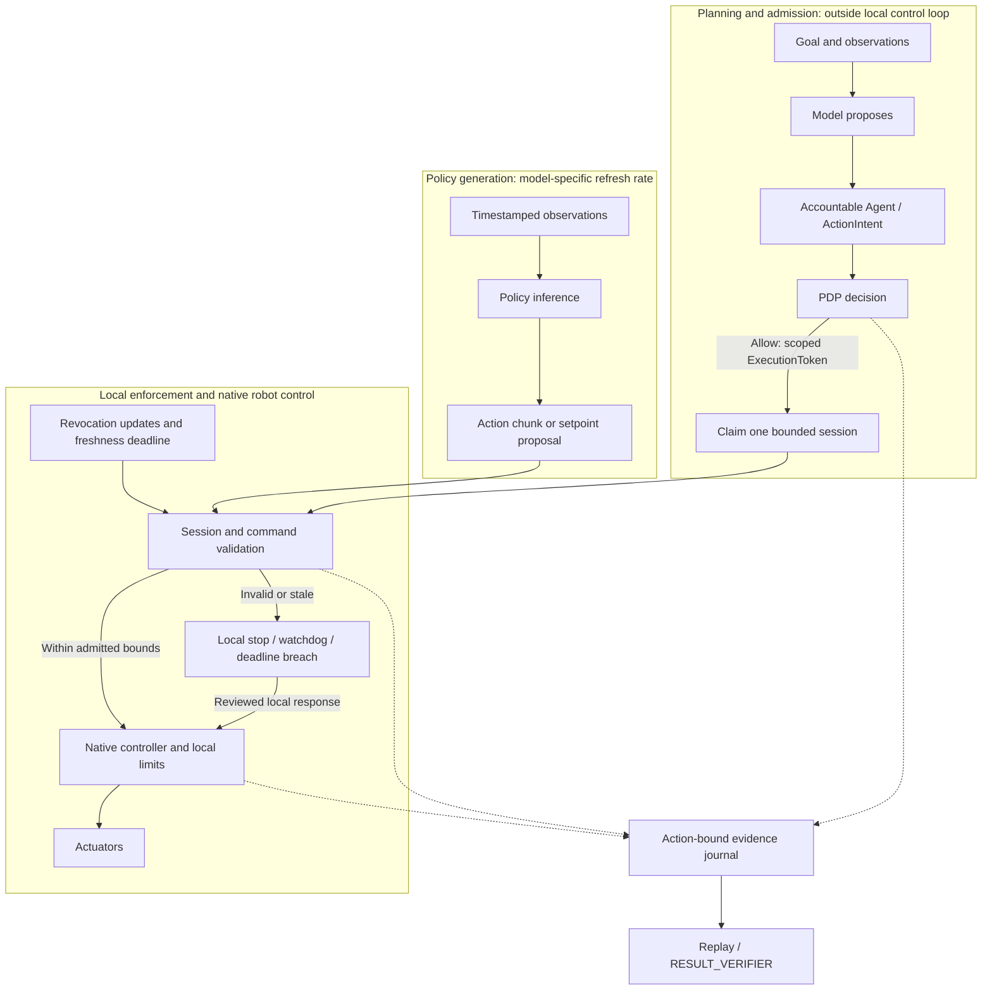

# Embodied AI Application-Layer Architecture Reference

Date: 2026-10-12  
Status: Reviewed research interpretation and proposed integration guidance. No new runtime behavior, token fields, simulator qualification, hardware limits or safety certification is established here.

## Purpose and evidence status

The [archived research report](../reports/embodied_ai_research_report.md) preserves
the external Google Doc and its normalized content digest. Successful ingestion
validates the export format and archive integrity; it does not validate the
report's scientific or implementation claims. This reference records selected
corrections and implications for SeedCore rather than endorsing the full report.

The [robot execution contract](robot_execution_contract.md),
[Microduck integration plan](microduck_integration_plan.md),
[policy gate matrix](../policy_gate_matrix.md) and
[active queue](../current_next_steps.md) retain their scope and precedence.
The Microduck motion adapter and hardware acceptance remain planned work.
Robotics session bindings need schema review; this document adds no fields to
the frozen `ExecutionToken` contract.

```text
model proposes -> accountable Agent -> ActionIntent -> PDP
  -> scoped ExecutionToken -> robot execution boundary
  -> onboard controller attempts action; local safety may refuse or stop
  -> action-bound evidence -> replay / RESULT_VERIFIER
```

## 1. Separate planning, policy inference and local control

Separating slower planning from local execution supports SeedCore's existing
boundary design. The report's planning (0.5–5 Hz), policy (20–50 Hz) and embedded
control (500–2000 Hz) ranges are illustrative literature ranges, not a selected
Microduck profile. Action execution frequency must not be read as the frequency
of fresh sensor-conditioned policy inference.

For constant velocity and uncompensated delay, displacement during the delay is
approximately `v * tau`. This illustrates why latency matters; it is not a
general tracking-error model, stability proof or collision criterion.

The following diagram is a proposed integration boundary, not a deployed stack:



| Responsibility | Proposed integration requirement | Evidence needed |
| --- | --- | --- |
| Planning and admission | A model proposes; deterministic PDP evaluation must finish before authority is issued. Admission is outside the motor loop. | Policy decision, principal and endpoint binding; reviewed schema |
| Policy generation | Record observation age, inference latency, chunk horizon and refresh cadence independently of action execution. | Pinned model, observation/action contract and measured traces |
| Edge enforcement | Validate the active session and current commands locally; native robot control owns the motor bus, balance and local safety response. | Adapter negative cases and measured timing for the selected profile |
| Evidence closure | Capture enough action-bound evidence to distinguish completion, interruption and uncertainty without blocking local stops. | Capture coverage, receipts and independent verifier outcome |

## 2. Timing budgets require a measured profile

The source report proposes the following **illustrative allocation** for a
hypothetical pipeline that completes a fresh sensor-to-action cycle at 50 Hz.
These numbers are not measured SeedCore performance or hardware acceptance limits.

| Stage | Illustrative allocation | Required qualification |
| --- | ---: | --- |
| Sensor acquisition and transfer | 4.0 ms | Exposure, timestamps, transfer and observation age |
| Preprocessing | 1.5 ms | Actual preprocessing and placement of visual encoding |
| Complete policy inference | 10.5 ms | All encoders and sampling steps for the selected model and precision |
| Local enforcement and applicable kinematics | 1.5 ms | Session checks and robot-specific constraints |
| Command dispatch | 1.5 ms | Actual transport, queueing and actuator interface |
| Scheduling margin | 1.0 ms | Measured load, jitter, deadline misses and response |
| Total | 20.0 ms | Arithmetic allocation only; no frequency guarantee |

The [original π0 paper, Appendix A-D](https://arxiv.org/html/2410.24164v1)
reports 73 ms onboard inference on an RTX 4090 and 86 ms including off-board
network latency. Its 50 Hz robots execute 25 actions between inference calls
every 0.5 seconds; its 20 Hz robots refresh every 0.8 seconds. It uses ten flow
integration steps. Those results do not support a 10.5 ms full-inference budget
or fresh visual feedback for every 50 Hz action.

For each SeedCore profile, specify sensor cadence, observation age, inference
refresh, action consumption, native control period and authority-enforcement
deadlines separately. Measure latency distributions and deadline misses under
the stated load. Define chunk underrun, stale observation and interruption
behavior. Quantization, zero-copy transport and real-time scheduling are
candidate optimizations whose benefits require measurement on the selected
hardware; none establishes a timing guarantee by itself.

### Admission caching and continuing enforcement

Network PDP calls, remote database access and evidence upload stay outside the
local control loop. Initial cryptographic validation and session admission may
produce locally cached authority state. That cache must remain subject to the
[execution contract's session rules](robot_execution_contract.md#session-lifecycle-and-time):

- Claim a single-use token once for one session; command refreshes carry an
  authenticated session binding and monotonically increasing sequence.
- Reject duplicate, stale or changed bindings, including endpoint, policy and
  admitted command scope. Refresh cannot widen scope or revive a terminal session.
- Derive a non-increasing local monotonic deadline from admitted expiry and
  bounded clock skew. Enforce expiry and maximum session duration independently.
- Check latest-command age independently of transport heartbeat or buffered
  trajectory availability. A live connection does not establish fresh intent.
- Enforce both observed revocation and the maximum permitted age of revocation
  state. A clear cached flag cannot authorize indefinite disconnected execution.
- On a bound violation, terminate the attempt through the reviewed local
  response and capture the outcome. Reconnection cannot replay stale motion;
  renewed work requires valid admission and reconciliation.

These checks need explicit local deadlines even when scheduled separately from
the native motor controller. A remote revocation cannot arrive instantaneously
during a partition; the profile must bound disconnected authority and reject
new remote sessions against stale authority context. These are integration
requirements, not a claim that the pending adapter implements them.

## 3. Evaluate action representations by task

Discrete action tokenization introduces quantization whose physical resolution
depends on action units, ranges and normalization. The report does not establish
that it necessarily causes chatter, limit cycles or gear wear on SeedCore robots.
Such effects require measurements for the selected controller and body.

ACT, diffusion and flow matching are candidate policy families. Diffusion and
flow matching can represent multimodal action distributions, but their sampling
procedures and step counts differ. A straight interpolation used in a flow
training objective does not guarantee a straight learned sampling path or a
jerk-bounded physical trajectory. Continuous outputs alone do not enforce
collision avoidance, actuator limits, stability or smoothness.

Compare candidates using task success, inference cost, observation age, command
continuity and out-of-distribution behavior. Apply explicit trajectory and
controller constraints where required. SeedCore does not require diffusion or
flow matching for fluid motion. The first Microduck biped integration starts
with a compatible pinned upstream policy; a new VLA or training pipeline is not
a prerequisite for M0–M3.

## 4. Local limits and stop behavior need robot-specific validation

The following are proposed qualification concerns, not implemented HAL safety
features or a declaration of ISO compliance. Applicable standards and limits
must be assessed for the selected robot, task, environment and contact scenario.

| Concern | Required review and evidence |
| --- | --- |
| Workspace and kinematics | Validate applicable workspace, collision and joint constraints. Any projection or clamping must preserve admitted semantics and be checked for path feasibility; an endpoint inside a box does not prove a safe swept path. |
| Velocity, acceleration and jerk | Check explicit extrema and transitions for the executed trajectory. A quintic spline or C2 continuity alone does not establish a chosen jerk bound. |
| Power and force limiting | Determine applicable contact force and pressure limits by body region and contact type, then validate the sensing, controller and physical response. Motor current alone is not a verified human-contact force measurement. |
| Local interruption | Specify and measure detection delay, response initiation, physical stopping time/distance and resulting posture separately. Local hazard response must remain effective without the planner or network. |

The report's 140 N quasi-static / 280 N transient pair is **not a universal
ISO/TS 15066 limit**. [DGUV's force/pressure measurement guidance](https://www.dguv.de/ifa/forschung/projektverzeichnis/ifa5151-2.jsp)
describes body-region-dependent mechanical properties and the need to measure
both force over time and pressure distribution. No generic force pair or software
filter establishes compliance for SeedCore's planned integration.

No sub-15 ms cutoff or 50 ms watchdog threshold is accepted here. Select values
from the pinned runtime and supervised measurements. As the
[execution contract](robot_execution_contract.md#partitions-revocation-and-recovery)
requires, a biped may need controlled deceleration or a supported posture response;
torque disable or dynamic braking must not be assumed safe in every state.
A software watchdog is not evidence of a qualified independent hardware E-STOP.

## 5. Reward synthesis is a proposed research extension

[Eureka](https://eureka-research.github.io/) studies LLM-generated rewards, and
[DrEureka](https://eureka-research.github.io/dr-eureka/) extends the approach to
sim-to-real transfer through reward design and domain randomization. Their
demonstrations do not guarantee transfer to another robot or task.

SeedCore's [MuJoCo workbench](mujoco_development_workbench.md) currently provides
bounded passive, constant-torque and PD-controller experiments. Its agent helper
proposes constrained parameters and interprets recorded checks. The
[model-package loader](model_package_ingestion.md) verifies assets and compiled
model parity. Neither provides an automated reward-generation or RL-training
pipeline, and package integrity does not establish physical fidelity.

A future reward-synthesis experiment would need a separately reviewed training
interface, resource bounds, reproducible baseline/candidate evaluation, sim-to-real
measurements and rollback artifacts. Microduck biped locomotion is a possible
research task after the baseline is fixed. Training results remain advisory;
policy installation and physical execution require their own admission. This
research does not complete M0–M3 or implement the proposed
[skill-package contract](robot_skill_contract.md).

## 6. Framework reading map

This is a research reading map, not a deployment benchmark or list of SeedCore
integrations. Frequency, compute and success claims need a cited configuration.

| Reference | Question for SeedCore research | Qualification boundary |
| --- | --- | --- |
| LeRobot / ACT / Diffusion Policy | How to collect demonstrations and compare task-specific policies? | Evaluate the selected policy, dataset, body and runtime |
| π0 | How to combine visual-language representations with continuous action chunks? | Separate inference refresh from action rate; original measurements are cited above |
| OpenVLA | What are the tradeoffs of tokenized actions and semantic transfer? | Measure precision and throughput rather than inferring gear wear or a universal rate ceiling |
| Mobile ALOHA | How do teleoperation and co-training support mobile manipulation? | Its embodiment and tasks do not establish Microduck readiness |
| Eureka / DrEureka | Can automated reward design help a bounded future training study? | Research extension; no reward-training integration or guaranteed transfer |

The archive's “technical report only” entry for π0 is outdated:
[Physical Intelligence's openpi repository](https://github.com/Physical-Intelligence/openpi)
provides implementations and checkpoints. Check the selected artifact's license
and runtime requirements when evaluating it. The [ContextFlow abstract](https://arxiv.org/abs/2609.06852)
reports the 35-percentage-point improvement over ICRT on LIBERO; its reported
40% success on a new real-robot pen-uncapping configuration is a separate result.
Neither figure establishes SeedCore performance.

## Related documentation

- [External report](../reports/embodied_ai_research_report.md): preserved source claims and archive digest.
- [Physical AI strategy](physical_ai_strategy.md): product scope and governance boundaries.
- [VLA configuration notes](vla_2026_optimizations.md): earlier configuration material; this reference qualifies the new timing and policy discussion.
- [Microduck source ledger](microduck_source_ledger.md): pinned sources and unresolved integration facts.
