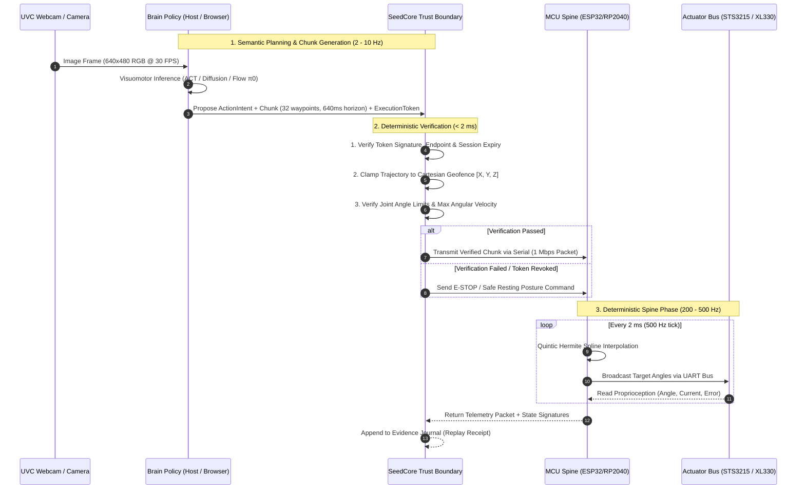

# Mini-Robotics Developer Blueprint: From Maker Kits to Governed Autonomous Companions

Date: 2026-10-12  
Status: Developer engineering blueprint for DIY, educational, and desktop mini-robotics implementations using SeedCore. Translates theoretical embodied AI architectures into concrete hardware, firmware patterns, wire protocols, and governance flows.

---

## 1. Introduction: The Mini-Robotics Paradigm

Industrial robotics blueprints (e.g., OpenVLA, Franka Emika Panda, Unitree H1) are engineered for heavy, high-inertia platforms in factory environments where physical errors risk serious injury. Consequently, they prescribe heavy compute (Jetson AGX Orin / multi-GPU servers), rigid industrial fieldbuses (EtherCAT, CAN-FD, MIPI CSI-2), complex Linux stacks (Ubuntu, ROS 2, Isaac Sim), and active kinetic containment (ISO 10218 140 N force clamping).

When building for **DIY makers, students, desktop companions, and kid-safe embodiments (like Microduck or 3D-printed tabletop arms)**, these constraints invert:

- **Safe-by-Physics:** Featherweight embodiments (< 500g – 2 kg) and micro-torques (< 0.2–2 Nm) mean that motor stall cannot break human skin or damage furniture. Safety shifts from millisecond kinetic hazard prevention to **behavioral, privacy, and permission governance**.
- **Slow Brain, Fast Spine:** Instead of fighting consumer USB/WebSerial/BLE latency jitter (15–40 ms) with expensive industrial transceivers, we adopt **receding-horizon action chunking**: the Brain emits chunks of 30–50 future waypoints (covering 0.5–1.0s), while the onboard MCU Spine executes smooth spline interpolation at 200–500 Hz.
- **Browser-Native & Zero-Install:** Instead of requiring 50 GB Linux and ROS 2 workstations, simulation and evaluation run directly in the browser via **C++/Wasm-compiled physics engines** (e.g., MuJoCo/Wasm).
- **SeedCore Verifiable Governance:** Autonomous policies never have unchecked access to the motors; they execute under scoped `ExecutionToken` leases, verified at the command boundary and recorded in replayable cryptographic receipts.

### The Intuitive Mental Model: Brain, Spine & Guard

For children, students, and beginners, the architecture breaks down into three clear roles:

```
┌────────────────────────────────────────────────────────┐
│  1. THE THINKING BRAIN (Laptop, Chromebook, or Cloud)  │
│  • Sees the world through a camera                     │
│  • Thinks: "Let's pick up the red block"               │
│  • Sends a plan of 30 waypoints every half-second      │
└──────────────────────────┬─────────────────────────────┘
                           │ (USB-CDC, WebSerial, or BLE)
┌──────────────────────────▼─────────────────────────────┐
│  2. THE SEEDCORE SAFETY GUARD (Rules & Permission)     │
│  • Checks: Did a parent/teacher authorize this?        │
│  • Checks: Does the arm stay inside the tabletop box?  │
│  • Records a receipt of everything that happened       │
└──────────────────────────┬─────────────────────────────┘
                           │ (Verified trajectory chunk)
┌──────────────────────────▼─────────────────────────────┐
│  3. THE MOVING SPINE (ESP32 / RP2040 Microcontroller)  │
│  • Smoothly moves the motors 200-500 times per second  │
│  • If the wire unplugs, it stops safely immediately    │
└────────────────────────────────────────────────────────┘
```

---

## 2. Bill of Materials (BOM) & Hardware Specifications ($100–$250 Total)

Mini-robotics does not require enterprise capital equipment. A complete autonomous physical AI platform can be constructed from off-the-shelf maker components:

| Subsystem | Component | Specifications | Estimated Cost |
| :--- | :--- | :--- | :--- |
| **Mechanical Body** | 3D-Printed Chassis | PLA / PETG with TPU flexible joints; SO-100 arm or Microduck biped body | $15 – $30 (filament) |
| **Actuators** | Smart Serial Bus Servos | 5–6x **Feetech STS3215** or **Dynamixel XL330** (half-duplex UART/RS-485 daisy chain @ 1 Mbaud, continuous position/speed/temp feedback) | $60 – $150 |
| **Spine MCU** | Microcontroller Board | **ESP32-S3** (Dual-core 240MHz, USB-OTG, BLE 5.0) or **Raspberry Pi Pico (RP2040)** (Dual Cortex-M0+, PIO state machines) | $6 – $12 |
| **Power Distribution** | Battery / Power Supply | 5V 3A USB-C PD or 2S LiPo (7.4V) with buck converter (LM2596 / MP1584) | $15 – $25 |
| **Vision Sensor** | Standard Camera | 1080p UVC wide-angle USB webcam or Raspberry Pi Camera Module 3 | $15 – $30 |
| **Brain Compute** | Host Workstation | Existing MacBook, Windows PC, Linux laptop, or Chromebook | $0 (existing device) |
| **Total BOM** | | | **$111 – $247** |

---

## 3. End-to-End System Architecture & Sequence Flow



---

## 4. The Onboard MCU "Spine" Firmware Pattern

The onboard microcontroller (ESP32 / RP2040) **never executes neural networks**. Its sole responsibility is deterministic real-time motion generation, motor bus communication, and fail-safe safety clamping.

### Core Responsibilities of the Spine
1. **Packet Parser & CRC:** Ingests binary packets containing trajectory waypoints over USB-CDC, UART, or BLE.
2. **Quintic Hermite Spline Interpolator:** Smoothly interpolates between discrete waypoints at 200–500 Hz, ensuring continuous position, velocity, and acceleration ($C^2$ continuity) to protect plastic gearboxes.
3. **100 ms Heartbeat Watchdog:** If a communication packet is delayed beyond 100 ms, the spine aborts open-loop execution and smoothly brings the robot to a resting posture.

### Reference C++ Spine Implementation Pattern

```cpp
// SpineController.hpp - Real-Time Trajectory Interpolator & Watchdog
#pragma once
#include <Arduino.h>

struct Waypoint {
    float angles[6];  // Radians
    uint32_t timestamp_ms;
};

class SpineController {
private:
    Waypoint current_chunk[64];
    uint8_t chunk_length = 0;
    uint32_t last_packet_time = 0;
    const uint32_t WATCHDOG_TIMEOUT_MS = 100;
    bool is_e_stopped = false;

public:
    void init() {
        Serial.begin(1000000); // 1 Mbps serial link to host
        // Initialize servo hardware bus (UART1/UART2)
    }

    void on_packet_received(const uint8_t* buffer, size_t len) {
        // 1. Verify packet CRC
        if (!verify_crc(buffer, len)) return;

        // 2. Unpack waypoints
        unpack_waypoints(buffer, current_chunk, &chunk_length);
        last_packet_time = millis();
        is_e_stopped = false;
    }

    void tick_500hz() {
        uint32_t now = millis();

        // Heartbeat Watchdog: Stop if packet is stale
        if (now - last_packet_time > WATCHDOG_TIMEOUT_MS) {
            if (!is_e_stopped) {
                execute_safe_resting_posture();
                is_e_stopped = true;
            }
            return;
        }

        // Evaluate Quintic Hermite Spline at current timestamp
        float target_angles[6];
        evaluate_spline(now, current_chunk, chunk_length, target_angles);

        // Broadcast to smart serial servos
        servo_bus_write(target_angles);
    }

private:
    void execute_safe_resting_posture() {
        // Decelerate smoothly to home resting pose (do not drop dead)
        servo_bus_ramp_to_rest();
    }
};
```

---

## 5. SeedCore Command Boundary & Scoped Tokens

Before trajectory chunks reach the MCU Spine, they pass through SeedCore's local execution boundary ([`robot_execution_contract.md`](robot_execution_contract.md)).

### 1. Scoped Capability Tokens
The Brain does not possess unrestricted motor write authority. It must hold an `ExecutionToken` specifying:
- **Principal & Session:** Accountable user/agent ID and monotonic session sequence.
- **Cartesian Geofence:** Minimum/maximum bounding box ($[X_{\min}, X_{\max}; Y_{\min}, Y_{\max}; Z_{\min}, Z_{\max}]$) preventing table edge runoffs.
- **Kinematic Limits:** Maximum linear speed ($v_{\max} \le 0.15\text{ m/s}$) and joint angular velocity ($\dot{\theta}_{\max} \le 2.0\text{ rad/s}$).
- **Time Lease:** Maximum session duration (e.g., 5.0 seconds).

### 2. Deterministic Cartesian Clamping
If a neural policy generates an erratic waypoint outside the authorized bounding box, SeedCore clamps the coordinate to the nearest boundary manifold before calculating inverse kinematics:

$$x_{\text{clamped}} = \max(X_{\min}, \min(X_{\max}, x_{\text{proposed}}))$$

### 3. Action-Bound Cryptographic Receipts
At the completion or interruption of each motion attempt, SeedCore seals an immutable receipt containing:
- SHA-256 of the input visual frame and model checkpoint digest.
- The admitted `ExecutionToken` signature.
- Recorded physical telemetry (joint angles, motor currents, error flags).
- Verifier outcome predicate (`COMPLETED`, `PREEMPTED`, or `DENIED`).

Parents, teachers, and developers can inspect this receipt in the replay console to understand exactly why the robot moved.

---

## 6. Zero-Install Browser Simulation to Physical Deployment

Rather than forcing developers through a multi-day installation of Ubuntu, ROS 2, and Isaac Sim, SeedCore provides a **browser-first C++/Wasm workflow**:

```
┌────────────────────────────────────────────────────────┐
│  STEP 1: DEVELOP & SIMULATE IN BROWSER                 │
│  • Open web application on Chromebook / Mac / Windows  │
│  • Load Microduck / SO-100 digital twin in Wasm MuJoCo │
│  • Train or test policy against simulated obstacles   │
│  • Verify numerical agreement (SIM-1 - SIM-6 gates)    │
└──────────────────────────┬─────────────────────────────┘
                           │ Plug in USB Cable
┌──────────────────────────▼─────────────────────────────┐
│  STEP 2: DEPLOY TO PHYSICAL ROBOT                      │
│  • Browser connects via WebSerial (navigator.serial)   │
│  • SeedCore admits ExecutionToken lease in-browser     │
│  • Trajectory chunks stream directly to physical MCU   │
│  • Immediate physical motion with zero software setup  │
└────────────────────────────────────────────────────────┘
```

---

## 7. Common Pitfalls & Developer Checklist

| Pitfall | Common Misconception | Engineering Solution |
| :--- | :--- | :--- |
| **Conflating Policy Rate with Motor Rate** | "I need my 7B model to infer in 10 ms to achieve 50 Hz control." | Run the model at **2–10 Hz**; emit **action chunks** (30–50 waypoints); interpolate on the MCU at **200–500 Hz**. |
| **Fighting Consumer USB Jitter** | "I cannot use USB webcams or serial cables because of 20 ms jitter." | Receding-horizon action chunking buffers future trajectory; small transport jitters are completely absorbed. |
| **Over-Engineered Industrial Safety** | "I need 140 N force sensors and optical light curtains for my desktop arm." | Lightweight robots (<2 kg) are **Safe-by-Physics**. Focus safety engineering on **workspace geofences, privacy gates, and token revocation**. |
| **Open-Loop Dropping** | "When the computer disconnects, cut motor torque immediately." | Cutting torque can cause an arm or biped to drop and break 3D-printed gears. Implement a **graceful deceleration ramp** in the MCU watchdog. |

---

## Related Documentation

- [`embodied_ai_architecture_reference.md`](embodied_ai_architecture_reference.md) — Architectural foundations and industrial vs. mini-robotics paradigm comparisons.
- [`physical_ai_strategy.md`](physical_ai_strategy.md) — Strategic thesis and customer solution delivery model.
- [`robot_execution_contract.md`](robot_execution_contract.md) — Runtime contracts for session admission, boundary validation, and evidence closure.
- [`mini_robot_simulator_implementation_plan.md`](mini_robot_simulator_implementation_plan.md) — C++/Wasm browser physics architecture.
- [`microduck_integration_plan.md`](microduck_integration_plan.md) — Microduck M0–M5 integration roadmap.
