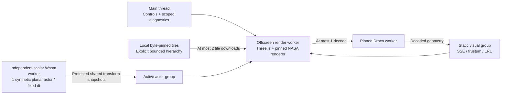

# Static scene streaming, HLOD and precision

Date: 2026-10-22
Status: Bounded mini-workbench implementation and local browser evidence; visual-only scope
Baseline: `0232943` architecture documentation plus the pending browser-performance slice

## Delivered slice

Mini Studio now links to `http://127.0.0.1:8767/scene.html`. This separate lab
uses **`3d-tiles-renderer@0.5.3`** with the existing **Three.js 0.181.1** in an
OffscreenCanvas WebGL2 render worker. A nested Draco worker decodes static
geometry. The existing, unchanged scalar Wasm engine owns one synthetic
three-link actor in a different physics worker at a 500 Hz fixed-step target.
Shared snapshots carry only its display transforms. UI controls and bounded
diagnostic updates stay on the main thread.

The original [mini-workbench fixture](../../../packages/scene-fixtures/README.md)
has five small Draco GLBs: a 48-triangle coarse parent and four 780-triangle
detail children. An explicit OGC 3D Tiles 1.1 REPLACE hierarchy selects visible
detail using frustum tests and screen-space error. Users can change distance,
orbit by pointer or use keyboard controls, vary the SSE target from 1–64 pixels,
choose a 3- or 6-tile cache, stop, restart and export measurements. The default
16-pixel target is this lab's setting, not a universal Google Earth constant.



This is a working streaming/precision increment, not a 2 GB STEP importer,
factory simulator, Google Earth clone, CAD tessellator or general geospatial
viewer. It does not replace the main assembly canvas or the WebGPU performance
lab. WebGL2 is named explicitly; no WebGPU renderer or native C++ graphics
engine is claimed for this page.

## Static and active data stay separate

`staticScene.ts` defines `seedcore.static-scene.v1` and a closed visual ingestion
profile. `scene.json` binds the tileset and every GLB by raw SHA-256 and exact
byte count, and supplies a synthetic f64 world origin. A separate committed
`decoder-runtime.json` freezes the reviewed Draco runtime bytes. The build rejects
modified installed decoders and embeds pins for the scene manifest and both runtime files. Startup checks decoder bytes
before constructing worker source; each tile is checked before GLTFLoader sees
it. A URL guard accepts only exact canonical same-origin fixture URLs or their
explicit manifest names; redirects, alternate origins, query strings, fragments,
traversal variants and nested unpinned resources are rejected.

The profile admits one texture-free static mesh per GLB, one embedded buffer,
POSITION/NORMAL plus triangle indices and the required Draco extension. It
rejects external buffers, images, materials with texture references, extra
extensions, animation, skins, transforms, scripts and arbitrary raw STL/OBJ/DAE.
Accessor counts, decoded byte estimates, triangle counts and Y-up→Z-up bounds
are checked before decode. Actual decoded geometry is checked again against the reviewed fixture
metadata. An independent native Draco test decodes all five source assets and
checks actual point/triangle counts and quantized position bounds.

This is curated, source-generated input, not a sandbox for arbitrary malicious
compressed files. Compressed bytes can hide allocations not described by glTF
accessors; new external assets need offline codec validation and a reviewed
ingestion path before pins are added. A manifest hash alone does not establish
that a newly supplied asset is safe, licensed, physically correct or printable.

The static group never enters component registry assemblies, DRC, BOM, MJCF,
Wasm dynamics, collision queries, model digests, policy observations or actuator
commands. It has no physical mass or collision meaning. The active actor always
keeps its complete, independent, fixed-step state, regardless of tile visibility
or detail level. It is the synthetic planar profile from the
[performance lab](browser_performance_pipeline.md), not an authored CW-S01 model
or an imported Microduck twin.

## Resource and fault behavior

| Boundary | Implemented limit / behavior |
| --- | --- |
| Manifest/tileset | 64 KiB; at most 21 explicit tiles, depth 3, up to 8 children; bounded axis-aligned boxes in a local ±5 m region |
| Hierarchy | REPLACE only, child bounds contained by parent, non-increasing geometric error, zero-error leaves; no external or implicit tilesets |
| Per tile | 1 MiB encoded cap; at most 4,096 vertices and 4,096 triangles; at most 256 KiB declared geometry arrays |
| Scheduling | Two simultaneous same-origin tile downloads; one parse job and one Draco worker; five-second fetch timeout |
| Cache | Select 3 or 6 tiles; NASA LRU estimated-content cap 2 MiB; unused geometry is disposed on eviction |
| Other retained data | 64 load/dispose/error events; bounded viewport resolution; bounded 5/15/30-second physics rehearsal |
| Frame memory | Reuse the existing three protected shared snapshots; no live Wasm memory transfer; visual drops never stand in for complete telemetry |
| Lifecycle | Stop/hidden page/worker failure terminate the attempt; new rehearsal uses new workers, memory and generation; no automatic resume |

The 2 MiB cap is an estimated tile-content/cache budget, **not a total tab or
GPU-memory limit**. Decoder Wasm heaps, runtime code, renderer resources, queued
encoded bytes and browser/driver allocations are separate. The report exposes
actual resident geometry-array bytes, visible triangles/tiles, peak resident
tile count, peak tile downloads, evictions, failure events and physics tick.
It does not label these measurements as GPU time, frame latency or physical
stop time. Cache pressure may preserve a coarser view rather than meet SSE;
the UI explicitly labels that condition.

Failure handling needed a specific integration fix. In the inspected NASA
0.5.3 traversal, FAILED children count as download-finished, which can let
REPLACE traversal hide a valid coarse parent. On a tile failure SeedCore now
**latches the public maximum-depth setting at the root**. The failed content is
never decoded/displayed; reviewed coarse coverage remains available while the
independent actor continues. The UI/report says `degraded`, retains the error,
and records `coarseFallbackLatched`. Changing the camera/SSE does not clear it;
start a new rehearsal to retry. A failed root has no valid visual fallback and
remains visibly degraded; no invented geometry is substituted.

An invalid executable decoder or manifest fails initialization. A corrupted
detail tile is a static-layer failure. Neither case grants authority or
silently changes the physics engine. Startup, context loss and worker failures
remain explicit. Reports use `synthetic_visual_streaming`,
`physicalAcceptance: false`, `executionAuthority: none`; they are unsigned
diagnostics, not receipts or complete simulation capture.

## Screen-space error and coordinate precision

For a perspective camera the reference calculation is:

```text
SSE = geometricError_m × viewportHeight_px /
      (distanceToBoundingVolume_m × 2 × tan(verticalFov_rad / 2))
```

The utility checks units/domain and handles a camera inside bounds explicitly.
Actual tile selection uses NASA's frustum/SSE traversal. A lower target requests
more detail; cache and request budgets remain independent. HLOD does not promise
a constant triangle count or 60 FPS on every scene/device. Visible triangle
counts are reported rather than inferred from a planetary viewer example.

The fixture uses a large synthetic origin, `[6371000, 1000000, -2000000]` m.
Global camera coordinates remain JS f64 numbers until that origin is subtracted.
Only small local camera/model translations reach GPU float32 matrices. The
active actor and static tiles use the same local frame; geometry is not rounded
at world-scale coordinates first. `cameraRelative()` independently tests the
same subtraction rule, preserving millimeter offsets where subtracting already
rounded global f32 values loses them. This is a fixed-origin rebase plus local
view matrices, not a moving planetary-origin manager or geodetic conversion.

glTF vertices/normals are Y-up. Tileset boxes and the studio are Z-up, with one
tested Y→Z conversion by the renderer. Compression and floating-origin display
do not replace physical joint frames, inertial frames or model qualification.

## Hosting, version coupling and reproduction

The localhost server provides COOP/COEP/CORP. The two scene entry resources
receive scoped Wasm compilation and blob-worker permissions because Three's
Draco loader constructs a nested worker from verified decoder text. Ordinary
JavaScript `unsafe-eval` remains forbidden. The authoring page retains its
stricter worker/CSP policy; remote origins are not added. Static data and decoder
routes are exact allowlists, and original assets are served from frozen startup
bytes. Third-party licenses/notices are bundled with the studio.

`3d-tiles-renderer@0.5.3` is pinned exactly and imported through `/three`, with
the existing Three version retained. Its `preprocessTileset()` implementation
uses `window.location`; the worker compatibility subclass overrides only that
method to use an already validated absolute URL and initialize nodes. This
method is not declared in the shipped TypeScript API: the narrow override is
explicit version coupling. An upgrade requires source review and rerunning the
worker, axis, cache, fallback and resource checks; this is not evidence that
every upstream plugin is DOM-free. There is no `window` shim or source patch.
`draco3d@1.5.9` is a locked development encoder/native-test dependency, not a
second browser physics engine. Runtime decoder files come from pinned Three.

From the repository root:

```bash
npm --prefix ts ci
node tools/robotics/verify-static-scene.cjs --browser
.venv/bin/python scripts/robotics/serve_mini_studio.py --port 8767
```

Open `/scene.html`. The verifier checks fixture reproducibility, rebuilds source
dependencies, typechecks the workspace, runs ten ingestion/Draco/SSE/RTC tests
and 16 local API tests. `--browser` requires real Chrome/OffscreenCanvas/WebGL2;
it does not silently skip missing capabilities. Without it the report says
`core_checks_passed_browser_not_run`. CI runs the core lane and retains its
report; hosted-runner graphics are not presumed qualified.

Ignored evidence is retained in `artifacts/robotics/static-scene/`:
`verification.json` binds source/output hashes; `browser-verification.json`
records the browser and ten check groups; `measurement.json`, `desktop.png`
and `mobile.png` support review. The local 22 October Chrome 155 exercise
covered coarse/detail transitions, independent physics progress, bounded
downloads/cache, zoom-out eviction, the constrained-cache case, responsive UI,
scoped export, corrupt detail fallback, decoder rejection and hidden-page
fencing. These are small synthetic functional checks, not a CAD-scale benchmark
or proof of frame-rate, hardware, CW-S02, policy or physical acceptance.

## Which Google Earth patterns are established, and what remains

Google's [Earth WebAssembly case study](https://web.dev/case-studies/earth-webassembly)
documents reuse of its C++ codebase and background streaming/decompression with
Wasm threads. It does not establish all suggested current SIMD, WebGPU, custom
allocator, UI-framework or per-frame triangle-count details. A native heap does
not eliminate JavaScript/graphics bridging or all allocation costs in a browser.
Those details remain unverified, rather than implementation requirements.

[Google Maps Photorealistic 3D Tiles](https://developers.google.com/maps/documentation/tile/3d-tiles-overview)
is a documented OGC 3D Tiles API. That does not prove the internal Earth client
uses the same public format everywhere. SeedCore uses the open
[OGC standard](https://docs.ogc.org/cs/22-025r4/22-025r4.html) and
[NASA renderer](https://github.com/NASA-AMMOS/3DTilesRendererJS), not Google data,
credentials, APIs or a copied planetary engine. 3D Tiles permits broader
hierarchies than an exactly eight-child octree; this fixture has four children.

Remaining work is explicit:

1. **KTX2/Basis textures:** the first profile deliberately rejects texture-bearing
   GLBs. Add original Basis/ETC1S/UASTC fixtures, pinned transcoder bytes, mip/
   dimension/decoded-memory limits, worker deadlines, format capability checks
   and unsupported-device behavior before enabling them. KTX2 is a container;
   Basis transcoding and native BC/ASTC support are separate facts. No automatic
   Apple/BC7/ASTC or universal 4–8× memory claim is made. See the
   [Khronos extension](https://github.com/KhronosGroup/glTF/tree/main/extensions/2.0/Khronos/KHR_texture_basisu)
   and [Three KTX2 loader](https://threejs.org/docs/#examples/en/loaders/KTX2Loader).
2. **External CAD ingestion:** curate or offline-convert a licensed source, pin
   its converter/toolchain and output, bound tessellation/decompression and
   preserve explicit visual/collision/physics roles. This fixture generator is
   not an Assimp/STEP/IGES import pipeline. Do not weaken the current closed
   asset profile to accept multi-gigabyte files in the browser.
3. **Larger scenes and editor adoption:** benchmark a named source/device with
   GPU/CPU/memory measurements, validate hierarchy error/bounds and LOD coverage,
   then preserve picking, snapping, accessibility and revision fencing when
   integrating a static backdrop into the main authoring canvas.

CW-S01 real-source readiness, CW-S02 MuJoCo/model/control/capture, Microduck M1–M4,
live Agent/PDP admission and hardware gates stay open. Streaming a visually
convincing room never establishes collision truth or permission to move.
